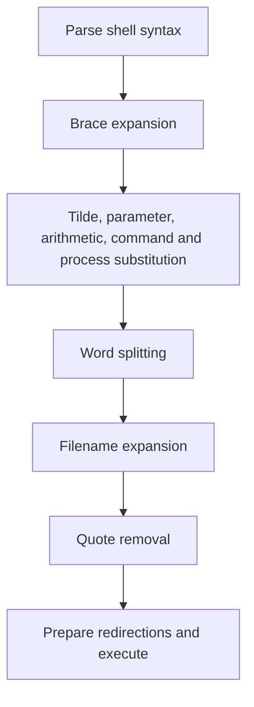
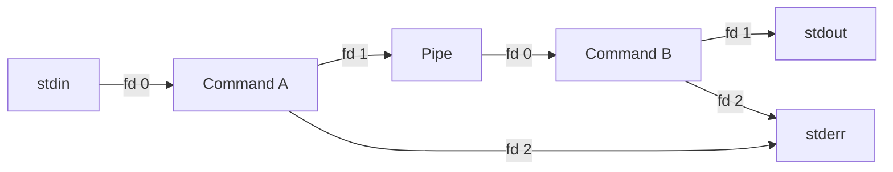
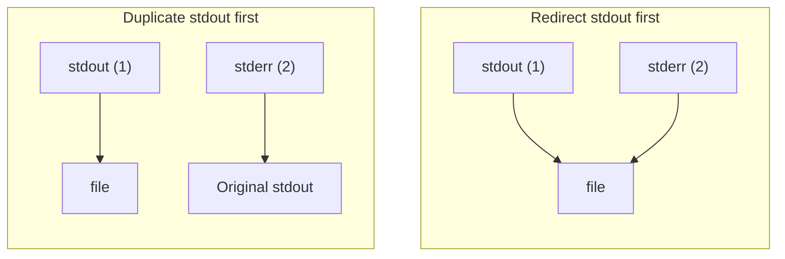
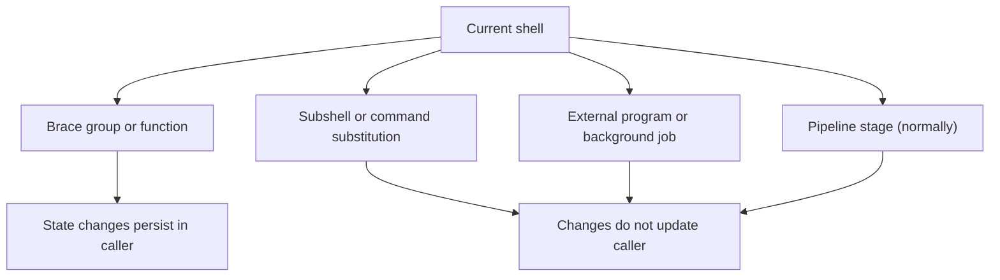

Getting better at Bash is not quite the same as getting better at `sed`, `awk`, `grep`, and the rest of the Unix toolbox. Those are good tools, but they are not Bash. Bash has a language of its own, and many small operations that seem to require a pipeline of external programs can be done with a few shell expressions.

This is a guide to that language. Not every feature, and not an attempt to rewrite Unix in Bash. The useful parts are the ones that help us preserve arguments, manipulate values, control execution, move data between processes, and understand what happened when something fails.

The examples assume Bash, not POSIX `sh` or Zsh. Most of the fundamentals work on Bash 3.2, still commonly shipped with macOS. Some examples need Bash 4 or 5; the differences are noted near the relevant features. Check the interpreter with `printf '%s\n' "$BASH_VERSION"` or `bash --version`.

## Start here

| I need to... | Reach for... |
|---|---|
| Remove a filename suffix | `${file%.tar.gz}` |
| Extract the last path component | `${path##*/}` |
| Supply a default | `${value:-default}` |
| Require a variable | `${value:?message}` |
| Replace all matches of a pattern | `${value//old/new}` |
| Preserve a list of arguments | `"${args[@]}"` or `"$@"` |
| Match a string | `[[ $value == pattern ]]` |
| Match a regular expression | `[[ $value =~ $regex ]]` |
| Format a value without a subprocess | `printf -v result FORMAT ...` |
| Read a file a line at a time | `IFS= read -r line` |
| Read a file into an array | `mapfile -t lines < file` |
| Inspect individual pipeline statuses | `"${PIPESTATUS[@]}"` |
| Wait for a background process | `wait "$pid"` |
| Debug a script | `bash -n script.sh`; `bash -x script.sh` |

There is a recurring theme here: Bash deals in words, arguments, streams, and statuses. Understanding those four things is more useful than memorizing a hundred commands.

## What Bash actually does

A terminal displays text and passes keyboard input. Bash interprets shell language. An external program performs whatever work it was written to do. Bash also has builtins that run without launching an external executable.

```bash
name='quarterly report.txt'
printf '<%s>\n' "$name"

type -a printf
type -a cd
command -v bash
```

`type` tells you whether a name resolves to an alias, function, builtin, or executable. Some names, such as `printf`, exist both as builtins and external programs. `builtin printf` explicitly selects the builtin; `command name` bypasses shell functions (and may still select a builtin).

A normal command receives a list of arguments, not an undifferentiated string. Bash handles the syntax, prepares the arguments and redirections, and runs the command. If you understand where the argument boundaries are, much of the shell starts making sense.



This is a mental model for ordinary command words, not a complete grammar. Assignment words, `[[ ... ]]`, arithmetic contexts, redirection operands and here-documents have their own rules. Process substitution is available on systems that support it. Tilde, parameter, arithmetic and command substitutions are performed together in the expansion stage; don't interpret the diagram as an independent pass for each type.

```bash
value='two words'
printf '<%s>\n' $value
# <two>
# <words>
printf '<%s>\n' "$value"
# <two words>
```

The unquoted expansion can undergo splitting and filename expansion. The quoted expansion preserves the value as one argument. Quotes belong to shell syntax; Bash removes them before passing the argument. Quote characters stored inside a variable do not become shell syntax again.

```bash
value='"two words"'
printf '<%s>\n' $value
# <"two>
# <words">
```

This is why trying to construct a command by concatenating quoted strings is usually a mistake. Use an array for the arguments, and avoid `eval` unless you actually intend to execute trusted shell source.

### Quoting and the different kinds of expansion

| Form | Meaning |
|---|---|
| `'text $HOME'` | Literal text |
| `"text $HOME"` | Expand values while preserving the word |
| `$'one\ntwo'` | ANSI-C quoting; interprets escape sequences |
| `${name}` | Parameter expansion with explicit boundaries |
| `$(command)` | Capture stdout, removing trailing newlines |
| `$((expression))` | Integer arithmetic expansion |
| `file{1,2}.txt` | Brace expansion, independent of existing files |
| `~/bin` | Tilde expansion; quote the resulting variable if stored |

```bash
name=backup
printf '%s\n' "${name}_file"   # backup_file
printf '%s\n' '$HOME'          # literal $HOME
printf '%s\n' "$HOME"          # home directory
printf '%s\n' $'first\nsecond'
```

`$name_file` refers to a different variable named `name_file`. The braces are an explicit boundary, not decorative punctuation. As a default, quote expansions unless splitting or globbing is what you actually want.

Brace expansion occurs before parameter expansion. `file{1..3}` generates three words; `file{1..$n}` is not a dynamic range. Use an arithmetic loop for a variable upper bound.

## Parameter expansion

This is the part of Bash worth learning properly. A parameter is a named variable, a positional parameter such as `$1`, or a special parameter such as `$?`. Expansion substitutes its value, optionally performing an operation on it.

### Remove a prefix or suffix

```bash
path='/var/log/nginx/access.log.gz'
printf '%s\n' "${path#*/}"     # var/log/nginx/access.log.gz
printf '%s\n' "${path##*/}"    # access.log.gz
printf '%s\n' "${path%/*}"     # /var/log/nginx
printf '%s\n' "${path%%/*}"    # empty: the longest suffix is the whole path
printf '%s\n' "${path%.*}"     # /var/log/nginx/access.log
printf '%s\n' "${path%%.*}"    # /var/log/nginx/access
```

Think of the operators as two directions and two match lengths:

```text
                         value
          +--------------------------------+
          | /var/log/nginx/access.log.gz   |
          +--------------------------------+
            ^                            ^
         #  shortest prefix       %  shortest suffix
        ##  longest prefix        %%  longest suffix
```

| Operator | Meaning |
|---|---|
| `${v#pattern}` | Remove shortest matching prefix |
| `${v##pattern}` | Remove longest matching prefix |
| `${v%pattern}` | Remove shortest matching suffix |
| `${v%%pattern}` | Remove longest matching suffix |

The match is anchored at the indicated end of the value. If nothing matches, the original value is returned. The patterns are shell globs, not regular expressions. In parameter expansion, `*` can match slashes, unlike ordinary filename globbing where a wildcard does not cross path components.

Some everyday uses:

```bash
url='https://example.com/api/'
without_scheme=${url#https://}
without_slash=${url%/}

file='sample_01.fastq.gz'
sample=${file%.fastq.gz}
```

`${url%/}` removes **one** trailing slash. It is not general path normalization. `${path##*/}` and `${path%/*}` are convenient for known path shapes, not exact replacements for `basename` and `dirname`: a trailing slash, `/`, or a name containing no slash behaves differently.

For files with multiple dots, the shortest suffix is usually what you want. `%%.*` removes everything from the earliest matching dot, which can even be in a directory component. Extract the filename first if that is the intended input.

### Replace or delete a pattern

```bash
s='foo-bar-foo'
printf '%s\n' "${s/foo/baz}"    # baz-bar-foo
printf '%s\n' "${s//foo/baz}"   # baz-bar-baz
printf '%s\n' "${s/#foo/baz}"   # baz-bar-foo (start only)
printf '%s\n' "${s/%foo/baz}"   # foo-bar-baz (end only)
printf '%s\n' "${s//-/}"        # foobarfoo
printf '%s\n' "${s//-/_}"       # foo_bar_foo
```

`/` replaces the first match; `//` replaces all matches. The `#` and `%` immediately after the replacement operator anchor the match to the beginning or end. An empty replacement deletes the matched part.

If the pattern comes from a variable and you want it treated literally, quote that expansion:

```bash
s='a*b*c'
needle='*'
printf '%s\n' "${s//"$needle"/}"  # abc
```

In Bash versions/configurations with `patsub_replacement` enabled, an unquoted `&` in the replacement represents the matched text. Quote a replacement variable when its contents should be literal. Don't confuse these operations with regex substitutions or a general-purpose text-processing engine.

### Unset, empty, and nonempty are different states

A variable can be unset, set to an empty string, or set to a nonempty value. The colon in the following operators means that an empty value is treated like an unset one.

| Expression | Unset | Empty | Nonempty |
|---|---|---|---|
| `${v:-fallback}` | fallback | fallback | value |
| `${v-fallback}` | fallback | empty | value |
| `${v:+yes}` | empty | empty | yes |
| `${v+yes}` | empty | yes | yes |
| `${v:=fallback}` | assign fallback | assign fallback | value |
| `${v=fallback}` | assign fallback | empty | value |
| `${v:?message}` | error | error | value |
| `${v?message}` | error | empty | value |

```bash
port=${PORT:-8080}
output=${1:-output.txt}
: "${CACHE_DIR:=$HOME/.cache/my-tool}"
```

`:-` returns a default without changing the original parameter. `:=` assigns the default to an assignable variable as well as expanding to it. `:` is a builtin that does nothing after expanding its arguments; it is useful for triggering assignments or validating variables.

At the top of a noninteractive script, require a value with:

```bash
: "${API_KEY:?API_KEY is required}"
```

If the variable is unset or empty, Bash prints an error and exits the noninteractive shell. This is an expansion error, not an ordinary return from `:`. Use the form without the colon if an intentionally empty value is acceptable. Assignment forms cannot assign to positional or special parameters.

To distinguish unset from empty without relying on newer Bash features:

```bash
if [[ ${CONFIG+x} ]]; then
    printf 'CONFIG is set\n'
fi
```

Bash 4.2+ also supports `[[ -v CONFIG ]]` for a variable that has been assigned a value, including an empty value. Be careful with dynamic array subscripts and untrusted names; a simple scalar name is the intended use here.

### Length, slicing, and case conversion

```bash
s='Hello World'
printf '%s\n' "${#s}"      # 11
printf '%s\n' "${s:0:5}"   # Hello
printf '%s\n' "${s:6}"     # World
printf '%s\n' "${s: -5}"   # World
printf '%s\n' "${s:1:-1}"  # ello Worl (Bash 4.2+)
printf '%s\n' "${s,}"      # hello World (Bash 4+)
printf '%s\n' "${s,,}"     # hello world
printf '%s\n' "${s^^}"     # HELLO WORLD
```

A negative offset needs a space or parentheses so that it is not parsed as `:-`. A negative substring length (where supported) specifies an end position relative to the end of the string. String length and case conversion are locale-sensitive; `${#s}` is not necessarily the byte length of UTF-8 data.

Bash 4.4+ also has useful transformation operators such as `${s@Q}` for a shell-quoted representation. `printf '%q' "$s"` is an older, convenient alternative for inspecting a value. These are Bash representations, not JSON escaping or a security boundary for other languages.

### Indirect expansion

```bash
host='localhost'
name=host
printf '%s\n' "${!name}"   # localhost
```

`${!name}` treats the value of `name` as the name of another parameter. This is useful when a known variable name is selected at runtime. For a collection of arbitrary keys, an associative array is usually clearer. Do not turn untrusted text into a variable name or arithmetic subscript.

### A small practical example

```bash
for file in *.fastq.gz; do
    [[ -f $file ]] || continue
    sample=${file%.fastq.gz}
    printf 'sample=%s input=%q\n' "$sample" "$file"
done
```

No `basename`, `sed`, `cut`, or command substitution. The shell already knows how to match the filenames and remove the suffix. This is a good use of native Bash: small operations on values that are already in the shell.

## Patterns, globs, and regular expressions

Three things that look similar are often confused:

| Syntax | Example | What it does |
|---|---|---|
| Brace expansion | `file{1,2}.txt` | Generates words without checking files |
| Glob pattern | `*.log` | Matches filenames or strings in a pattern context |
| Regular expression | `^[0-9]+$` | Matches strings with regex syntax |

A shell glob uses `*`, `?`, and bracket expressions such as `[0-9]`. A regex has different meanings for `*`, `.`, `+`, grouping, and anchors. Quoting determines whether pattern characters are active.

```bash
file='server.log'
pattern='*.log'
[[ $file == $pattern ]]      # pattern match
[[ $file == "$pattern" ]]    # literal comparison with *.log
```

`case` is especially good for dispatching on several patterns:

```bash
case $file in
    *.tar.gz) printf 'compressed archive\n' ;;
    *.log)    printf 'log file\n' ;;
    *)        printf 'other\n' ;;
esac
```

For more structured matches, Bash has a POSIX extended regular expression operator and a capture array:

```bash
version='v1.24.3'
regex='^v([0-9]+)\.([0-9]+)\.([0-9]+)$'
if [[ $version =~ $regex ]]; then
    major=${BASH_REMATCH[1]}
    minor=${BASH_REMATCH[2]}
    patch=${BASH_REMATCH[3]}
    printf '%s.%s.%s\n' "$major" "$minor" "$patch"
fi
```

`BASH_REMATCH[0]` is the entire match; subsequent entries are capture groups. Save the values you need before another regex match changes the array. Quoting the entire right-hand expansion of `=~` makes it literal on modern Bash; store the regex in a variable and leave that expansion unquoted. There is no word splitting or pathname expansion in `[[ ... ]]`.

### Filename expansion and shell options

By default, a glob with no matching filename remains a literal word. This can be awkward in loops and arrays. `nullglob` removes unmatched patterns; `failglob` instead reports an expansion error. `dotglob` includes most leading-dot names, and `globstar` (Bash 4+) allows `**` to match directory trees.

```bash
(
    shopt -s nullglob
    logs=( *.log )
    printf 'found %d logs\n' "${#logs[@]}"
    for log in "${logs[@]}"; do
        printf '%q\n' "$log"
    done
)
```

The subshell keeps the option change local to this operation. For recursive globbing on Bash 4+:

```bash
(
    shopt -s globstar nullglob
    for file in **/*.sh; do
        [[ -f $file ]] || continue
        printf '%q\n' "$file"
    done
)
```

`**` is not a replacement for every use of `find` (metadata predicates, symlink policy and huge trees are good reasons to use `find`). Extended glob patterns such as `@(jpg|png)` and `!(pattern)` can express alternatives and negation. Enable `extglob` before parsing code that uses its special syntax, including function definitions containing such patterns. The right-hand pattern of `[[ ... == ... ]]` already uses extended matching rules.

## Arrays and arguments

A scalar is not a list. Use an array when individual values matter, particularly filenames and command arguments.

```bash
files=('a b.txt' 'c.txt' '-strange.txt')
files+=('another file.txt')
printf 'count=%d\n' "${#files[@]}"
for file in "${files[@]}"; do
    printf 'file=%q\n' "$file"
done
```

| Expansion | Meaning |
|---|---|
| `${files[0]}` | Element at index 0 |
| `"${files[@]}"` | Each element as a separate argument |
| `"${files[*]}"` | All elements joined into one word using first character of IFS |
| `${#files[@]}` | Number of assigned elements |
| `"${!files[@]}"` | Assigned indices |
| `"${files[@]:1:2}"` | Slice of two elements starting at index 1 (dense array example) |

Indexed arrays can be sparse. After `unset 'files[1]'`, index 2 still exists; the array has fewer elements, but the remaining indices do not shift. Rebuild with `files=("${files[@]}")` if you actually want a dense array. Quote the operand to `unset` so that the bracket syntax isn't interpreted as a filename pattern.

Use the same model with script arguments:

```bash
printf 'script=%s argc=%s\n' "$0" "$#"
for arg in "$@"; do
    printf '<%s>\n' "$arg"
done
```

`"$@"` preserves argument boundaries, including empty arguments. `"$*"` joins them. The difference matters when forwarding arguments. Positional parameters beyond nine need braces (`${10}`). `shift` removes positional arguments from the current function or script.

### Build a command as arguments, not a string

```bash
path='quarterly report.txt'
args=(printf '%s\n' "$path")
"${args[@]}"
```

Here is the same idea for a real external command:

```bash
url='https://example.com/'
args=(curl --fail --silent --show-error --connect-timeout 5)
if [[ ${VERBOSE:-0} == 1 ]]; then
    args+=(--verbose)
fi
args+=(-- "$url")
"${args[@]}"
```

The array contains the executable name and separate arguments. Shell operators such as `|`, `>` and `&&` do not become syntax when they come from an array; put those operators in the shell program itself. There is no need to pass the command through `eval`.

### Associative arrays (Bash 4+)

Associative arrays map strings to values instead of integer indices.

```bash
declare -A ports=([http]=80 [https]=443 [ssh]=22)
printf '%s\n' "${ports[https]}"
for service in "${!ports[@]}"; do
    printf '%s=%s\n' "$service" "${ports[$service]}"
done
```

For a small in-memory count:

```bash
declare -A counts=()
for word in apple banana apple orange banana apple; do
    counts["$word"]=$(( ${counts[$word]:-0} + 1 ))
done
for word in "${!counts[@]}"; do
    printf '%s: %d\n' "$word" "${counts[$word]}"
done
```

Associative array iteration order is unspecified. An empty string is not a valid associative key. The example uses fixed, trusted keys and numeric counts; older Bash versions have pitfalls involving repeated evaluation of dynamic array subscripts in arithmetic or other contexts. For arbitrary external records, validate inputs and consider a dedicated tool. `awk` is still an excellent choice for processing large streams of records.

## Conditions, arithmetic, and loops

Bash conditionals test exit statuses. A status of zero means success; nonzero means something else, depending on the command. A test that returns false is not necessarily an error.

```bash
if [[ -r input.txt ]]; then
    printf 'Readable\n'
elif [[ -e input.txt ]]; then
    printf 'Exists but is not readable\n'
else
    printf 'Missing or inaccessible\n'
fi
```

`[` is a command (also available as a Bash builtin). `[[ ... ]]` is Bash syntax, with its own rules for patterns, comparisons and quoting. Prefer the latter in Bash scripts. Use `-eq`, `-lt` and friends for numeric tests, or use `(( ... ))` for integer arithmetic.

| Test | Meaning |
|---|---|
| `[[ -z $s ]]` | Empty string |
| `[[ -n $s ]]` | Nonempty string |
| `[[ $a == "$b" ]]` | Literal string equality |
| `[[ $a == *.log ]]` | Pattern match |
| `[[ -f $path ]]` | Regular file |
| `[[ -d $path ]]` | Directory |
| `[[ -L $path ]]` | Symbolic link, including dangling links |
| `[[ -r $path ]]` | Readable by the current process |
| `[[ $a -nt $b ]]` | File a is newer (or a exists and b does not) |
| `(( n > 0 ))` | Integer comparison |

Combine tests using `&&`, `||` and `!` inside `[[ ... ]]`, or combine whole commands using those operators outside. `cmd1 && cmd2 || cmd3` is not quite an if/else: `cmd3` also runs if `cmd2` fails.

### Arithmetic is integer arithmetic

```bash
n=7
printf '%s\n' "$((n / 2))"   # 3
printf '%s\n' "$((n % 2))"   # 1
printf '%s\n' "$((2 ** 8))"  # 256
((n += 3))
```

`$(( ... ))` expands to a number. `(( ... ))` is a command whose exit status is zero if the expression evaluates to a nonzero number. This matters when `set -e` is enabled:

```bash
n=0
((n++))   # expression value is 0, so exit status is 1
```

When incrementing a counter for its side effect alone, `n=$((n + 1))` avoids the arithmetic-command status trap. `((++n))` evaluates to the new value but can still return status 1 if that value is zero.

Leading zeroes are interpreted as octal in arithmetic expressions. If the input must be a nonnegative decimal integer, validate its form before using it:

```bash
input='08'
if [[ $input =~ ^[0-9]{1,9}$ ]]; then
    n=$((10#$input))
    printf '%d\n' "$n"    # 8
fi
```

The length limit is deliberate in this example. Bash arithmetic uses fixed-width integers without overflow checking. Do not put arbitrary user-supplied expressions in arithmetic contexts; Bash can evaluate more than plain numbers there. Bash is also not a floating-point calculator.

### Loops

```bash
for ((i=0; i<5; i++)); do
    printf '%02d\n' "$i"
done

for arg in "$@"; do
    printf '%q\n' "$arg"
done
```

Use `while` when the loop should continue as long as a command succeeds. `until` is the opposite. `break` exits a loop and `continue` skips to its next iteration; both accept a nesting count when needed.

## Read, write, and format

Bash has a few builtins that are easy to overlook because we are used to reaching for external tools.

### Read without losing information

```bash
while IFS= read -r line || [[ -n $line ]]; do
    printf '<%s>\n' "$line"
done < input.txt
```

`IFS=` prevents the normal whitespace trimming and field splitting of `read`. `-r` disables backslash processing. The extra condition handles a last line with no newline. Redirect the file into the loop rather than piping into it if the loop needs to modify variables in the current shell.

For simple delimited records, explicitly choose a separator:

```bash
address='192.168.1.20:8080'
IFS=: read -r host port <<< "$address"
printf 'host=%s port=%s\n' "$host" "$port"
```

This is a here-string: it supplies the expanded string plus a newline as standard input. The example assumes an IPv4 address or hostname with one port separator, not an IPv6 literal. `IFS` splitting is not a CSV parser, does not understand quoted delimiters, and has special rules for whitespace.

| Option | Use |
|---|---|
| `read -r` | Preserve backslashes |
| `read -a fields` | Split one record into an indexed array |
| `read -d ''` | Read through a NUL delimiter |
| `read -u "$fd"` | Read from a specific file descriptor |
| `read -t 5` | Time out after five seconds (where applicable) |
| `read -s` | Suppress terminal echo |
| `read -p 'Prompt: '` | Display a prompt when reading from a terminal |

Bash variables cannot store a NUL byte. They can, however, hold filenames containing spaces, tabs, and newlines. For arbitrary Unix filenames, use a NUL-delimited stream:

```bash
while IFS= read -r -d '' file; do
    printf '%q\n' "$file"
done < <(find . -type f -print0)
```

Here `find` is the right tool to traverse a directory tree. Bash takes care of reading the result without splitting a filename. Process substitution does not automatically propagate the producer's exit status; see the section on execution environments below.

For modest line-oriented files, Bash 4+ can load them into an array in one operation:

```bash
mapfile -t lines < input.txt
printf 'lines=%d\n' "${#lines[@]}"
```

`-t` removes the record delimiter from each element. This keeps empty lines and does not require word splitting. `readarray` is another name for `mapfile`. Don't load an unbounded file into memory without a reason.

### Format values using printf

```bash
printf '%s\n' 'hello'
printf '%04d\n' 42       # 0042
printf '%-12s %5d\n' worker 7
printf '%q\n' 'two words'

printf -v filename 'backup-%04d.tar.gz' 42
printf '%s\n' "$filename"
```

`printf -v` writes directly into a shell variable. There is no need for `result=$(printf ...)`, which normally uses a subshell and removes trailing newlines. Always use a fixed format string, such as `printf '%s\n' "$value"`, rather than passing uncontrolled data as the format.

Bash 4.2+ supports time formatting without launching `date`:

```bash
printf -v timestamp '%(%Y-%m-%d %H:%M:%S)T' -1
printf '%s\n' "$timestamp"
```

`-1` represents the current time; the format follows the system's `strftime` conventions. On Bash 3.2, use `date` instead. `%q` is great for inspecting arguments, but it produces Bash-escaped text, not a generic serialization format.

### Read a small file into a scalar

```bash
content=$(<input.txt)
printf '%s\n' "$content"
```

`$(<file)` is a Bash shortcut for reading a file through command substitution without invoking `cat`. Like other command substitutions, it strips trailing newline characters and cannot preserve NUL bytes. Use redirection into a program when the bytes themselves matter.

## Functions, scope, and references

A function runs in the current shell unless its invocation is placed in a separate execution environment, such as a subshell or most pipeline stages. It can access the caller's variables, change the working directory, open descriptors, and modify shell options.

```bash
log() {
    printf '[%s] %s\n' "$1" "$2" >&2
}

log INFO 'Starting work'
```

Use `local` for variables that should not escape the function. Bash has dynamic scope: a function called from another function can see its caller's local variables. That is useful to know, but relying on it for implicit data flow makes a script harder to reason about.

```bash
format_name() {
    local prefix=$1
    local number=$2
    printf '%s-%04d\n' "$prefix" "$number"
}

name=$(format_name worker 7)
printf '%s\n' "$name"
```

Functions return an exit status, not a string. Output data through stdout, send diagnostics to stderr, and let `return` communicate success or failure.

A common bug is combining declaration and command substitution:

```bash
fetch_value() {
    local value
    value=$(false) || return
    printf '%s\n' "$value"
}
```

Writing `local value=$(false)` would test the status of `local`, not reliably the status of the substitution. Declare the local first, then make the assignment a separate command. The same issue applies to commands such as `export` and `declare`.

### Attributes and namerefs

`declare` is more than another way to assign variables. It can declare an array, mark a variable read-only, give it an integer attribute, print its definition, or (Bash 4.3+) create a nameref.

```bash
readonly app_name='my-tool'
declare -a hosts=(web app db)
declare -p hosts
```

`declare -i` makes assignments use arithmetic evaluation; it is not an input validator. `export` makes a variable available in the environment of subsequently launched programs; it does not export a Bash array as an array.

A nameref is useful for returning data without capturing stdout:

```bash
split_name() {
    local -n result_ref=$1
    local input=$2
    result_ref=${input%.tar.gz}
}

filename=''
split_name filename 'backup.tar.gz'
printf '%s\n' "$filename"    # backup
```

The first argument is the name of a trusted destination variable. Use an internal reference name that doesn't collide with the target. A nameref is not a safe way to access an arbitrary untrusted variable name. For a simple function that returns text, stdout is often enough.

## Streams and file descriptors

A Unix process normally starts with three file descriptors. A descriptor is a number referring to an open resource, not the resource itself.

| Descriptor | Name | Typical use |
|---|---|---|
| 0 | stdin | Input |
| 1 | stdout | Normal data |
| 2 | stderr | Diagnostics |



The shell sets up the pipe and redirections. The programs themselves don't need to know which shell connected them.

### Redirection order matters

```bash
some_command > output.log 2>&1
some_command 2>&1 > output.log
```

They look almost identical. They are not. Bash processes redirections from left to right. `2>&1` duplicates the current destination of descriptor 1 into descriptor 2; it does not create a permanent link between the two descriptors.



| Syntax | Effect |
|---|---|
| `> file` | Create or truncate file and redirect stdout |
| `>> file` | Append stdout |
| `< file` | Read stdin from file |
| `2> file` | Redirect stderr |
| `2>&1` | Duplicate current stdout onto stderr |
| `&> file` | Bash shorthand for `> file 2>&1` |
| `<<'EOF'` | Literal here-document |
| `<<< "$value"` | Here-string (adds a newline) |
| `> /dev/null` | Discard stdout |

A here-document is handy for multiline literal text. Quote the delimiter if the contents should not be expanded:

```bash
while IFS= read -r line; do
    printf '%s\n' "$line"
done <<'TEXT'
$HOME remains literal here.
So does $(some_command).
TEXT
```

An unquoted delimiter allows parameter, command and arithmetic expansion in the body. `<<-` strips leading tabs (not spaces), useful for indentation. Redirections can create or truncate a file even if the command subsequently fails, so don't redirect a file into itself while reading it.

### Open your own file descriptors

```bash
exec 3< input.txt
IFS= read -r -u 3 first_line
exec 3<&-
printf '%s\n' "$first_line"
```

`exec` without a command applies redirections to the current shell. `exec` with a command replaces the shell process with that program (on success). Bash 4.1+ can allocate an unused descriptor automatically:

```bash
exec {fd}< input.txt
IFS= read -r -u "$fd" first_line
exec {fd}<&-
```

Close descriptors when finished. They may otherwise stay open or be inherited by children. Dynamic descriptor syntax is useful when functions need their own resources and should not collide over descriptor 3.

## Execution environments: groups, subshells, and pipelines

Much of Bash's surprising behavior comes from not knowing which execution environment a command is running in.



This assumes ordinary foreground invocations; a function or group placed in a pipeline or run in the background normally has a separate environment too. Bash's `lastpipe` option can change where the final foreground pipeline stage executes when job control is inactive.

```bash
value=before
{ value=after; }
printf '%s\n' "$value"       # after

(value=inside)
printf '%s\n' "$value"       # after
```

A brace group uses the current shell. The braces need surrounding token boundaries and a semicolon or newline before `}`. Parentheses create a subshell environment. This is a convenient way to contain a directory change or shell-option change:

```bash
(
    cd /tmp || exit
    printf 'inside: %s\n' "$PWD"
)
printf 'outside: %s\n' "$PWD"
```

`$$` is not always the PID you expect in a subshell: it expands to the invoking shell's PID even inside a parenthesized subshell. Bash 4+ provides `$BASHPID` for the current Bash process, and `$BASH_SUBSHELL` indicates the nesting level of subshell environments.

### Command substitution and process substitution

```bash
value=$(printf 'first\nsecond\n\n')
printf '%q\n' "$value"
```

Command substitution runs a command in a subshell environment and captures stdout. All trailing newline characters are removed; internal newlines survive. Stderr is not captured unless you redirect it.

Process substitution instead presents a stream as a file-like path, often under `/dev/fd/`:

```bash
diff <(printf '%s\n' alpha beta) <(printf '%s\n' alpha gamma)
```

The external `diff` reads two streams without needing us to create two temporary files. `>(command)` goes the other way: it presents a writable path that feeds the command's stdin. Availability depends on OS support. The producer is asynchronous, and a consumer's successful status does not automatically establish that every process substitution succeeded. For critical producer output, arrange explicit status collection or stage and validate the output first.

### The pipeline subshell surprise

```bash
count=0
printf '%s\n' a b c | while IFS= read -r line; do
    count=$((count + 1))
done
printf '%s\n' "$count"   # normally 0
```

By default, the loop executes in a separate environment. Its counter is not the parent's counter. If you need the count afterward, put the loop in the current shell:

```bash
count=0
while IFS= read -r line; do
    count=$((count + 1))
done < <(printf '%s\n' a b c)
printf '%s\n' "$count"   # 3
```

For a real file, a simple `< input.txt` is even better. Bash 4.2+ has `shopt -s lastpipe`, which can run the last foreground pipeline stage in the current shell when job control is disabled. I prefer the explicit redirection because it makes the intended execution environment obvious.

## Exit statuses and error handling

These are the special parameters I use most:

| Parameter | Meaning |
|---|---|
| `$?` | Status of the most recent command or pipeline |
| `$!` | PID of the most recently started asynchronous pipeline |
| `$$` | Invoking shell's PID |
| `$#` | Number of positional arguments |
| `"$@"` | All positional arguments, separately quoted |
| `"${PIPESTATUS[@]}"` | Individual statuses of the most recent foreground pipeline |
| `$-` | Active single-letter shell options |

Capture a status before another command overwrites it. For example:

```bash
if false; then
    printf 'success\n'
else
    status=$?
    printf 'failed: %d\n' "$status" >&2
fi
```

Exit status 127 usually means command not found, 126 means the command was found but could not be executed, and Bash commonly reports `128 + signal_number` for a command terminated by a signal. A program can also deliberately return such a number. Don't infer more than the status actually tells you.

### Pipelines and pipefail

```bash
false | true
statuses=("${PIPESTATUS[@]}")
printf '%s\n' "${statuses[@]}"   # 1, then 0
```

Without `pipefail`, the pipeline's status is the final command's status. With `pipefail`, the pipeline status is the rightmost nonzero status, or zero if all stages succeeded.

```bash
(
    set -o pipefail
    if false | true; then
        printf 'success\n'
    else
        printf 'pipeline failed\n' >&2
    fi
)
```

Capture `PIPESTATUS` immediately if you want every component's result. Even an assignment to save `$?` changes `PIPESTATUS`; if both are needed, capture them in a single assignment or command expansion. Also remember that a producer can receive SIGPIPE if a downstream command exits early on purpose. Not every nonzero pipeline status means data was corrupted.

### Strict mode is not exception handling

```bash
set -euo pipefail
```

This is a useful starting policy for many scripts, not a guarantee of correctness.

- `-e` exits on certain unhandled nonzero statuses, with important exceptions (conditional tests, non-final commands in AND/OR lists, pipeline contexts and more).
- `-u` reports an expansion of an unset parameter as an error, with specific exceptions. Use `${value:-}` or `${value-}` if absence is expected.
- `pipefail` exposes otherwise hidden failures in pipelines.

If a function is called as an `if` test or on the left of `||`, `errexit` may be suppressed throughout its body. Command substitution also normally clears `errexit` unless POSIX mode or `inherit_errexit` (Bash 4.4+) is enabled. `ERR` traps share many of the same exceptions as `-e`; `set -E` extends their inheritance but does not turn them into exceptions.

Use explicit checks for important operations, especially inside functions used as conditions:

```bash
prepare() {
    mkdir -p -- "$1" || return
    cd -- "$1" || return
    printf 'ready: %s\n' "$PWD"
}

if prepare /tmp/my-tool; then
    printf 'prepared\n'
else
    printf 'could not prepare directory\n' >&2
fi
```

The function changes the caller's directory on success. If that is not wanted, put the function body in a subshell. The point is to make failure and scope intentional, rather than relying on one global flag.

## Background work, signals, and cleanup

A trailing `&` starts an asynchronous command. Save `$!` immediately and use `wait` to collect its status. Starting a command successfully does not mean the background work succeeded.

```bash
pids=()
for item in alpha beta gamma; do
    (
        printf 'processing %s\n' "$item"
        # Do the actual work here.
    ) &
    pids+=("$!")
done

failed=0
for pid in "${pids[@]}"; do
    if wait "$pid"; then
        printf 'worker %s finished\n' "$pid"
    else
        status=$?
        printf 'worker %s failed: %d\n' "$pid" "$status" >&2
        failed=1
    fi
done
```

This waits for every child even if one fails. A plain `wait` with no arguments waits for all active children but does not report each child's failure. Bash 4.3+ adds `wait -n` to wait for the next eligible child to complete; Bash 5.1+ adds `wait -p var` to identify the completed job when using `-n`. These are useful when writing a bounded worker pool, but a loop over saved PIDs is often enough.

Parallel jobs may interleave their output. For jobs that must survive a logout or an SSH disconnection, use a supervisor, scheduler, or terminal multiplexer. `&` is not a guarantee of survival.

### Traps and temporary resources

A trap tells Bash what to do when it receives a signal or reaches a special event such as `EXIT`. The code below is intended to be a standalone script, not something to source into your interactive shell:

```bash
#!/usr/bin/env bash
set -euo pipefail

workdir=$(mktemp -d) || exit 1

cleanup() {
    local status=$?
    trap - EXIT
    if [[ -n $workdir && -d $workdir ]]; then
        rm -rf -- "$workdir" || printf 'cleanup failed: %q\n' "$workdir" >&2
    fi
    exit "$status"
}

trap cleanup EXIT
trap 'exit 130' INT
trap 'exit 143' TERM

printf '%s\n' 'example data' > "$workdir/result.txt"
printf 'work completed\n'
```

`mktemp` and `rm` are external tools; Bash does not need to reinvent temporary directory creation or file removal. The cleanup path comes from a successful `mktemp`, not a loosely constructed user path. The `EXIT` trap preserves the script's status. Signals `INT` and `TERM` are handled explicitly so normal cleanup can run when Bash processes them. This is not a promise that cleanup always happens: `SIGKILL`, abrupt system failures, and process replacement with `exec` are among the exceptions. A trap may also be deferred while Bash waits for a foreground command.

## A small script that puts it together

Suppose we want a tool that summarizes `.fastq.gz` filenames by their sample names, with an optional input directory and a dry-run mode. It does not read or rename any sequencing files. Here is a complete script for Bash 5.2 or newer:

```bash
#!/usr/bin/env bash
set -euo pipefail

usage() {
    printf 'Usage: %s [-n] [-d directory]\n' "${0##*/}"
}

main() {
    local directory=. dry_run=0 option
    local OPTIND=1 OPTARG
    local file base sample count
    local -a files=()
    local -A counts=()

    while getopts ':nd:h' option; do
        case $option in
            n) dry_run=1 ;;
            d) directory=$OPTARG ;;
            h) usage; return 0 ;;
            :) printf 'Missing argument for -%s\n' "$OPTARG" >&2; return 2 ;;
            \?) printf 'Unknown option: -%s\n' "$OPTARG" >&2; return 2 ;;
        esac
    done
    shift "$((OPTIND - 1))"
    if (( $# != 0 )); then
        usage >&2
        return 2
    fi
    if [[ ! -d $directory || ! -r $directory || ! -x $directory ]]; then
        printf 'Directory is not accessible: %q\n' "$directory" >&2
        return 1
    fi

    shopt -s nullglob
    files=("$directory"/*.fastq.gz)
    for file in "${files[@]}"; do
        [[ -f $file ]] || continue
        base=${file##*/}
        sample=${base%.fastq.gz}
        # Strip common paired-end suffixes; leave other sample names alone.
        case $sample in
            *_R1|*_R2) sample=${sample%_R?} ;;
        esac
        [[ -n $sample ]] || continue
        count=${counts[$sample]:-0}
        counts["$sample"]=$((count + 1))
        if (( dry_run )); then
            printf '%q -> %q\n' "$file" "$sample" >&2
        fi
    done

    for sample in "${!counts[@]}"; do
        printf '%q\t%d\n' "$sample" "${counts[$sample]}"
    done
}

main "$@"
```

`getopts` handles short options, including options with arguments. The leading colon requests silent error handling, letting the script print its own diagnostics. Long options such as `--directory` need a separate parser, usually a small `while`/`case` loop. The script demonstrates argument parsing, parameter expansion, globbing, arrays, explicit validation, arithmetic and stream separation. `%q` keeps odd sample names printable; the result is a Bash-readable report, not a TSV interchange format for arbitrary data. The associative array does not promise sorted output. The `nullglob` setting is acceptable here because this is a standalone script.

This example targets Bash 5.2 or newer to avoid relying on older associative-subscript behavior with dynamic keys. Bash 4.3 and older also have differences in empty-array expansion under `set -u`. As with all directory scans, a changing directory or an inaccessible file can affect what is observed.

## Shell options and the interactive shell

`set` changes shell options and positional parameters. `shopt` controls Bash-specific behavior. Inspect them before changing them:

```bash
set -o
shopt
help read
help printf
help set
```

| Setting | Why it matters |
|---|---|
| `set -o pipefail` | Pipeline status reflects non-final failures |
| `set -u` | Detect unexpected unset variables |
| `set -x` | Trace expanded commands; may reveal secrets |
| `shopt -s nullglob` | Unmatched globs produce no words |
| `shopt -s dotglob` | Include leading-dot names in ordinary globs |
| `shopt -s globstar` | Recursive `**` globbing (Bash 4+) |
| `shopt -s extglob` | Extended patterns; enable before parsing |
| `shopt -s lastpipe` | Final foreground pipeline stage can use current shell (Bash 4.2+) |

To avoid leaking option changes or directory changes, contain a small task in `( ... )`. For interactive configuration, put intentional settings in `~/.bashrc`; login shells may read different startup files. Do not assume your interactive aliases, functions or settings exist in a CI job.

### A few prompt habits worth keeping

These are interactive Bash/Readline facilities, not a recommended way to write scripts:

| Action | Useful command or key |
|---|---|
| Search command history | `Ctrl-R` (usual Emacs bindings) |
| View recent history | `history 20` |
| Preview history entry before replay | `!123:p` |
| Insert previous command's last argument | `Alt-.` (usual Emacs bindings) |
| Go back to previous directory | `cd -` |
| Remember a directory | `pushd DIR`; `popd` |
| Use vi-style editing | `set -o vi` |
| Inspect suspended or background jobs | `jobs` |
| Resume a job | `fg %1` or `bg %1` |
| Interrupt or suspend foreground work | `Ctrl-C` or `Ctrl-Z` |

History expansion can execute unexpectedly, so prefer inserting or previewing a command before running it. `Ctrl-Z` suspends rather than detaches. On terminals with software flow control, `Ctrl-S` can pause output and `Ctrl-Q` can resume it. Readline shortcuts depend on editing mode and terminal keybindings.

## Debug the actual failure

Start with the actual interpreter and environment, then inspect the expanded arguments. A surprising number of problems are not bugs in the algorithm.

```bash
bash -n script.sh
bash -x script.sh
```

`-n` checks syntax without executing commands; it cannot prove runtime correctness. `-x` prints command traces after expansions and may expose tokens, passwords, or arguments. Only trace a script in an appropriate environment.

For a more useful trace:

```bash
PS4='+ ${BASH_SOURCE[0]:-?}:${LINENO}:${FUNCNAME[0]:-main}: ' bash -x script.sh
```

Or send xtrace to a separate descriptor from inside a Bash 4.1+ script:

```bash
exec {trace_fd}> trace.log
BASH_XTRACEFD=$trace_fd
PS4='+ ${BASH_SOURCE[0]:-?}:${LINENO}: '
set -x
printf '%s\n' 'example'
set +x
unset BASH_XTRACEFD
```

Unsetting `BASH_XTRACEFD` closes the associated descriptor. Do not set it to descriptor 2 and then unset it unless you actually intend to close stderr. Use a trace file with appropriate permissions. `declare -p variable`, `printf '%q\n' "$variable"`, and `type -a name` are also useful native inspection tools.

### The script looks right, but the bytes disagree

Smart quotes (`“ ” ‘ ’`) are not shell quotes. A nonbreaking space is not a normal shell separator. A typographic dash is not the ASCII option prefix. A backslash followed by a space and then a newline does not continue a command; the backslash must be immediately followed by the newline.

A script with Windows CRLF line endings may yield an error such as:

```text
/usr/bin/env: 'bash\r': No such file or directory
```

A UTF-8 byte order mark before `#!` may also prevent the kernel from recognizing the shebang. For those problems, inspect the bytes rather than trying to fix them with parameter expansion:

```bash
file script.sh
od -An -tx1 -N 64 script.sh
```

Use UTF-8 without a BOM and LF line endings for ordinary shell scripts. In a cross-platform repository, `.gitattributes` can contain `*.sh text eol=lf`. Bash itself has no reason to replace proper file-format inspection or conversion tools.

### The environment is part of the program

```bash
printf 'Bash=%s\nPWD=%q\nPATH=%q\n' "$BASH_VERSION" "$PWD" "$PATH"
type -a bash
command -v curl
```

`bash script.sh` selects Bash directly and reads the file, whereas `./script.sh` asks the OS to execute it with its shebang and needs appropriate permissions. `sh script.sh` selects a different language. A shell launched by cron, systemd, CI, or SSH may have a different working directory, PATH, locale, environment, terminal state and startup files. Check those before blaming the script.

| Failure | First thing to inspect |
|---|---|
| `bad substitution` | Actual shell and Bash version |
| `unbound variable` | Unset value under `set -u` |
| `command not found` | `type -a name`, PATH and execution environment |
| `Permission denied` | File permissions, interpreter and mount options |
| Values disappear after a loop | Pipeline/subshell boundaries |
| A glob becomes a literal filename | Unmatched pattern and `nullglob` |
| A script exits at an increment | Arithmetic command status under `set -e` |
| A captured value is missing newlines | Command substitution removes trailing newlines |
| Pipeline failure goes unnoticed | `pipefail` and `PIPESTATUS` |

### A note on Bash versions

Check the version of Bash that actually runs the script, rather than the version of the terminal or OS.

| Feature | Minimum Bash version (common usage) |
|---|---|
| Indexed arrays, parameter removal/replacement, `[[ ... ]]`, `=~`, `printf -v` | 3.2 or earlier |
| Associative arrays, `mapfile`, case conversion, `globstar`, `BASHPID` | 4.0 |
| Dynamic file descriptors, `BASH_XTRACEFD` | 4.1 |
| `[[ -v name ]]`, time-formatting `printf`, `lastpipe`, negative substring length | 4.2 |
| Namerefs, `wait -n` | 4.3 |
| `${value@Q}`, `inherit_errexit`, improved empty-array handling with `nounset` | 4.4 |
| `wait -p` | 5.1 |

Some features have additional changes in patch releases or compatibility modes. Modern Bash installed alongside the system shell is not automatically the interpreter selected by every script. POSIX `sh` compatibility is a separate question; if the script needs Bash, say so in the shebang and documentation.

## When not to use Bash

The goal is not a script with zero external programs. The goal is to use the appropriate layer for the work.

| Task | Good choice |
|---|---|
| Trim a suffix, replace a small pattern, join arguments | Parameter expansion and arrays |
| Validate a small string | `[[ ... ]]`, `case`, or `=~` |
| Format a scalar or read a small text file | `printf`, `read`, `mapfile` |
| Search across thousands of files | `grep` or `rg` |
| Filter, join, or aggregate large text streams | `awk`, `sort`, or a suitable language |
| Parse JSON or real CSV | `jq` or a proper parser |
| Traverse files with detailed metadata predicates | `find` |
| Copy, move, archive, or download files | Dedicated utilities |
| Handle binary data, complex state, or large numeric computations | A language suited to the task |

Spawning a subprocess to remove a known suffix inside a loop is unnecessary. Reimplementing a mature streaming tool in a Bash loop to avoid one dependency is often worse. Bash variables cannot represent arbitrary binary data, shell arithmetic has a limited integer range, and complex nested data is not a natural fit for the language.

## Keep this close

| Need | Bash expression or command |
|---|---|
| Default only when unset | `${v-default}` |
| Default when unset or empty | `${v:-default}` |
| Assign a default | `${v:=default}` |
| Require a value | `${v:?message}` |
| Prefix, shortest / longest | `${v#pattern}` / `${v##pattern}` |
| Suffix, shortest / longest | `${v%pattern}` / `${v%%pattern}` |
| Replace first / all | `${v/pattern/repl}` / `${v//pattern/repl}` |
| Replace at start / end | `${v/#pattern/repl}` / `${v/%pattern/repl}` |
| Length / substring | `${#v}` / `${v:offset:length}` |
| Lowercase / uppercase | `${v,,}` / `${v^^}` |
| Indirection | `${!name}` |
| Preserve arguments | `"$@"`, `"${array[@]}"` |
| Array keys / count | `"${!array[@]}"`, `${#array[@]}` |
| Format into a variable | `printf -v name FORMAT ...` |
| Read literal line | `IFS= read -r line` |
| Read a file into an array | `mapfile -t lines < file` |
| Test a glob / regex | `[[ $v == pattern ]]` / `[[ $v =~ $regex ]]` |
| Group without changing scope | `{ command; }` |
| Contain side effects | `( command )` |
| Capture stdout | `$(command)` |
| Present a stream as a file | `<(command)` |
| Save background PID | `pid=$!` |
| Collect status | `wait "$pid"`, `status=$?` |
| Inspect pipeline | `"${PIPESTATUS[@]}"` |
| Inspect shell features | `help`, `type -a`, `declare -p`, `shopt` |

For the details behind these rules, the [GNU Bash Reference Manual](https://www.gnu.org/software/bash/manual/bash.html) is worth bookmarking. In particular, its sections on shell expansions, conditional expressions, builtins, arrays, and execution environments explain the exceptions that short examples cannot cover.

---

The useful part of learning Bash is not discovering that everything can be done with it. It is discovering which work the shell has already done for you, which work belongs to another program, and how to connect the two without losing information along the way.
