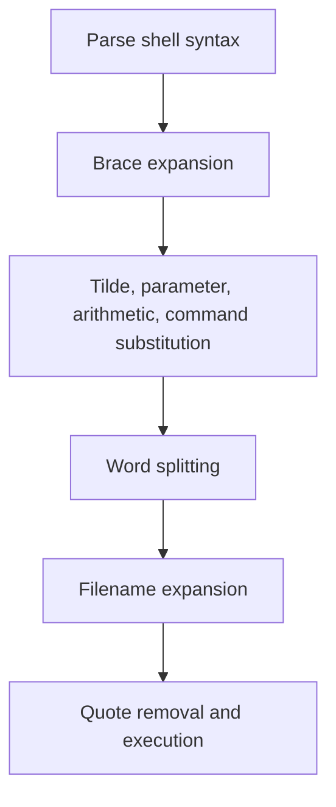
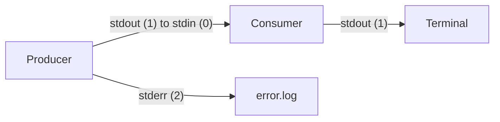

Bash recipes for everyday scripting and debugging. Find the operation you need, copy the relevant pattern, and adapt it. Use builtins for small shell tasks; reach for external tools when they do the job better.

Examples assume Bash, not `sh` or Zsh. Most work on Bash 3.2; newer features are marked. Example paths, filenames and commands are placeholders where indicated. Check your version with `printf '%s\n' "$BASH_VERSION"`.

## Start here

| I need to... | Use |
|---|---|
| Remove a trailing slash | `${path%/}` |
| Extract a filename | `${path##*/}` |
| Replace every match | `${s//old/new}` |
| Supply a default | `${v:-default}` |
| Require a variable | `${v:?message}` |
| Match a pattern | `[[ $s == *.log ]]` |
| Capture regex groups | `[[ $s =~ $re ]]`, `BASH_REMATCH` |
| Pass arguments safely | `"$@"`, `"${args[@]}"` |
| Read a line intact | `IFS= read -r line` |
| Format into a variable | `printf -v name FORMAT ...` |
| Capture stdout | `out=$(command)` |
| Preserve a loop's variables | `while ...; do ...; done < file` |
| Merge stderr into stdout | `>file 2>&1` |
| Check pipeline failures | `set -o pipefail`, `PIPESTATUS` |
| Wait for background work | `wait "$pid"` |
| Inspect actual arguments | `printf '%q\n' "$@"` |
| Debug a script | `bash -n script.sh`, `bash -x script.sh` |

## Manipulate strings without subprocesses

### Remove prefixes and suffixes

```bash
path='/var/log/nginx/access.log.gz'
name=${path##*/}         # access.log.gz
parent=${path%/*}        # /var/log/nginx
stem=${name%.*}          # access.log
base=${name%%.*}         # access
relative=${path#/}      # var/log/nginx/access.log.gz

url='https://example.com/'
url=${url%/}             # https://example.com
```

| Operator | Removes |
|---|---|
| `${v#pattern}` | Shortest matching prefix |
| `${v##pattern}` | Longest matching prefix |
| `${v%pattern}` | Shortest matching suffix |
| `${v%%pattern}` | Longest matching suffix |

`#` works from the beginning; `%` works from the end. Double the operator for the longest match. These are glob patterns, not regular expressions. If nothing matches, the original value remains.

```text
access.log.gz
      └─────┘  %%.*  removes .log.gz
          └─┘  %.*   removes .gz
```

Practical: derive sample names without `basename`, `sed`, or `awk`.

```bash
for file in ./*.fastq.gz; do
    [[ -f $file ]] || continue
    sample=${file##*/}
    sample=${sample%.fastq.gz}
    printf '%s\n' "$sample"
done
```

**Gotcha:** `${path%/*}` is not a complete replacement for `dirname`. A slashless name stays unchanged, `/file` yields an empty string, and trailing slashes affect basename-like expansion. `${path%/}` removes only one slash, including the slash in `/`. Use the real tools when you need their full path semantics.

### Replace, delete, slice and change case

```bash
s='foo-bar-foo'
a=${s/foo/baz}          # baz-bar-foo
b=${s//foo/baz}         # baz-bar-baz
c=${s/#foo/baz}         # baz-bar-foo (prefix only)
d=${s/%foo/baz}         # foo-bar-baz (suffix only)
e=${s//-/}              # foobarfoo
f=${s//-/_}             # foo_bar_foo

s='Hello World'
first=${s:0:5}          # Hello
last=${s: -5}           # World
length=${#s}            # 11
lower=${s,,}            # hello world (Bash 4+)
upper=${s^^}            # HELLO WORLD (Bash 4+)
```

Keep the space in `${s: -5}`: `${s:-5}` is a default-value expression. Length and slicing generally operate on characters in the current locale, not bytes. Replacement patterns are globs; modern Bash can also treat an unquoted `&` in replacement text specially (`patsub_replacement`). Quote literal replacement variables: `${s//old/"$replacement"}`.

### Defaults, required values and indirection

| Expression | Unset | Empty | Nonempty |
|---|---|---|---|
| `${v:-x}` | x | x | value |
| `${v-x}` | x | empty | value |
| `${v:=x}` | assign x | assign x | value |
| `${v=x}` | assign x | empty | value |
| `${v:+x}` | empty | empty | x |
| `${v+x}` | empty | x | x |
| `${v:?error}` | error | error | value |
| `${v?error}` | error | empty | value |

With the colon, unset and empty both count as missing. Without it, only unset counts.

```bash
port=${PORT:-8080}
output=${1:-output.txt}
: "${THREADS:=4}"         # assign default to THREADS
# : "${API_KEY:?API_KEY is required}"  # fail if missing or empty

name=HOME
printf '%s\n' "${!name}"  # indirect expansion: value of HOME
```

`${v:?message}` exits a noninteractive shell when the required value is missing. `[[ -v v ]]` (Bash 4.2+) checks whether a simple variable is set, even when empty; `[[ -n ${v:-} ]]` checks for nonempty content. Prefer explicit defaults for optional values under `set -u`.

## Keep arguments intact

```bash
file='quarterly report.txt'
printf '<%s>\n' $file     # two arguments; may also expand globs
printf '<%s>\n' "$file"   # one argument
printf '%s\n' '$HOME'    # literal $HOME
printf '%s\n' "$HOME"    # expanded value
```

When an unquoted expansion introduces spaces or wildcard characters, Bash can split it into several words and expand those words against filenames. Quoting preserves the original boundary.



This is the ordinary-word model; assignments, arithmetic and `[[ ... ]]` have different rules. Process substitution happens alongside parameter and command substitution on supported systems. Text produced by expansion is not reparsed as shell syntax unless you deliberately use something such as `eval`.

| Form | Use |
|---|---|
| `"$v"` | One value, including an empty value |
| `"${v}_suffix"` | Explicit variable-name boundary |
| `"$@"` | Original positional arguments, separately quoted |
| `"$*"` | All positional arguments joined into one string |
| `$'a\tb\n'` | Interpret backslash escapes |
| `"$(command)"` | Capture stdout, strip trailing newlines |
| `$((2 + 3))` | Integer arithmetic expansion |

Debug the actual argument boundaries:

```bash
show_args() {
    printf 'argc=%s\n' "$#"
    if (( $# )); then printf '<%q>\n' "$@"; fi
}
show_args 'a b' '' '*.log'
```

`%q` produces a shell-readable representation; it is excellent for spotting spaces, newlines and literal glob characters. Do not print secrets.

## Match strings, globs and regular expressions

```bash
file='app.log'
[[ $file == *.log ]] && printf 'log file\n'
[[ $file == "*.log" ]]   # false: quoted pattern is literal
[[ -f $file ]]           # regular file
[[ -d $file ]]           # directory
[[ -L $file ]]           # symbolic link (even dangling)
[[ -s $file ]]           # exists and has nonzero size
```

Use `[[ ... ]]` for Bash conditions. Its operands do not undergo ordinary word splitting or filename expansion. Quoting the pattern on the right of `==` makes it literal.

```bash
version='v1.24.3'
re='^v([0-9]+)\.([0-9]+)\.([0-9]+)$'
if [[ $version =~ $re ]]; then
    major=${BASH_REMATCH[1]}
    minor=${BASH_REMATCH[2]}
    patch=${BASH_REMATCH[3]}
    printf '%s %s %s\n' "$major" "$minor" "$patch"
fi
```

`=~` uses extended regular expressions. Keep the regex variable unquoted on the right. `BASH_REMATCH[0]` is the full match; later elements are captures. A later regex test can overwrite them.

```bash
case ${1:-} in
    start|stop|restart) printf 'valid action\n' ;;
    *.log)             printf 'log filename\n' ;;
    *)                 printf 'unknown action\n' ;;
esac
```

Filename globbing is a separate operation:

| Pattern / option | Effect |
|---|---|
| `*.log` | Matching filenames in current directory |
| `file?.txt` | Exactly one character in place of `?` |
| `file[12].txt` | `file1.txt` or `file2.txt`, if present |
| `file{1,2}.txt` | Two generated words, whether files exist or not |
| `shopt -s nullglob` | Unmatched glob expands to zero words |
| `shopt -s failglob` | Unmatched glob raises expansion error |
| `shopt -s dotglob` | Include hidden names in ordinary globs |
| `shopt -s globstar` | Recursive `**` (Bash 4+) |

```bash
(
    shopt -s nullglob globstar   # Bash 4+
    files=(./**/*.log)
    for file in "${files[@]}"; do
        printf '%s\n' "$file"
    done
)
```

The subshell limits option changes to this block. Default Bash leaves an unmatched glob unchanged; never assume a glob found a file. For extended patterns such as `@(jpg|png)`, enable `extglob` **before Bash parses** a command or function containing them.

## Build commands with arrays, not strings

```bash
args=(--fail --silent --show-error)
url='https://example.com/'
# Add options without breaking spaces in values.
args+=(--header 'Accept: application/json')
curl "${args[@]}" "$url"
```

Do not build a command string and then run `eval "$cmd"`. Arrays preserve boundaries without reparsing input as shell syntax. For forwarding arguments, use `some_command "$@"`.

```bash
files=('a b.txt' 'c.txt' '-strange.txt')
files+=('d.txt')
printf '%s\n' "${files[0]}"
printf 'count=%s\n' "${#files[@]}"
printf '%s\n' "${files[@]:1:2}"
for i in "${!files[@]}"; do
    printf '%s: %q\n' "$i" "${files[i]}"
done
```

`"${files[@]}"` expands to one word per element; `"${files[*]}"` joins them. Indexed arrays can be sparse: length is not necessarily the last index plus one. For commands that support `--`, use it before untrusted filenames, or prefix filenames with `./`.

Associative arrays (Bash 4+) are useful for small lookup tables and counters:

```bash
declare -A count=()
for word in apple banana apple orange banana apple; do
    count["$word"]=$(( ${count[$word]:-0} + 1 ))
done
for word in "${!count[@]}"; do
    printf '%s: %d\n' "$word" "${count[$word]}"
done
```

Keys cannot be empty; iteration order is not guaranteed. Use indexed arrays for ordered lists. Keep arithmetic inputs trusted and numeric; Bash arithmetic can evaluate variable references as expressions.

## Read, split and format data

```bash
while IFS= read -r line || [[ -n $line ]]; do
    printf '%s\n' "$line"
done < input.txt
```

`IFS=` preserves surrounding whitespace, `-r` preserves backslashes, and the extra test handles a final line without a newline. This is text processing, not arbitrary binary processing.

```bash
address='192.168.1.20:8080'
IFS=: read -r host port <<< "$address"
IFS=, read -r -a fields <<< 'one,two,three'
mapfile -t lines < input.txt    # Bash 4+
```

`read -a` fills an indexed array. `mapfile -t` loads lines without their trailing delimiter; it can consume substantial memory for large files. `IFS` splitting is not a CSV parser, and the address example is not an IPv6 endpoint parser.

For arbitrary filenames, use NUL separators:

```bash
while IFS= read -r -d '' file; do
    printf '%q\n' "$file"
done < <(find . -type f -print0)
```

The producer's exit status is not automatically propagated by process substitution. If finding every file is essential, check the producer separately (for example, write its output to a temporary file and check its exit status before reading).

```bash
printf -v filename 'backup-%04d.tar.gz' 42
printf '%s\n' "$filename"       # backup-0042.tar.gz
printf '%-16s %8d\n' 'workers' 8
printf '%q\n' "$filename"
```

`printf -v` writes directly to a variable; no `$(...)` needed. Use a constant format string: `printf '%s\n' "$value"`, not `printf "$value"`. Bash variables cannot hold NUL bytes.

## Conditions, loops and functions

```bash
if [[ -f config.ini ]]; then
    printf 'found config\n'
fi

for ((i=0; i<3; i++)); do
    printf '%s\n' "$i"
done

n=0
n=$((n + 1))
(( n > 0 )) && printf 'positive\n'
```

`[[ $a == $b ]]` compares strings or patterns; `(( a > b ))` compares integer expressions. `(( expression ))` succeeds when the result is nonzero; `$(( expression ))` produces a value. Under `set -e`, standalone `((n++))` can exit when the old value is zero. Assignment `n=$((n+1))` avoids that trap.

Leading zeroes can mean octal. For nonnegative decimal user input, validate first (and impose a sensible range before arithmetic):

```bash
value=08
if [[ $value =~ ^[0-9]{1,6}$ ]]; then
    number=$((10#$value))
    printf '%d\n' "$number"
fi
```

Functions return a status, not a string. Print data to stdout and diagnostics to stderr.

```bash
stem() {
    local file=${1##*/}
    printf '%s\n' "${file%.*}"
}
name=$(stem '/tmp/report.csv')
```

Command substitution runs in a subshell environment and strips trailing newlines. To assign directly when appropriate, use `printf -v` or a nameref (Bash 4.3+):

```bash
set_result() {
    local -n ref=$1     # trusted variable name, not arbitrary input
    ref=$2
}
set_result answer 'some value'
printf '%s\n' "$answer"
```

`local` has dynamic scope: called functions can see a caller's locals. Avoid accidental name collisions, particularly when using namerefs. `return 1` signals failure; `exit 1` exits the shell (or subshell).

For small option parsers, use `getopts` rather than manually splitting arguments:

```bash
verbose=0
output=out.txt
while getopts ':vo:' opt; do
    case $opt in
        v) verbose=1 ;;
        o) output=$OPTARG ;;
        :) printf 'Missing value: -%s\n' "$OPTARG" >&2; exit 2 ;;
        \?) printf 'Unknown option: -%s\n' "$OPTARG" >&2; exit 2 ;;
    esac
done
shift "$((OPTIND - 1))"
```

`getopts` handles short options, including required arguments, not GNU-style long options. Reset `OPTIND=1` before parsing another argument list in the same shell.

## Redirect streams and keep state

| Syntax | Effect |
|---|---|
| `cmd >file` | Replace file with stdout |
| `cmd >>file` | Append stdout |
| `cmd 2>file` | Redirect stderr |
| `cmd >file 2>&1` | Send both streams to file |
| `cmd 2>&1 >file` | stderr stays at the old stdout destination |
| `cmd1 \| cmd2` | Pipe stdout to stdin |
| `cmd1 \|& cmd2` | Pipe stdout and stderr (Bash 4+) |
| `cmd <file` | Read stdin from file |
| `cmd <<< "$v"` | Feed value plus newline to stdin |

Redirections apply left to right. `2>&1` duplicates the current destination of descriptor 1; it does not permanently link stderr to future stdout changes.



Example: `producer 2>error.log | consumer` (replace both command names).

```bash
cat <<'EOF_TEXT'
$HOME and $(pwd) remain literal here.
EOF_TEXT

cat <<EOF_TEXT
Home is $HOME
EOF_TEXT
```

Quote a here-document delimiter to disable expansion in its body. `<<-` strips leading tabs, not spaces.

Read separately from the normal stdin stream:

```bash
exec 3< input.txt
IFS= read -r line <&3
exec 3<&-
```

Bash 4.1+ can allocate a descriptor using `exec {fd}< input.txt`, read with `read -r -u "$fd" line`, and close it with `exec {fd}<&-`. Close descriptors you no longer need. Do not redirect a file onto itself (`sort file >file` truncates it before `sort` reads it).

### Why a variable disappears after a loop

```bash
count=0
printf '%s\n' a b c | while IFS= read -r line; do
    count=$((count + 1))
done
printf '%s\n' "$count"    # usually 0

count=0
while IFS= read -r line; do
    count=$((count + 1))
done < <(printf '%s\n' a b c)
printf '%s\n' "$count"    # 3
```

Pipeline segments normally run in separate shell environments. `lastpipe` (Bash 4.2+) can change the final segment's behavior when job control is inactive; don't rely on it implicitly. Use input redirection when the loop needs to update parent state.

| Form | Environment |
|---|---|
| `{ cd /tmp; }` | Current shell (unless in a subshell context) |
| `(cd /tmp)` | Subshell; parent directory unchanged |
| `out=$(command)` | Subshell; stdout captured |
| `<(command)` | Asynchronous producer exposed as a file-like path |
| `command &` | Asynchronous job |
| `source script.sh` | Current shell; can modify variables and options |
| `exec command` | Replaces current shell if successful |

Use `diff <(sort a.txt) <(sort b.txt)` to compare generated outputs without named temporary files. Process substitution is convenient, but it does not automatically report the producers' failure statuses.

## Catch failures and preserve exit statuses

```bash
if command -v curl >/dev/null 2>&1; then
    printf 'curl is available\n'
fi

if output=$(false); then
    printf '%s\n' "$output"
else
    rc=$?
    printf 'command failed: %d\n' "$rc" >&2
fi
```

Capture `$?` immediately. Any intervening command changes it. Do not use `if ! command; then rc=$?; fi` to capture the original failure: `!` inverts the status.

Avoid combining `local` with a command substitution whose failure matters:

```bash
fetch() {
    local body
    body=$(curl -fsS "$1") || return "$?"
    printf '%s\n' "$body"
}
```

`local body=$(...)` can hide the substitution's failure behind the successful `local` builtin.

### Pipelines and strict mode

```bash
set -o pipefail
false | true
printf 'pipeline=%s stages=(%s)\n' "$?" "${PIPESTATUS[*]}"
# pipeline=1 stages=(1 0)
```

Without `pipefail`, a pipeline normally reports its final command's status. With it, the rightmost failing command's status wins. `PIPESTATUS` holds each stage's status; read it immediately, just like `$?`. The example deliberately runs a failing pipeline without `errexit`.

For standalone scripts, consider:

```bash
set -euo pipefail
```

| Option | Effect |
|---|---|
| `-e` | Exit on certain unhandled nonzero statuses |
| `-u` | Error on many unset variable expansions |
| `pipefail` | Reflect failures of non-final pipeline stages |

This is not exception handling. `-e` has exceptions for conditions, most `&&`/`||` positions, negation and pipeline segments. Calling a function as a condition can disable `errexit` in its body. Command substitution normally clears `-e` in non-POSIX Bash; `shopt -s inherit_errexit` (Bash 4.4+) changes that. Use explicit status checks for operations that must succeed.

A nonzero status is not necessarily an error: `grep` returns 1 for no matches; `read` returns nonzero at EOF. A producer can also receive `SIGPIPE` when a consumer such as `head` stops early. Don't add `|| true` indiscriminately.

## Background jobs and cleanup

```bash
pids=()
for i in 1 2 3; do
    sleep "$i" &               # substitute real work here
    pids+=("$!")
done

failed=0
for pid in "${pids[@]}"; do
    if wait "$pid"; then
        printf 'finished %s\n' "$pid"
    else
        rc=$?
        printf 'failed %s: %s\n' "$pid" "$rc" >&2
        failed=1
    fi
done
# Use exit "$failed" at the end of a standalone script.
```

Save `$!` immediately after launching each job. Waiting without collecting individual statuses can hide failures. `wait -n` (Bash 4.3+) waits for one eligible child; `wait -n -p var` (Bash 5.1+) can also identify the completed job. Limit concurrency for real workloads rather than starting thousands of children.

A reusable standalone-script pattern for temporary files:

```bash
#!/usr/bin/env bash
set -euo pipefail

tmpdir=$(mktemp -d) || exit 1
cleanup() {
    local rc=$?
    trap - EXIT
    if [[ -n $tmpdir && -d $tmpdir ]]; then
        rm -rf -- "$tmpdir" || printf 'cleanup failed\n' >&2
    fi
    exit "$rc"
}
trap cleanup EXIT
trap 'exit 130' INT
trap 'exit 143' TERM

printf '%s\n' 'temporary data' > "$tmpdir/data"
# Do work here.
```

Register cleanup only after creating a private temporary directory. This pattern preserves the original status and handles ordinary exit, interrupt and termination. `SIGKILL` and power loss cannot be trapped. It is not a process-tree supervisor; if you launch workers, manage their termination and waits explicitly. Run this as a script, not by sourcing it into your interactive shell.

## Useful things at the prompt

| Shortcut / command | Use |
|---|---|
| `Ctrl-R` | Search previous commands (usual Readline bindings) |
| `Alt-.` | Insert last argument of a previous command |
| `Ctrl-A` / `Ctrl-E` | Start / end of line (Emacs mode) |
| `Ctrl-X Ctrl-E` | Edit current command in your editor (Emacs mode) |
| `history 20` | Show recent commands |
| `!123:p` | Preview history entry 123 before running |
| `cd -` | Return to previous directory |
| `pushd DIR`, `popd` | Directory stack |
| `type -a NAME` | Inspect command resolution |
| `jobs`, `fg %1`, `bg %1` | Inspect/resume jobs |
| `Ctrl-Z` | Suspend foreground job, not detach |
| `Ctrl-S` / `Ctrl-Q` | Pause / resume output if terminal flow control is enabled |

Brace expansion is useful for creating related names: `mkdir -p app/{src,tests,docs}` or `cp -- config.yaml{,.bak}`. Check existing destinations before overwriting files. History expansion is primarily interactive; preview destructive commands before replaying them. For work that must survive disconnects, use an appropriate supervisor, scheduler or terminal multiplexer.

## Debug a script that behaves strangely

```bash
bash -n script.sh                     # parse only
bash -x script.sh                     # execute with expanded-command trace
PS4='+ ${BASH_SOURCE}:${LINENO}: ' bash -x script.sh
```

Tracing executes the script and can reveal secrets. Use a safe test environment and disable tracing around sensitive operations. `bash -n` does not validate runtime behavior or dynamically sourced files.

| Symptom | First check |
|---|---|
| `bad substitution` | Check interpreter and Bash version; don't run Bash syntax with `sh` |
| `command not found` | `type -a NAME`, `printf '%s\n' "$PATH"` |
| Works locally, fails in CI | Compare user, working directory, environment, shell and external tool versions |
| `/usr/bin/env: bash\r` | Windows CRLF line endings |
| Looks correct but parsing fails | Smart quotes, BOM, nonbreaking spaces, trailing whitespace after `\` |
| Unexpected split or wildcard | Quote variables; inspect arguments with `%q` |
| Empty output but status 0 | Check whether a wrapper, `local` or final pipeline stage hid a failure |
| Variable empty after a loop | Check pipeline/subshell boundaries |

Inspect actual bytes when the editor is misleading:

```bash
file script.sh
LC_ALL=C sed -n '1,20l' script.sh
od -An -tx1 -N 64 script.sh
```

Save scripts as UTF-8 without BOM and with LF line endings. `bash script.sh` chooses Bash explicitly; `./script.sh` uses the shebang and needs execution permission. A backslash continues a line only if immediately followed by a newline, not a space.

### Bash version checks

| Feature | Minimum Bash |
|---|---|
| Parameter trimming/replacement, indexed arrays, `[[ ... ]]` | 3.2 or earlier |
| Associative arrays, `mapfile`, case conversion, `globstar`, `\|&` | 4.0 |
| Dynamic file descriptors | 4.1 |
| `[[ -v name ]]`, `lastpipe` | 4.2 |
| Namerefs, `wait -n` | 4.3 |
| `inherit_errexit`, `mapfile -d` | 4.4 |
| `wait -n -p var` | 5.1 |

macOS commonly ships Bash 3.2. A newer Bash installed separately is not necessarily the interpreter invoked by your script. GNU and BSD tool differences are a separate issue.

## When not to use Bash

Use parameter expansion, arrays and builtins for small in-memory operations. Use `awk` for streaming large text datasets, `grep` or `rg` for searching, `find` for filesystem traversal, `jq` for JSON, and a proper language/library for complex parsing, numerical work or substantial data structures. External programs are not a failure of shell programming.

For exact semantics and more examples, use `help read`, `help printf`, `help trap`, `help set`, `help shopt` and the [Bash reference manual](https://www.gnu.org/software/bash/manual/).

Keep arguments intact, check statuses explicitly, and use the simplest tool that expresses the operation correctly.
