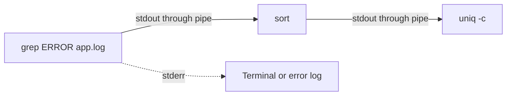
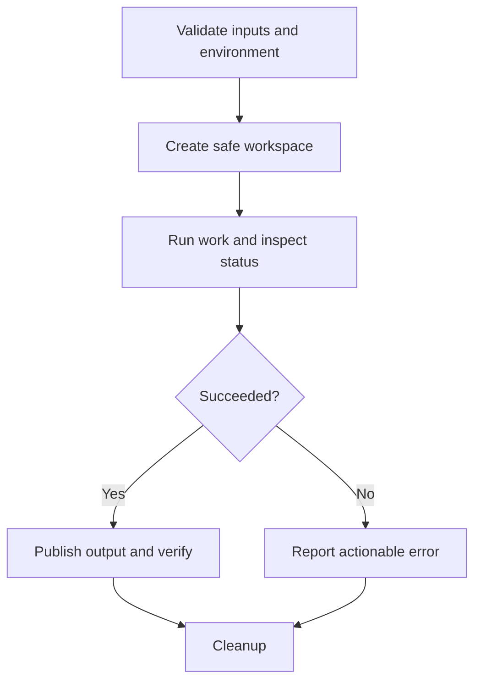

Bash is great glue. It can connect a handful of programs into something useful in a few lines. It can also interpret a perfectly reasonable-looking line in a way you never intended.

The trick is not memorizing hundreds of commands. It is understanding **what Bash reads, what it expands, what it executes, and what happens when a command fails**. Once that makes sense, the shortcuts are safer, the scripts are shorter, and the strange failures become easier to explain.

This is a practical Bash guide, not a catalog of every feature. Commands assume Bash on a Unix-like system. Where macOS, POSIX `sh`, or GNU tools behave differently, we'll say so.

## Start here: quick lookup

Use the first line that matches what you are doing. For obscure failures, check the **actual characters**, **interpreter**, and **environment** before changing the program logic.

| Need or symptom | First useful action | Why |
|---|---|---|
| Recall a command | `Ctrl-R` or `history 20` | Search instead of retyping |
| Replay history entry 123 | `!123:p`, then `!123` | Preview before executing |
| Reuse previous last argument | `Alt-.` or `!$` | Preserve a path you just typed |
| A variable with spaces breaks a command | Quote it: `"$value"` | Keep one argument as one argument |
| `bad substitution` | `bash --version`; inspect `${...}` | Wrong syntax or running `sh` instead of Bash |
| Script shows `^M` or `bash\r` | `file script.sh`; `sed -n '1,5l' script.sh` | Likely Windows CRLF endings |
| Script looks right but fails | `LC_ALL=C sed -n '1,20l' script.sh` | Smart quotes, hidden spaces, or escapes |
| Unexpected exit | `bash -x script.sh` | Trace commands and statuses; beware secrets |
| Syntax error | `bash -n script.sh` | Parse without executing |
| Pipeline hides a failure | `set -o pipefail` | Propagate a non-final command's failure |
| Command works by hand, not in CI | `pwd`; `env`; `type -a COMMAND` | Different environment, shell, or path |

These are starting points, not guaranteed fixes. Never replay a destructive history entry without checking it first.

---

## Bash Is Not the Terminal

The terminal displays text and sends keyboard input. Bash is the shell that interprets commands. `grep`, `awk`, `find`, `curl`, and `git` are separate programs, whereas `cd`, `read`, and `export` are Bash builtins.

Consider:

```bash
grep -i 'connection refused' app.log | sort | uniq -c
```

Bash recognizes the pipeline, prepares the arguments and file descriptors, starts the commands, and waits for them. It does not search or sort the log itself.


The phrase `'connection refused'` is **one argument**, despite containing a space. After removing the quotes, Bash passes the text to `grep` without the quote characters. In normal shell argument notation, the beginning of the command looks like this:

```text
argv[0] = grep
argv[1] = -i
argv[2] = connection refused
argv[3] = app.log
```

Arguments are not a single string. They are separate values. Much of Bash safety comes down to preserving those boundaries.

An **exit status** is a number from a completed command: `0` usually means success and nonzero means something else. The meaning of nonzero depends on the program; for `grep`, status `1` normally means *no match*, not an operational failure.

```bash
if grep -q 'ERROR' app.log; then
  printf 'Found an error\n'
else
  printf 'No matching error line (or grep failed)\n'
fi
```

If you need to distinguish no match from an actual `grep` error, inspect its status explicitly. Bash conditionals test whether commands succeed; they are not restricted to Boolean expressions.

**Bash versus `sh` versus Zsh.** `#!/usr/bin/env bash` asks for Bash. `#!/bin/sh` asks for the system's `sh`, which might be `dash`, Bash in a different compatibility mode, or another shell. Bash features such as `[[ ... ]]`, arrays, and process substitution are not portable `sh` syntax. Zsh has its own expansion and globbing rules. Use the shell you actually wrote the script for.

Check what you are running:

```bash
printf 'Bash version: %s\n' "$BASH_VERSION"
bash --version | head -n 1
type -a bash
```

macOS typically ships Bash 3.2 by default. Some useful modern features, including `mapfile` and associative arrays, are absent there. Homebrew Bash is a separate installation.

---

## Work Faster at the Prompt

These are **interactive** tricks. They are for typing commands into Bash, not for putting history expansion in scripts.

### Recall a command instead of retyping it

```bash
history 20          # Show recent entries
!123                # Execute history entry 123
!-3                 # Execute the entry three commands back
!!                  # Repeat the previous command
!git                # Last command starting with 'git'
!?docker?           # Last command containing 'docker'
```

For example:

```text
$ history 3
  121  ls -lah
  122  git status
  123  docker ps -a

$ !123
docker ps -a
```

Other history expansions operate on *arguments*:

```bash
mkdir -p /tmp/demo-project
cd !$                # Last argument: /tmp/demo-project
```

`!^` is the first argument of the previous command; `!$` is the last. `sudo !!` repeats the previous command with `sudo`, but don't use it without checking the command first.

**Preview dangerous expansions:** `!123:p` and `!!:p` print the expanded command instead of running it. History entries may have changed because other commands ran, and history expansion can surprise you around quotes. The interactive history feature is usually enabled by default in Bash but off in noninteractive scripts; `set +H` disables it.

The quick typo correction is worth remembering:

```text
$ systemctl stats nginx
$ ^stats^status
systemctl status nginx
```

That substitutes the first matching text in the previous command and executes the result. Use `fc` or the history-preview modifier if you would rather inspect it first.

### Keyboard shortcuts that pay for themselves

These are Bash's usual Emacs-mode Readline bindings; terminal software and custom keybindings can change them.

| Keys | Action |
|---|---|
| `Ctrl-R` | Search backward through command history; repeat to go further back |
| `Ctrl-A` / `Ctrl-E` | Beginning / end of command line |
| `Ctrl-U` / `Ctrl-K` | Cut from cursor to start / end of line |
| `Ctrl-W` | Cut the previous word |
| `Ctrl-Y` | Paste the last cut text |
| `Alt-.` | Insert the previous command's last argument; repeat to cycle older ones |
| `Ctrl-L` | Clear the terminal view |
| `Ctrl-X` then `Ctrl-E` | Edit the command in `$EDITOR`/`$VISUAL` using Readline's editor command |
| `Ctrl-C` | Interrupt the foreground command |
| `Ctrl-Z` | Suspend the foreground job |
| `Ctrl-D` | Send EOF; an empty interactive prompt normally exits |

`Ctrl-S` may appear to freeze terminal output on terminals with software flow control enabled; `Ctrl-Q` resumes it. The shell may be fine.

### Short navigation tricks

```bash
cd -                       # Previous working directory
pushd /var/log             # Enter and remember previous directory
popd                       # Return using directory stack
mkdir -p app/{src,tests,docs}
cp config.yaml{,.bak}      # Expands to config.yaml config.yaml.bak
```

`type -a python` shows aliases, builtins, functions, and executable matches. `command -v jq` is a practical way to check whether a command can be resolved.

### Suspend versus detach

```bash
long_command &
pid=$!
jobs
wait "$pid"
```

`&` starts a background job in the current shell; `$!` records its process ID. `fg %1` brings job 1 into the foreground; `bg %1` resumes a suspended job in the background.

`Ctrl-Z` does **not** mean safe background execution across logout. Use `tmux`, a job scheduler, or systemd for jobs that must survive disconnects.

---

## The Script Looks Fine. The Bytes Disagree.

Before debugging logic, inspect the actual characters. This is especially important for scripts copied from chats, documents, Windows editors, CI configuration, and web pages.

### Straight quotes versus smart quotes

Bash recognizes ASCII `'` and `"` as quote delimiters. The visually similar `‘`, `’`, `“`, and `”` are different Unicode characters. They are **not** Bash quoting syntax.

```bash
name='two words'
printf '%s\n' "$name"       # One value: two words
printf '%s\n' “$name”       # Curly quotes do NOT protect the space
```

The second command undergoes word splitting. The curly quotes become literal characters rather than protecting the variable. It may print a plausible-looking result, making the bug harder to notice.

Other lookalikes cause similar trouble:

| Character | Problem |
|---|---|
| ASCII `-` versus `–` or `—` | A typographic dash is not an option prefix |
| Regular space versus nonbreaking space (U+00A0) | Bash does not treat it like normal shell whitespace |
| Zero-width space (U+200B) | Can silently become part of a name or argument |
| ASCII `$` versus fullwidth `＄` | Only the ASCII dollar sign starts expansion |
| ASCII `\` versus a typographic slash | Only a real backslash escapes characters |

Don't globally delete all non-ASCII text; UTF-8 filenames, comments, and string contents can be legitimate. Look for suspicious characters **in syntax**.

### Four dollar-sign forms, four different jobs

| Form | What it means | Example |
|---|---|---|
| `$name` | Expand a variable | `"$HOME"` |
| `${name}` | Expand with an explicit boundary | `"${HOME}/bin"` |
| `$(command)` | Run command and substitute its stdout | `"$(date +%F)"` |
| `$((expression))` | Calculate an integer | `$((2 + 3))` |

```bash
name=backup
printf '%s\n' "$name_file"     # Looks for a DIFFERENT variable: name_file
printf '%s\n' "${name}_file"   # backup_file
printf '%s\n' '${name}'       # Literal characters, no expansion
printf '%s\n' "\$HOME"        # Literal $HOME
```

`${}` is invalid: there is no parameter name or valid expansion inside the braces. The braces are useful when the variable name meets adjacent text, or when using parameter operations like `${name:-default}`. They are not required around every simple variable.

`$(command)` captures stdout and removes trailing newline characters. It does not capture stderr unless you redirect it. `(( expression ))` is a command with a success/failure status, not the same thing as `$(( expression ))`, which substitutes a result.

### CRLF, BOM, and shebang failures

Unix scripts conventionally use LF line endings (`0A`). Windows tools often write CRLF (`0D 0A`). With a CRLF shebang, Linux may see `bash\r` instead of `bash`:

```text
/usr/bin/env: 'bash\r': No such file or directory
```

A UTF-8 byte-order mark (BOM, `EF BB BF`) before `#!` can prevent the kernel from recognizing the interpreter line at all.

| First bytes | Meaning |
|---|---|
| `23 21` | `#!` starts at byte zero (normal shebang) |
| `EF BB BF 23 21` | BOM appears before the shebang |
| `0D 0A` at line endings | Windows CRLF |
| `0A` at line endings | Unix LF |

Inspect bytes rather than guessing:

```bash
file script.sh
LC_ALL=C sed -n '1,30l' script.sh
od -An -tx1 -N 64 script.sh
bash -n script.sh
```

For a known CRLF file, use `dos2unix script.sh`. If you do not have that command, a Python conversion can remove **only** CRLF line endings:

```bash
python3 - <<'PY'
from pathlib import Path
p = Path('script.sh')
data = p.read_bytes()
p.write_bytes(data.replace(b'\r\n', b'\n'))
PY
```

Only run conversion on files you trust and intended to modify. A script should normally be saved as **UTF-8 without BOM, with LF endings**. Git attributes such as `*.sh text eol=lf` can help keep that consistent across Windows and Linux checkouts.

### The invisible space after a backslash

```bash
curl \
  --connect-timeout 5 \
  https://example.com
```

A backslash followed immediately by a newline continues the command. A backslash followed by a **space**, then a newline, does not. The space is escaped, and the next physical line becomes a different command. `sed -n 'l'` or `cat -v` can expose that trailing whitespace.

### When the editor or operating system is the real difference

`bash script.sh` invokes Bash directly, so it can run a script without the execute bit and bypasses shebang selection. `./script.sh` asks the operating system to execute the file, so it needs suitable permissions, a valid interpreter line, and an executable filesystem mount.

On macOS, the default Bash is often 3.2. Tools such as `sed -i`, `date -d`, and `readlink -f` differ between GNU and BSD versions; this is separate from Bash syntax. A script can parse correctly and still fail because the external tool behaves differently.

When scripts cross machines, inspect **bytes, interpreter, tool versions, and execution environment** in that order.

---
## How Bash Expands a Command

A command line goes through several stages. The exact expansion rules depend on its syntactic context, but the practical sequence for ordinary words includes brace expansion, tilde expansion, parameter/command/arithmetic expansion, word splitting, pathname expansion (globbing), and quote removal.

This explains why an innocent-looking variable can turn into multiple arguments, and why unquoted variables can accidentally match filenames.

### Quoting is about preserving arguments

```bash
filename='quarterly report.txt'

cat $filename             # Two arguments: quarterly and report.txt
cat "$filename"           # One argument: quarterly report.txt
```

Single quotes keep text literal. Double quotes allow `$variable`, `$(command)`, and certain escapes while suppressing most word splitting and filename expansion.

```bash
printf '%s\n' '$HOME'     # Literal $HOME
printf '%s\n' "$HOME"     # Expanded home directory
printf '%s\n' "$(pwd)"    # Capture output from pwd
```

**Default rule:** quote expansions unless you specifically want splitting or globbing. In Bash's `[[ ... ]]` tests and arithmetic expressions, some splitting rules differ, but quoting for clarity is still useful.

### Positional parameters, arrays, and the argument boundary

```bash
printf 'script=%s args=%s\n' "$0" "$#"
printf '<%s>\n' "$@"
```

`"$@"` expands to a **separate, quoted argument for each original argument**. `"$*"` instead joins the arguments into one string, usually separated by the first character of `IFS`. Unquoted `$*` or `$@` can trigger word splitting and filename expansion.

Arrays exist because a list of filenames should not be smuggled through a whitespace-delimited string:

```bash
files=('a b.txt' 'c.txt' '-strange.txt')

for file in "${files[@]}"; do
  printf 'file: %q\n' "$file"
done
```

`%q` produces a Bash-readable escaped representation of one argument. It is particularly useful when you suspect invisible characters.

Some parameter expansions worth memorizing:

| Expression | Meaning |
|---|---|
| `${v:-default}` | Use default if unset or empty |
| `${v-default}` | Use default only if unset |
| `${v:=default}` | Assign default if unset or empty |
| `${v:?message}` | Fail with a message if unset or empty |
| `${v:+alternate}` | Use alternate if set and nonempty |
| `${#v}` | String length |
| `${path##*/}` | Remove longest matching prefix, often directory path |
| `${path%.*}` | Remove shortest matching suffix, often an extension |
| `${v//old/new}` | Replace all matching substrings/patterns |

The operators have different behavior for *unset* versus *empty*. Under `set -u`, `${v:-default}` is normally safer than casually expanding an unset variable.

### Globs are not regular expressions

```bash
*.log               # Any name ending in .log
file?.txt           # Exactly one character after 'file'
report[12].csv      # report1.csv or report2.csv
```

Bash expands globs against filenames before calling a program. Brace expansion is different: `file{1,2}.txt` generates two words regardless of which files exist.

If `*.log` matches nothing, Bash normally leaves the literal pattern unchanged. A safe loop guards that case:

```bash
for file in *.log; do
  [[ -e "$file" || -L "$file" ]] || continue
  printf '%s\n' "$file"
done
```

Or explicitly enable `nullglob` in a scope where the changed behavior is intended:

```bash
(
  shopt -s nullglob
  logs=( *.log )
  printf '%s\n' "${logs[@]}"
)
```

`shopt -s failglob` instead turns an unmatched glob into an error. Both options can be useful, but don't flip shell behavior globally without understanding who else uses the shell.

### Reading lines without corrupting them

```bash
while IFS= read -r line || [[ -n "$line" ]]; do
  printf '%s\n' "$line"
done < file.txt
```

`IFS=` avoids leading/trailing whitespace trimming, `-r` keeps backslashes literal, and the extra test handles a final line that lacks a newline character.

Bash's `mapfile -t lines < file.txt` is convenient on Bash 4+, but unavailable in the default Bash 3.2 on macOS. Even `mapfile` is line-based, not appropriate for arbitrary filenames containing newlines.

---

## Pipelines, File Descriptors, and Subshells

Every ordinary Unix process starts with three familiar streams:

| Descriptor | Name | Default |
|---|---|---|
| `0` | stdin | Input from terminal or previous pipeline stage |
| `1` | stdout | Normal output |
| `2` | stderr | Diagnostics and error messages |

A pipe connects one command's stdout to another's stdin. It does not automatically carry stderr.



### Redirection order matters

```bash
command > out.log 2> err.log     # Keep outputs separate
command > all.log 2>&1          # Send both to all.log
command 2>&1 > out.log          # stderr still goes to original stdout
command >> append.log          # Append normal output
command < input.txt            # Read stdin from file
command |& tee combined.log    # Bash shorthand: stdout and stderr to pipe
```

File descriptors are redirected **from left to right**. In `command 2>&1 > out.log`, stderr gets a copy of the original stdout destination before stdout is redirected to the file.

Here-documents can expand variables, or preserve their text literally:

```bash
name=world
cat <<EOF
Hello, $name
EOF

cat <<'EOF'
Literal $name and $(whoami)
EOF
```

The quoted delimiter in `<<'EOF'` disables parameter and command expansion inside the body. This matters when generating configuration or scripts containing dollar signs.

### Command substitution and process substitution

```bash
today="$(date +%F)"
diff <(sort a.txt) <(sort b.txt)
```

`$(...)` substitutes output as a string (with trailing newlines removed). `<(...)` is **process substitution**: Bash supplies a path-like reference to a command's stream, useful when another program expects filenames. It's Bash-specific and may depend on platform facilities such as `/dev/fd`.

Do not assume failure inside command substitution always propagates cleanly, especially when wrapped in `local`, `export`, or `readonly` declarations. For example, avoid:

```bash
local result="$(might_fail)"   # Declaration's status can mask the command's status
```

Prefer two statements inside a function:

```bash
local result
result="$(might_fail)" || return
```

### The pipeline subshell surprise

```bash
count=0
printf '%s\n' a b c | while IFS= read -r line; do
  ((count += 1))
done
printf '%s\n' "$count"    # Usually 0
```

In normal Bash behavior, the loop on the right of the pipeline executes in a subshell. Changes made to `count` do not return to the parent shell. Bash has an optional `lastpipe` setting in certain circumstances, but relying on that makes scripts less predictable.

```bash
count=0
while IFS= read -r line; do
  ((count += 1))
done < input.txt
printf '%s\n' "$count"
```

Or feed the loop via process substitution:

```bash
while IFS= read -r line; do
  printf '%s\n' "$line"
done < <(generate_lines)
```

Caution: process-substitution producers run asynchronously, and their failure statuses are not automatically handled like an ordinary simple command. For critical pipelines, explicit temporary files or other status checks may be clearer.

---

## Variables, Conditions, Functions, and Loops

A shell variable stays in the current shell unless it is exported to child processes:

```bash
mode=production
export mode
python3 worker.py
```

The child receives `mode`, but it cannot directly change the parent's variable. `local` creates function-local Bash variables; `readonly` prevents later assignments.

Useful special parameters:

| Parameter | Meaning |
|---|---|
| `$0` | Script name or shell invocation name |
| `$1`, `$2` | Positional arguments |
| `$#` | Number of arguments |
| `"$@"` | All arguments, boundaries preserved |
| `$?` | Status of the most recently completed foreground pipeline |
| `$$` | Shell's PID (not always the current subshell PID) |
| `$BASHPID` | PID of the current Bash process |
| `$!` | PID of last asynchronously started job |
| `$LINENO` | Current source line number |
| `${BASH_SOURCE[0]}` | Bash source file path |

`$?` changes whenever another command runs. Capture it immediately if you need it later.

### Conditions test commands

```bash
if [[ -f "$input" ]]; then
  printf 'Input exists\n'
elif [[ -d "$input" ]]; then
  printf 'Input is a directory\n'
else
  printf 'Input is missing or another file type\n'
fi
```

Common tests include `-e` (exists), `-f` (regular file), `-d` (directory), `-s` (nonempty file), `-r`/`-w`/`-x` (access), `-n` (nonempty string), and `-z` (empty string). Test expressions are not permission guarantees; an operation can still fail afterward.

Bash `[[ ... ]]` avoids unwanted splitting and globbing of variables in the test expression. Use `(( ... ))` for arithmetic conditions and `case` for command-line options:

```bash
case "${1:-}" in
  start) printf 'Starting\n' ;;
  stop)  printf 'Stopping\n' ;;
  *)     printf 'Usage: %s start|stop\n' "$0" >&2; exit 2 ;;
esac
```

`[[ $name == *.txt ]]` uses a pattern; `[[ $value =~ ^[0-9]+$ ]]` uses Bash regular-expression matching, with distinct quoting rules for the regex. Neither is quite the same as POSIX `[`.

### Functions return statuses, not strings

```bash
get_name() {
  printf '%s\n' 'Ada'
}

name="$(get_name)"
```

A function's `return` command takes an integer status, conventionally 0–255, not a text value. Use stdout to produce textual data, and stderr for logging.

### Loops and the arithmetic-status trap

```bash
for file in *.txt; do
  [[ -e "$file" ]] || continue
  printf '%s\n' "$file"
done

while some_condition; do
  do_work
done
```

Here's a surprisingly common failure under `set -e`:

```bash
set -e
count=0
((count++))       # Arithmetic value was 0; command exits with status 1
printf 'Never reached\n'
```

`(( expression ))` returns status **1 when the expression evaluates to zero**. The post-increment expression evaluates to the *old* value. Use `((count += 1))`, `((++count))`, or `count=$((count + 1))` when the increment is not intended as a condition.

Use `break` and `continue` to control loops. For command arguments, a `while [[ $# -gt 0 ]]` loop with `case` and `shift` is usually simpler than elaborate parsing machinery.

---

## Files, Filenames, and Everyday Text Tools

Linux filenames can contain spaces, tabs, newlines, quotes, wildcard characters, and even leading hyphens. Unix filenames cannot contain NUL bytes, so **NUL-separated paths** are a dependable interchange format.

Bad:

```bash
for file in $(find . -name '*.log'); do
  printf '%s\n' "$file"
done
```

That mixes command substitution, word splitting, and pathname expansion. It loses filename boundaries.

Better:

```bash
while IFS= read -r -d '' file; do
  printf 'Found: %q\n' "$file"
done < <(find . -type f -name '*.log' -print0)
```

For an external command that accepts many path arguments:

```bash
find . -type f -name '*.log' -exec wc -l -- {} +
```

Or with parallel execution (GNU and common BSD `xargs` versions):

```bash
find . -type f -name '*.log' -print0 |
  xargs -0 -P4 -n1 wc -l --
```

Some `xargs` implementations invoke the command even with no input; GNU `xargs -r` suppresses that but is not universal. `find ... -exec ... +` is often simpler and portable.

### The ordinary tools worth knowing

| Tool | Good for | Example |
|---|---|---|
| `grep` | Find matching lines | `grep -n 'ERROR' app.log` |
| `sed` | Simple substitutions and line editing | `sed 's/old/new/g' file` |
| `awk` | Field-based text and small reports | `awk -F '\t' '{print $1}' data.tsv` |
| `cut` | Select delimited columns | `cut -f1,3 data.tsv` |
| `sort` | Sort records | `sort names.txt` |
| `uniq -c` | Count adjacent equal records | `sort names.txt \| uniq -c` |
| `head` / `tail` | Inspect ends of files | `tail -f app.log` |
| `column` | Align simple tables | `column -t -s $'\t' data.tsv` |

Use `printf` rather than `echo` when you need predictable formatting, arguments that start with `-`, or backslash escapes. `echo` behavior varies between shells and environments.

### Hard links and symbolic links

```bash
ln original.txt hardlink.txt
ln -s original.txt symlink.txt
ls -li original.txt hardlink.txt symlink.txt
readlink symlink.txt
```

A hard link is another directory entry referring to the same underlying file inode and generally cannot cross filesystems. A symbolic link stores a pathname and can point across filesystems or become dangling. This distinction becomes important when deleting, deploying, and backing up files.

`readlink -f` is available on many Linux systems but not reliably on the default macOS userland; don't assume a GNU option works everywhere.

### Inspect archives; do not promise an undo

```bash
tar -tzf archive.tar.gz | less
mkdir -p extracted
tar -xzf archive.tar.gz -C extracted
```

Extract into a dedicated directory whenever possible. `tar` does **not** have a reliable undo operation. If an archive overwrites existing files, listing the archive afterward does not identify which files originally existed or restore overwritten contents. Avoid scripts that 'undo' extraction by blindly deleting every archive member.

```bash
rsync -av --dry-run source/ destination/  # Inspect intended transfers
rsync -av source/ destination/
```

Trailing slashes matter in `rsync`; `source/` refers to the contents of the directory. Use `--delete` only after checking exactly what would be removed.

### HTTP and time without drama

```bash
curl -fsSL 'https://example.com/data.json' -o data.json
date +%F
stamp="$(date +%Y%m%d_%H%M%S)"
time some_command
```

`curl -f` makes many HTTP error statuses fail, but it is not a substitute for checking the returned data. Avoid `curl ... | bash` unless you have explicitly verified and trust what will be executed. For cross-platform date arithmetic, GNU `date -d` and BSD/macOS `date` require different syntax.

---
## Write Scripts That Fail Predictably

A script is reliable when it checks its assumptions, keeps argument boundaries intact, reports useful errors, and cleans up after itself. No one-line option can replace that.

### Strict mode helps, but it isn't exception handling

```bash
set -euo pipefail
```

| Setting | What it does |
|---|---|
| `-e` | Exits on many unhandled nonzero command statuses |
| `-u` | Reports use of many unset variables as errors |
| `-o pipefail` | Gives a failed pipeline a nonzero status even when a later stage succeeds |

`set -e` has exceptions in `if`, `while`, `&&`, `||`, `!`, and certain functions and substitutions. It can also exit on *expected* nonzero statuses, such as `grep` finding no match. Treat it as a backstop, not as control flow.

Without `pipefail`:

```bash
false | true
printf '%s\n' "$?"     # 0: last pipeline stage succeeded
```

With `pipefail`, the same pipeline returns nonzero. Bash also has `PIPESTATUS`, which holds the exit status of **each** stage, but it must be captured immediately because the next command overwrites it:

```bash
set +e
false | true
statuses=( "${PIPESTATUS[@]}" )
printf 'first=%s second=%s\n' "${statuses[0]}" "${statuses[1]}"
```

For normal conditional logic, explicit tests are clearer than relying on `-e`:

```bash
if grep -q 'READY' status.txt; then
  printf 'Ready\n'
else
  status=$?
  if (( status == 1 )); then
    printf 'Not ready yet\n'
  else
    printf 'Could not read status.txt (grep exit %d)\n' "$status" >&2
    exit "$status"
  fi
fi
```

### Log to stderr; reserve stdout for data

```bash
log() {
  printf '[%s] %s\n' "$(date +'%Y-%m-%d %H:%M:%S')" "$*" >&2
}

die() {
  printf 'ERROR: %s\n' "$*" >&2
  exit 1
}
```

If your script produces data meant for a pipeline, logging to stdout can corrupt that data. Think of stdout as a program's result and stderr as its diagnostic channel. Avoid logging secrets, tokens, or passwords.

### Cleanup needs an exit trap and careful paths

Temporary files should have unpredictable names, not hardcoded `/tmp/myfile.txt` paths shared between concurrent runs.

```bash
tmpdir="$(mktemp -d)" || exit 1
cleanup() {
  if [[ -n "${tmpdir:-}" && -d "$tmpdir" ]]; then
    rm -rf -- "$tmpdir"
  fi
}
trap cleanup EXIT
```

Here the deletion target comes from a freshly created temporary directory, not an unchecked user-controlled variable. In long-lived scripts, also consider whether signals can interrupt cleanup, whether the temporary location has enough space, and how secrets are stored there.

An `ERR` trap (`trap '...' ERR`) can help report failures, but inherits many of `set -e`'s exceptions and can surprise you inside functions. Do not confuse it with a universal `try/catch` mechanism.

### A small production-style example

This script counts matching log lines and writes the result to a named file. It uses a temporary file in the **destination directory**, then renames it only after the processing command succeeds.

```bash
#!/usr/bin/env bash
set -euo pipefail

usage() {
  printf 'Usage: %s INPUT_LOG OUTPUT_REPORT\n' "$0" >&2
  exit 2
}

log() {
  printf '%s\n' "$*" >&2
}

# The trap runs when the script exits, including after most failures.
tmpfile=''
cleanup() {
  if [[ -n "$tmpfile" && -e "$tmpfile" ]]; then
    rm -f -- "$tmpfile"
  fi
}
trap cleanup EXIT

main() {
  [[ $# -eq 2 ]] || usage

  local input=$1 output=$2
  local output_dir
  output_dir="$(dirname -- "$output")"

  [[ -f "$input" && -r "$input" ]] || {
    log "Cannot read input: $input"
    return 1
  }
  [[ -d "$output_dir" && -w "$output_dir" ]] || {
    log "Cannot write to directory: $output_dir"
    return 1
  }

  # The caller chooses the output path; an existing report is replaced.
  tmpfile="$(mktemp "${output}.tmp.XXXXXX")"
  awk '/ERROR/ { count++ } END { print count+0 }' "$input" > "$tmpfile"
  mv -f -- "$tmpfile" "$output"
  tmpfile=''
  log "Wrote report to $output"
}

main "$@"
```

This demonstrates validation, quoting, clear errors, cleanup, and a final rename on the same filesystem. The rename is normally atomic when source and destination are on the same filesystem, but it does not make the entire workflow transactional. A caller still needs to decide whether overwriting an existing report is acceptable.

For bigger workflows, write focused functions and test them rather than growing one enormous Bash script.

### Argument parsing without a framework

```bash
input=''
verbose=false

while [[ $# -gt 0 ]]; do
  case "$1" in
    -i|--input)
      [[ $# -ge 2 ]] || { printf 'Missing value for %s\n' "$1" >&2; exit 2; }
      input=$2
      shift 2
      ;;
    -v|--verbose)
      verbose=true
      shift
      ;;
    --)
      shift
      break
      ;;
    -h|--help)
      printf 'Usage: %s -i FILE [-v]\n' "$0"
      exit 0
      ;;
    *)
      printf 'Unknown argument: %s\n' "$1" >&2
      exit 2
      ;;
  esac
done

[[ -n "$input" ]] || { printf 'Missing --input\n' >&2; exit 2; }
```

This is enough for many small scripts. Supporting `--` matters if callers may pass filenames starting with a hyphen. For complicated argument grammar, an ordinary programming language may be a better choice.

### Parallel jobs: capture failures from *all* children

```bash
job_one & pid1=$!
job_two & pid2=$!

failed=0
if wait "$pid1"; then :; else failed=1; fi
if wait "$pid2"; then :; else failed=1; fi

(( failed == 0 )) || { printf 'At least one job failed\n' >&2; exit 1; }
```

`wait` returns a child's exit status. With `set -e`, a bare failed `wait` can terminate the script before it inspects other jobs. Using `wait` inside `if` makes the intended handling explicit. For more complex scheduling, consider GNU Parallel, a job runner, or a real scheduler rather than inventing your own concurrency system in Bash.

### A good script lifecycle



---

## Debug the Actual Failure

These are the first commands I'd reach for when a script looks correct but behaves strangely:

```bash
bash -n script.sh                         # Syntax only, no execution
shellcheck script.sh                     # Static checks (if installed)
bash -x script.sh                        # Trace execution: potentially sensitive
file script.sh                           # Encoding and line-ending hints
LC_ALL=C sed -n '1,30l' script.sh       # Escaped/non-printable characters
od -An -tx1 -N 128 script.sh            # Exact bytes
```

`bash -x` prints expanded commands and can disclose secrets. Use it only where logs and terminal history are appropriately protected. `set -x` turns tracing on within a script; `set +x` turns it off. A `BASH_XTRACEFD` destination can keep traces separate from ordinary stderr on Bash versions supporting it.

For an interactive shell, `printf '%q\n' "$value"` reveals how Bash would escape a suspicious argument. `declare -p variable` reveals Bash's representation of variables and arrays.

### When it works locally but not in CI or systemd

Inspect the **actual execution context**:

```bash
pwd
id
printf 'PATH=%s\n' "$PATH"
printf 'SHELL=%s\n' "${SHELL:-unset}"
command -v python3 || true
umask
```

The interactive shell may have loaded `.bashrc`, aliases, functions, or a custom `PATH` that the service does not have. Cron, systemd, containers, and CI steps can also use different users, shells, working directories, permissions, and exported variables.

Use absolute paths when appropriate, provide required environment explicitly, and test the script in an environment that resembles the one that will run it.

### Common failures and their first useful checks

| Symptom | Likely area | First check |
|---|---|---|
| `bash\r: No such file or directory` | CRLF shebang | `od -An -tx1 -N 64 script.sh` |
| `command not found` for an apparently valid name | Smart quotes, NBSP, BOM, `PATH` | `sed -n 'l'`, `type -a` |
| `bad substitution` | Wrong shell or malformed `${...}` | Shebang, `bash -n` |
| Script exits after `((count++))` | Arithmetic status under `set -e` | Check expression's value |
| Script succeeds despite a failed pipeline stage | Missing `pipefail` | `PIPESTATUS` immediately after pipeline |
| Variable changes in a `while` loop disappear | Pipeline subshell | Feed loop with redirection |
| Works at prompt, fails via systemd/cron | Environment/working directory | `pwd`, `id`, `PATH`, service config |
| `Permission denied` for `./script.sh` | Execute permission or filesystem mount | `ls -l`, `findmnt` |
| Filenames with spaces or newlines break a loop | Word splitting | Quote arrays, use `-print0` |
| A 'safe' deletion removes the wrong thing | Unchecked variable/path expansion | Inspect resolved target; dry-run |

### Dry runs for destructive operations

```bash
file='old-report.txt'  # Illustrative target; inspect it before changing anything
dry_run=true
run() {
  if "$dry_run"; then
    printf 'DRY RUN:' >&2
    printf ' %q' "$@" >&2
    printf '\n' >&2
  else
    "$@"
  fi
}

run rm -- "$file"
```

This preserves argument boundaries in the printed preview, but it is not a guarantee that a destructive command is safe. Validate the intended paths, run with least privilege, and have backups for things you cannot recreate. Never make a generic `rm -rf "$dir"` helper your default solution to cleanup.

### Know when not to use Bash

Bash is excellent for orchestration, process launching, short transformations, and gluing established tools together. It is much less pleasant for complex structures, elaborate data parsing, concurrency, robust cross-platform application logic, or long-lived services.

If a 20-line script grows into a 500-line program with nested quoting and state, Python, Go, or another suitable language is likely to make it easier to test and maintain. The point is not to write the cleverest shell one-liner. It is to solve the problem clearly.

---

## Fast command reference

**At the prompt**

```text
Ctrl-R        Search command history
Ctrl-A/E      Start/end of line
Ctrl-U/K      Cut to start/end of line
Alt-.         Insert prior final argument
!!            Previous command
!123          History entry 123
!123:p        Preview entry 123
!$            Prior final argument
^old^new      Fix typo in previous command
cd -          Previous directory
```

**Check your interpreter and bytes**

```bash
bash --version
bash -n script.sh
shellcheck script.sh
file script.sh
LC_ALL=C sed -n '1,30l' script.sh
od -An -tx1 -N 64 script.sh
```

**Variables and filenames**

```bash
printf '%s\n' "$value"
printf '%q\n' "$value"
printf '<%s>\n' "$@"
for file in "${files[@]}"; do printf '%s\n' "$file"; done
find . -type f -name '*.log' -exec wc -l -- {} +
```

**Pipes, errors, and logs**

```bash
command > stdout.log 2> stderr.log
command > combined.log 2>&1
set -o pipefail
journalctl -u my-service -n 100
```

**Reliable execution**

```bash
set -euo pipefail
command -v jq >/dev/null || { printf 'jq missing\n' >&2; exit 1; }
tmpdir="$(mktemp -d)"
trap 'rm -rf -- "$tmpdir"' EXIT
```

The small rule that ties everything together:

> Bash does not understand what you meant. It parses characters, expands words, and runs commands. Preserve argument boundaries, inspect the bytes, and handle failures deliberately.
