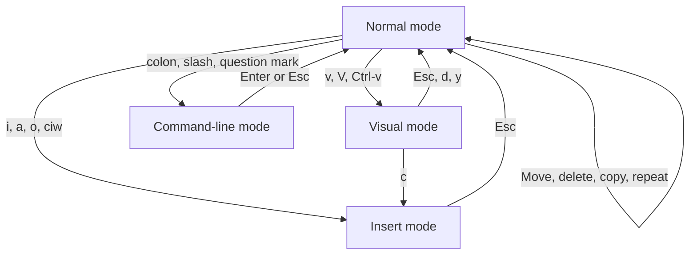
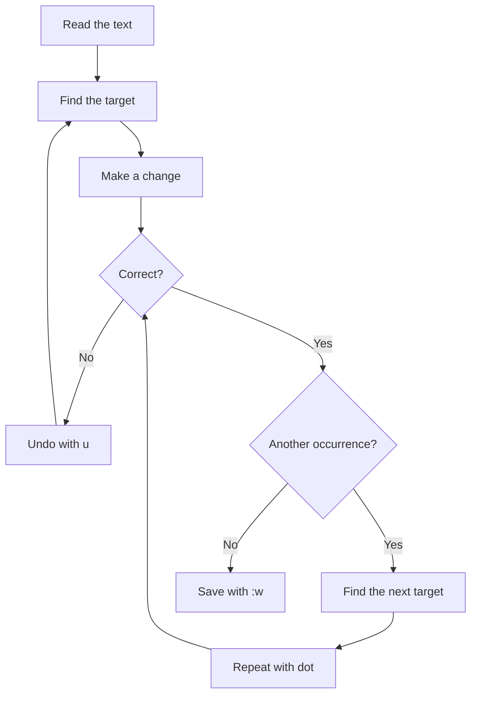

A good chef needs a good knife. A good mechanic needs a good toolbox. A developer needs a good editor.

I use Vim because I can edit a shell script on my laptop or a configuration file on a remote Linux machine without changing how I work. I do not need a collection of plugins or a complicated configuration to do that.

Learning Vim is not about memorizing hundreds of shortcuts. It is about learning how a few commands work together. This guide covers the sequences that are useful in everyday editing.

In the examples below, `<Esc>` means Escape, `<Enter>` means Enter, and `Ctrl-r` means holding Control while pressing `r`. Other keys are pressed in sequence. Commands start in Normal mode unless stated otherwise.

## Modes

In most editors, typing inserts text. In Vim, typing in Normal mode issues commands. Insert mode is where you enter text; Visual mode is where you select it; Command-line mode is where you search or run commands such as `:w`.



Normal mode is where I spend most of my time. I move to the text I want to edit, make the change, and return to Normal mode.

| Keys | Action |
|---|---|
| `i` / `a` | Insert before / after the cursor |
| `I` / `A` | Insert at the first non-blank character / end of line |
| `o` / `O` | Open a new line below / above |
| `v` / `V` | Select characters / whole lines |
| `Ctrl-v` | Select a rectangular block |
| `Esc` | Return to Normal mode |

For example, `A;<Esc>` appends a semicolon to the current line without having to move the cursor to the end first.

## Moving around

Moving one character at a time is sometimes necessary, but most of the time I know roughly where I want to go: a word, a bracket, a line, or a piece of text elsewhere in the file.

| Keys | Movement |
|---|---|
| `h`, `j`, `k`, `l` | Left, down, up, right |
| `w`, `b`, `e` | Next word start, previous word start, word end |
| `W`, `B`, `E` | Same movements, treating non-whitespace runs as words |
| `0`, `^`, `$` | Start of line, first non-blank character, end of line |
| `gg`, `G` | First / last line of the file |
| `42G` | Go to line 42 |
| `Ctrl-d`, `Ctrl-u` | Scroll down / up half a screen |
| `zz` | Center the current line on screen |
| `%` | Jump between matching brackets, parentheses or braces |
| `f,` | Jump to the next comma on the line |
| `t,` | Jump to just before the next comma |
| `;`, `,` | Repeat the last character search / reverse it |
| `Ctrl-o`, `Ctrl-i` | Move backward / forward through the jump list |

`f` and `t` work with any character, not just commas. Their uppercase versions, `F` and `T`, search backward on the line.

### Relative line numbers

These two settings are useful even in a minimal `.vimrc`:

```vim
set number
set relativenumber
```

The current line shows its actual number. The surrounding lines show their distance from it.

```text
  3   prepare()
  2   {
  1       check_environment
 42       build                  <-- cursor
  1       run_tests
  2       deploy
  3   }
```

To reach `deploy`, press `2j`. To reach the opening brace, press `2k`. To jump to an absolute line reported by a compiler, use `42G` or `:42<Enter>`.

The same counts work with editing commands. `d2j` deletes the current line and the two lines below it. `3dd` deletes three lines starting at the current line. Both delete three lines, not two.

## Composing commands

Many Vim commands follow a simple grammar:

```text
[count] operator [count] motion-or-text-object
```

An operator describes what to do. A motion or text object describes the affected text.

| Operator | Action |
|---|---|
| `d` | Delete |
| `c` | Change (delete and enter Insert mode) |
| `y` | Yank (copy) |
| `>` | Indent |
| `<` | Unindent |

For example:

```text
d3w     delete through three word motions
c$      change from the cursor to the end of the line
y$      yank from the cursor to the end of the line
dt)     delete up to, but not including, the next )
```

A count can go before or after the operator. `3dw` and `d3w` are equivalent; `2d3w` combines the counts and performs six word motions.

### Text objects

A motion works from the cursor. A text object lets you operate on a surrounding piece of text, even when the cursor is somewhere inside it.

| Text object | Delete | Change | Yank |
|---|---|---|---|
| Inner word | `diw` | `ciw` | `yiw` |
| Inside double quotes | `di"` | `ci"` | `yi"` |
| Inside single quotes | `di'` | `ci'` | `yi'` |
| Inside parentheses | `di(` | `ci(` | `yi(` |
| Inside braces | `di{` | `ci{` | `yi{` |
| Inside square brackets | `di[` | `ci[` | `yi[` |
| Inner paragraph | `dip` | `cip` | `yip` |
| Whole line | `dd` | `cc` | `yy` |

In `ci"`, `c` means change, `i` means inner, and `"` identifies the quoted text. The corresponding `ca"` changes the text including its surrounding quotes. Similarly, `daw` deletes a word with adjacent whitespace where available.

A doubled operator such as `dd`, `yy` or `cc` acts on a whole line. It is a special linewise form rather than a text object.

Consider this shell command:

```bash
curl --max-time 30 "https://example.com/api"
```

With the cursor anywhere inside the URL, `ci"https://example.org/health<Esc>` replaces it while keeping the quotes intact.

```bash
curl --max-time 30 "https://example.org/health"
```

There is no need to select the URL character by character. The same idea works for function arguments, strings and configuration values.

## Everyday editing

Most daily edits are combinations of the commands above.

| Task | Keystrokes |
|---|---|
| Replace the current word | `ciw` + new text + `Esc` |
| Replace a single character | `r` + replacement character |
| Replace the rest of a line | `C` + new text + `Esc` |
| Delete the rest of a line | `D` |
| Duplicate the current line | `yyp` |
| Swap the current line with the next | `ddp` |
| Copy three lines | `3yy` |
| Paste above or before the cursor | `P` |
| Join the current and next lines | `J` |
| Toggle the case of a character | `~` |
| Delete five lines | `5dd` |
| Indent six lines | `6>>` |
| Unindent the current line | `<<` |
| Undo / redo | `u` / `Ctrl-r` |

`p` pastes after the cursor for characterwise text and below the current line for linewise text. `P` does the opposite.

Vim stores deleted and yanked text in registers. If I copy a word and then change another word, the change can overwrite the unnamed register. `"0p` pastes from the register containing the most recent yank, even after a deletion or change.

### Editing several lines

Visual mode is useful when the affected range is easier to see than to describe with a motion.

To select the current line and the next five lines, then indent them:

```text
V5j>
```

To select the same range again, press `gv`.

For shell scripts, block selection is useful for adding comments to a group of lines:

```bash
echo "Preparing"
echo "Building"
echo "Deploying"
```

With the cursor on the first line, use:

```text
0 Ctrl-v 2j I# <Esc>
```

The spaces between key names are for readability; the space after `#` is actual inserted text. Pressing Escape applies the insertion to the other selected lines.

```bash
# echo "Preparing"
# echo "Building"
# echo "Deploying"
```

To remove those two-character comment prefixes, start on the first line and use `0`, `Ctrl-v`, `2j`, `l`, `d`.

For lines that are not aligned, a linewise selection and substitution can be more convenient: `V2j` followed by `:s/^/# /<Enter>`. Vim automatically inserts the selected range when you press `:` in Visual mode.

## Search, change, repeat

Searching is often faster than navigating to a specific line. `/pattern<Enter>` searches forward and `?pattern<Enter>` searches backward. `n` repeats the search in the same direction, and `N` reverses it. `*` searches forward for the word under the cursor; `#` searches backward.

The dot command, `.`, repeats the last change. It does not repeat cursor movements or searches. This makes it useful when the same edit needs to happen in several places.



Suppose a shell script contains:

```bash
TIMEOUT=30
RETRY_TIMEOUT=30
CONNECT_TIMEOUT=30
```

To change these values one by one, start at the top of the file and use:

```text
/\<30\><Enter>
cw60<Esc>
n.
n.
:w<Enter>
```

The search pattern matches the whole word `30`. `cw` changes the first match, and `.` repeats that change at the following matches. Inspect each match before applying the edit if the file contains other occurrences of `30`.

For a larger change, substitution is more convenient:

```vim
:s/old/new/g
:%s/old/new/gc
:%s/\<timeout\>/request_timeout/gc
:10,20s/old/new/g
```

The first command replaces all matches on the current line. `%` means the whole file, `g` means all matches on each line, and `c` asks for confirmation. The last example operates only on lines 10 through 20.

The delimiters `\<` and `\>` match word boundaries, which helps avoid replacing part of a longer identifier. Substitution is text-based, not a language-aware refactoring tool.

Use `:noh` to clear search highlighting, `u` to undo a change and `Ctrl-r` to redo it.

### When a change is not enough: macros

The dot command repeats one change. A macro can repeat a whole sequence of actions, including movements.

Suppose I want to turn these lines into assignments:

```text
port
host
timeout
```

Start on the first line and record a macro in register `a`:

```text
qaA=<Esc>jq
```

Here `qa` starts recording, `A=` appends an equals sign, `Esc` returns to Normal mode, `j` moves down a line, and the final `q` stops recording. The first line has already been changed. `2@a` repeats the recorded sequence on the next two lines.

```text
port=
host=
timeout=
```

`@a` runs the macro once, and `@@` runs the most recently executed register again. Test a macro on one line before applying it across a large range.

## Working with files

Vim distinguishes between buffers and windows. A buffer holds text in memory. A window displays a buffer. A tab page contains one or more windows. Several windows can display the same buffer, so there is no need to open a new Vim process for every file.

| Command | Action |
|---|---|
| `:e path/to/file` | Edit a file |
| `:ls` | List buffers |
| `:b 2` | Switch to buffer 2 |
| `:b filename` | Switch to a buffer by name |
| `:bn` / `:bp` | Next / previous buffer |
| `Ctrl-^` | Switch to the alternate file |
| `:bd` | Close the current buffer |
| `:sp path/to/file` | Open a horizontal split |
| `:vsp path/to/file` | Open a vertical split |
| `Ctrl-w h/j/k/l` | Move between split windows |
| `Ctrl-w w` | Cycle through windows |
| `Ctrl-w =` | Equalize window sizes |
| `:q` | Close the current window |

Press Enter after commands beginning with `:`. Vim normally protects unsaved changes when switching or closing buffers. With `set hidden`, modified buffers can remain in memory when you switch away; they still need to be saved.

For example, I can open a script and its configuration side by side:

```sh
vim -O deploy.sh config.env
```

Move between the files with `Ctrl-w h` and `Ctrl-w l`. If I only need one window, `:only` closes the other windows in the current tab page, subject to Vim's unsaved-change checks.

When I am working with two files in a single window, `Ctrl-^` is often all I need to switch between them. In many terminals, `Ctrl-6` sends the same key.

## Vim and the shell

One useful feature of Vim is that it can work directly with shell commands. There is no need to leave the editor just to inspect a command's output or transform some text.

| Command | Action |
|---|---|
| `:!pwd` | Run a shell command |
| `:!shellcheck %:S` | Check the current shell script (if ShellCheck is installed) |
| `:r !date` | Insert the output of `date` below the current line |
| `:r filename` | Read a file into the current buffer |
| `:%!sort` | Filter the whole buffer through `sort` |
| `:10,20!sort -u` | Sort and deduplicate lines 10–20 |
| `:w` | Save the current buffer |

On a Unix-like system, `%:S` expands to the current filename with shell escaping. Save the file before running ShellCheck so it checks the latest version on disk.

A filter replaces the selected text with its output. For example, a file containing:

```text
beta
alpha
beta
gamma
```

Becomes the following after `:%!sort -u<Enter>`:

```text
alpha
beta
gamma
```

The original file on disk is unchanged until it is saved. If the result is not what I wanted, `u` restores the previous buffer contents. The external commands and their behavior depend on what is installed on the host.

## Saving and leaving

| Command | Action |
|---|---|
| `:w` | Save the current file |
| `:wa` | Save all modified writable file buffers |
| `:q` | Close the current window (quit if it is the last one) |
| `:wq` | Save and close the current window |
| `:qa` | Quit all windows, protecting unsaved changes |
| `:q!` | Force close the current window; may discard unsaved changes |
| `:qa!` | Quit Vim and discard unsaved changes |

If I forget a command, `:help` is usually enough. Some useful starting points are `:help motion.txt`, `:help text-objects`, `:help single-repeat`, `:help registers`, and `:help windows`. Running `vimtutor` from the shell is also a good way to practice the basics.

## What I use most

If I had to start over with Vim, I would practice these sequences first:

```text
w b e 0 ^ $ gg G       move around
f<char> t<char> %      find a character or bracket
ciw ci" ci(            change a word, string or argument
dd yy p yyp            delete, copy, paste, duplicate
/ n N *                find text
. u Ctrl-r             repeat, undo, redo
Ctrl-o Ctrl-i          return to earlier locations
Ctrl-^                 switch between two files
:w :q                  save and leave
```

Once those become familiar, counts, text objects, Visual mode and macros are natural extensions. The commands are more useful together than they are in isolation.

I do not need to know every command Vim offers. I just need to know how to get to the text, make the change, and carry on with my work.
