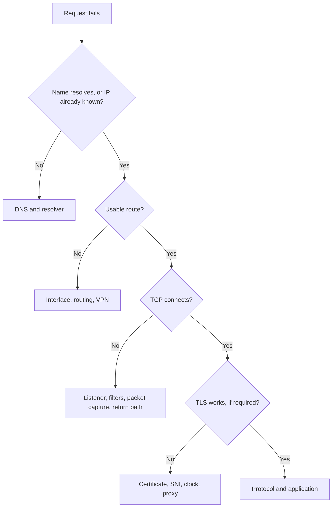
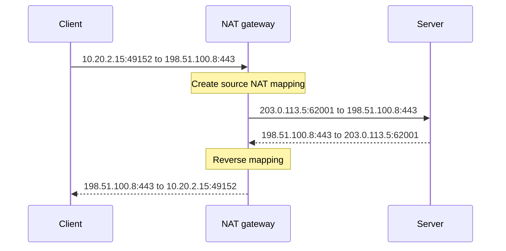
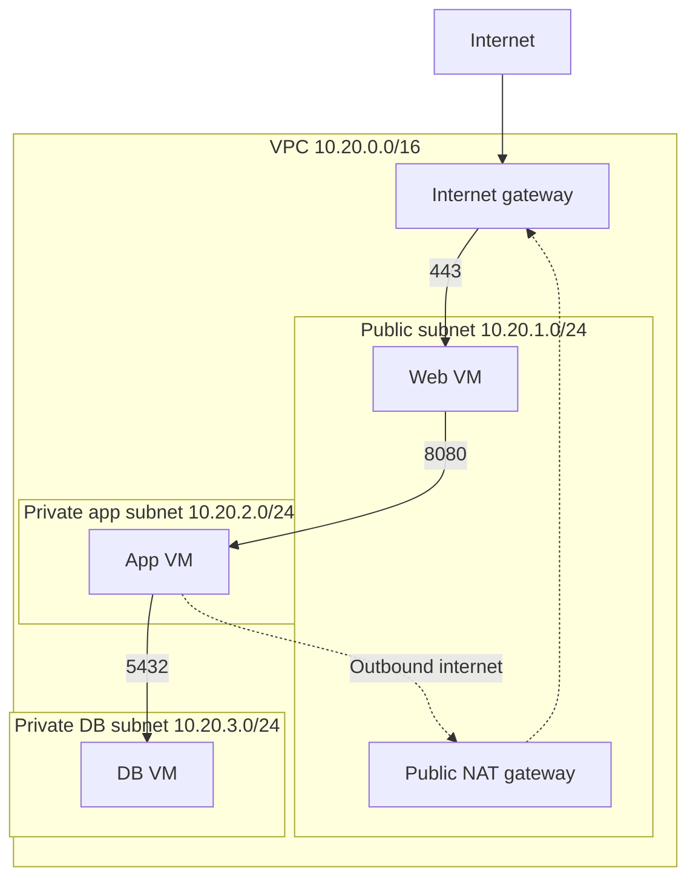

Networking notes for when a connection fails, a route looks wrong, or a service cannot reach another machine. Start from the failing client and find the last thing that worked.

Commands assume Linux unless noted. Replace the example addresses, interfaces, ports and names with your own. `example.com` and the public-looking IPs in `192.0.2.0/24`, `198.51.100.0/24` and `203.0.113.0/24` are documentation examples, not test endpoints. All sample outputs and packet captures are illustrative. Some tools need installation or elevated privileges.

## Start here: quick diagnosis

| Symptom | Start with |
|---|---|
| Interface has no address | `ip -br addr`, `ip link` |
| Not sure which subnet an IP belongs to | CIDR calculation below |
| Wrong interface or gateway | `ip route get IP`, `ip rule` |
| Local host or gateway unreachable | `ip neigh`, `ip -s link` |
| Hostname does not resolve | `getent ahosts HOST`, `dig HOST` |
| Connection refused or timed out | `nc -vz -w 3 IP PORT`, `tcpdump` |
| Works on localhost only | `ss -lntp` on the server |
| TCP works, HTTPS fails | `curl -v`, `openssl s_client` |
| Private VM cannot reach internet | Subnet routes, NAT, egress policy |
| Works on host but not in container | Test inside the container |
| Small requests work, large ones stall | `tracepath`, interface MTU |



This is diagnostic order, not packet order. DNS itself needs a path. HTTP/3 uses QUIC over UDP. Test from the actual application environment.

## Find the subnet and check the interface

```bash
ip -br addr
ip link
ip -s link
```

`UP` means administratively enabled; it does not prove a working link, valid address or usable route. Look for carrier state, address/prefix, RX/TX errors and drops. If the address is wrong, check DHCP or static configuration.

### CIDR without a calculator

| Prefix | IPv4 mask | Total addresses |
|---|---|---:|
| `/16` | `255.255.0.0` | 65,536 |
| `/19` | `255.255.224.0` | 8,192 |
| `/22` | `255.255.252.0` | 1,024 |
| `/24` | `255.255.255.0` | 256 |
| `/26` | `255.255.255.192` | 64 |
| `/28` | `255.255.255.240` | 16 |
| `/31` | `255.255.255.254` | 2 |
| `/32` | `255.255.255.255` | 1 |

Total IPv4 addresses = `2^(32 - prefix)`. For a partial mask octet, block size = `256 - mask octet`. Round the IP's corresponding octet down to a block boundary; set later octets to zero.

```text
192.168.14.123/22
mask:          255.255.252.0
block size:    256 - 252 = 4 (third octet)
network:       192.168.12.0/22
last address:  192.168.15.255

172.16.77.123/19
mask:          255.255.224.0
block size:    256 - 224 = 32 (third octet)
network:       172.16.64.0/19
last address:  172.16.95.255
```

For a normal IPv4 broadcast subnet, the first and last addresses are reserved. `/31` point-to-point links and `/32` host routes are exceptions. Standard AWS and Azure IPv4 subnets typically reserve five addresses; total addresses are not necessarily assignable addresses.

Private IPv4 ranges: `10.0.0.0/8`, `172.16.0.0/12`, `192.168.0.0/16`. `169.254.0.0/16` is link-local; `127.0.0.0/8` is loopback.

**Gotcha:** overlapping private CIDRs cause ambiguous routes when connecting networks through VPNs or peering. Private addresses can be routed privately; public addresses are not necessarily reachable.

## Find where the packet is going

```bash
ip route
ip route get 10.20.2.15
ip rule
ip route show table all
```

Example routing table:

```text
default via 192.168.1.1 dev eth0
10.20.0.0/16 via 192.168.1.2 dev eth0
10.20.2.0/24 via 192.168.1.3 dev eth0
```

`10.20.2.15` matches all three. Within the selected routing table, the longest matching prefix wins (`/24`); metrics may distinguish otherwise competing routes. Policy routing may select a different table.

```text
$ ip route get 10.20.2.15
10.20.2.15 via 192.168.1.3 dev eth0 src 192.168.1.20
```

- `via`: next hop, not necessarily the final destination.
- `dev`: selected outgoing interface.
- `src`: source address the kernel chose for this lookup.

For a multihomed host, check the route with the intended source: `ip route get 10.20.2.15 from 192.168.1.20`. For IPv6, use `ip -6 route get ADDRESS`.

**Gotcha:** a route lookup predicts a forwarding decision, not successful delivery. Run it in the correct namespace, and check the return route from the server too. Asymmetric routing can be valid but may break stateful middleboxes or reverse-path filtering.

### Check the next hop, not just the destination

```bash
ip neigh
ip neigh show dev eth0
ping -c 3 192.168.1.3
sudo tcpdump -eni eth0 arp
```

```text
192.168.1.3 dev eth0 lladdr 02:00:00:00:00:03 REACHABLE
192.168.1.40 dev eth0 FAILED
```

`FAILED` suggests neighbor resolution failed. `STALE` is not itself a failure; the entry may be refreshed when used.

ARP resolves an on-link IPv4 next hop to a MAC address; it does not find the MAC of a remote server across the internet. The IP destination normally stays the same as the packet is routed, while link-layer addresses change at each Ethernet hop. IPv6 uses Neighbor Discovery (`ip -6 neigh`). Cloud networking may implement this virtually.

## Hostname does not resolve, or resolves incorrectly

```bash
getent ahosts api.example.com
dig api.example.com A
dig api.example.com AAAA
resolvectl status
cat /etc/resolv.conf
```

`getent` follows the system name-service configuration; `dig` sends a DNS query. They can disagree due to `/etc/hosts`, search domains, split DNS, caching or resolver configuration. Applications may also use their own resolver or proxy. `resolvectl` applies to systems using systemd-resolved.

Check both the returned address and TTL; resolver and application caches may expire at different times.

| Result | What to check |
|---|---|
| `NXDOMAIN` | Wrong name, private zone, cached negative answer |
| `SERVFAIL` | Resolver/upstream failure, DNSSEC, delegation |
| `NOERROR`, empty answer | Record type may not exist; check A/AAAA/CNAME |
| Query times out | Resolver reachability, UDP/TCP port 53, VPN |
| Wrong IP | Hosts file, cache, split DNS, wrong zone |
| Multiple IPs | Which address did the application actually select? |

Compare a known resolver and test TCP DNS when appropriate:

```bash
dig @10.20.0.2 api.internal.example A
dig @10.20.0.2 api.internal.example A +tcp
dig @1.1.1.1 api.example.com A
```

Use an authorized private resolver for private names; do not send internal names to public resolvers. A public answer for a private endpoint may indicate broken private DNS.

**Tip:** isolate DNS from HTTPS using `curl --resolve` (see TLS section). Connecting by IP alone can break certificate validation and virtual-host routing.

## Connection refused, timed out, or works only locally

From the client:

```bash
nc -vz -w 3 10.20.3.20 5432
ip route get 10.20.3.20
```

From the server:

```bash
sudo ss -lntp
ss -ntp
ip route get 10.20.2.15
```

| Result | Interpretation |
|---|---|
| Connection succeeded | TCP handshake worked; application may still fail |
| Connection refused | Active rejection, often a closed port or reject rule |
| Connection timed out | No usable response; check both directions |
| Network unreachable | No usable path reported; inspect local routes and errors |

Example server listeners:

```text
LISTEN 0 128 127.0.0.1:8080  0.0.0.0:*
LISTEN 0 128   0.0.0.0:5432  0.0.0.0:*
```

Port 8080 listens only on IPv4 loopback. Port 5432 listens on all local IPv4 interfaces, subject to routing and firewall policy. An IPv6 listener (`[::]`) may or may not accept IPv4-mapped connections depending on socket configuration.

```bash
# On the server, compare loopback and its actual address:
curl -v http://127.0.0.1:8080/health
curl -v http://10.20.3.20:8080/health
```

If only loopback works, check binding, address selection and policy before modifying rules. If there is no listener, inspect the service logs. UDP has no TCP-style handshake: use an application-specific request and capture packets rather than relying on `nc -u` success.

### Read the packets

```bash
sudo tcpdump -nn -i any 'host 10.20.3.20 and tcp port 5432'
```

Abbreviated `tcpdump` output for a successful handshake:

```text
10.20.2.15.53144 > 10.20.3.20.5432: Flags [S]
10.20.3.20.5432 > 10.20.2.15.53144: Flags [S.]
10.20.2.15.53144 > 10.20.3.20.5432: Flags [.]
```

Refused connection:

```text
10.20.2.15.53144 > 10.20.3.20.5432: Flags [S]
10.20.3.20.5432 > 10.20.2.15.53144: Flags [R.]
```

Timed-out connection:

```text
10.20.2.15.53144 > 10.20.3.20.5432: Flags [S]
10.20.2.15.53144 > 10.20.3.20.5432: Flags [S]
10.20.2.15.53144 > 10.20.3.20.5432: Flags [S]
```

Capture at both ends when possible:

| Observation | Next investigation |
|---|---|
| Client sends SYN; server sees none | Forward path, route, intermediate/cloud filter, correct capture interface |
| Server sees SYN; sends nothing | Host firewall, listener, kernel or resource issues |
| Server sends SYN-ACK; client sees none | Return route, NAT, stateless filtering |
| Client sees SYN-ACK; no final ACK | Client firewall/stack or wrong capture point |
| Handshake complete | Inspect TLS or application protocol |

An intermediate device can generate an RST. An absent packet in a capture can also mean the filter or capture location is wrong.

For a bounded capture to inspect later:

```bash
sudo tcpdump -ni eth0 -s 128 -c 200 -w incident.pcap \
  'host 10.20.3.20 and tcp port 5432'
```

Packet captures can contain confidential data even with a short snap length. Restrict access, capture only what is needed, and sanitize before sharing.

## TCP works, but HTTPS fails

```bash
curl -v --connect-timeout 5 --max-time 15 https://api.example.com/health
```

Look for the resolved address, `Trying`, `Connected`, TLS negotiation, certificate verification and HTTP response. If a proxy is involved, these may refer to the proxy rather than the final destination.

Test a specific backend address while preserving the hostname, TLS SNI and certificate validation:

```bash
curl -v --noproxy '*' \
  --resolve api.example.com:443:203.0.113.10 \
  https://api.example.com/health
```

Only use direct access where permitted by network policy. This overrides normal DNS for the named host and port. It is useful for separating DNS failures from backend or virtual-host problems.

Inspect TLS independently (OpenSSL versions supporting `-verify_hostname`):

```bash
openssl s_client \
  -connect 203.0.113.10:443 \
  -servername api.example.com \
  -verify_hostname api.example.com \
  -verify_return_error </dev/null
```

| Symptom | Inspect |
|---|---|
| Hostname mismatch | SNI, DNS target, certificate names |
| Unknown CA / incomplete chain | Trust store, intermediate certificate, inspection proxy |
| Expired / not yet valid | Certificate dates, system clock |
| Handshake alert | TLS versions, client certificates, server policy |
| HTTP `401` / `403` | Authentication, authorization, proxy policy |
| HTTP `502` / `504` | Upstream connection, response or timeout |
| HTTP `503` | Unavailable backend or service |

Do not use `curl -k` as a permanent fix. A successful HTTP response may be from a proxy, load balancer or wrong backend.

**Tip: measure the stages.**

```bash
curl -sS -o /dev/null --max-time 15 \
  -w 'dns=%{time_namelookup} tcp=%{time_connect} tls=%{time_appconnect} first=%{time_starttransfer} total=%{time_total}\n' \
  https://api.example.com/health
```

These are cumulative times in seconds. For a fresh direct HTTPS/TCP connection, TCP setup is roughly `tcp - dns`, TLS setup is `tls - tcp`, and time to first byte after TLS is `first - tls`. Proxies, reuse and redirects change the interpretation.

## Check NAT and firewall rules

On a Linux host or router you administer:

```bash
sudo nft list ruleset
sudo iptables -S
sudo iptables -t nat -S
sudo conntrack -L -p tcp --dport 443
```

Use the tools appropriate to the host. `iptables` may be a compatibility frontend for nftables; `conntrack` may require installation and privileges. On hosts using UFW or firewalld, also inspect their managed policy. These commands do not show the rules of a separate cloud NAT gateway or cloud firewall.

| Mechanism | What changes |
|---|---|
| SNAT | Source address, possibly source port |
| DNAT | Destination address, possibly destination port |
| Stateful filtering | Tracks connections; can permit associated replies |
| Stateless filtering | Evaluates each packet independently |



If a connection works in one direction only, check the return route and whether the same stateful gateway can recognize the reply. Check the source address **after** NAT when investigating allowlists. A source port can be preserved or rewritten; do not assume it stays the same.

For intermittent outbound failures under heavy connection load, check NAT port capacity, connection tracking limits and provider metrics. On a Linux gateway doing connection tracking:

```bash
sysctl net.netfilter.nf_conntrack_count net.netfilter.nf_conntrack_max
```

These counters may not exist if the feature is unavailable. Compare the count with the limit and inspect logs for drops; do not increase limits blindly.

**Gotcha:** NAT is not a firewall policy. Port forwarding alone does not ensure a listener, a usable return path or permission to access the service.

## Private VM cannot reach the internet, or another subnet

Start inside the guest. Test DNS, the selected route and an actual service port. If the guest checks look fine, move to the provider's route tables and network security policy.



This is a simplified single-AZ IPv4 example, not a high-availability design. Typical AWS routing:

| Subnet | VPC-local destination | Default IPv4 route |
|---|---|---|
| Public | `local` | Internet gateway |
| Private app | `local` | Public NAT gateway, if internet egress is needed |
| Private database | `local` | None, unless explicitly needed |

No internet? Check the private subnet route, NAT status/public IP, NAT subnet internet gateway route and egress/return policy. Private endpoints or an approved proxy may be alternatives. A public subnet route does not assign a public IP.

For a database reachable from one VM but not another, compare the effective source/destination routes, both sides' security rules, subnet ACLs and the listener. Security groups in AWS are stateful; network ACLs are stateless and must permit the return traffic, including the client ephemeral port. A guest firewall is another layer.

```bash
# AWS examples; substitute real IDs and use the correct region/account.
aws ec2 describe-route-tables --filters 'Name=vpc-id,Values=vpc-REPLACE_ME'
aws ec2 describe-security-groups --group-ids sg-REPLACE_ME
aws ec2 describe-network-acls --filters 'Name=vpc-id,Values=vpc-REPLACE_ME'
```

Use provider flow logs where available to locate accepted or rejected traffic. Flow logs are not full packet captures; coverage and delivery vary. A packet may be rejected before it reaches the guest.

On Azure or Google Cloud, apply the same checks to effective routes, NSGs or VPC firewall rules, NAT and private DNS. Peering is not necessarily transitive.

**Remember:** the guest routing table and the provider routing table are different things.

## Works on the host but not inside a container or VPN

### Containers

```bash
docker inspect app
docker network ls
docker network inspect bridge
docker exec -it app sh
```

Inside the container, if tools are available:

```bash
ip -br addr
ip route
cat /etc/resolv.conf
getent ahosts api.example.com
```

On Kubernetes:

```bash
kubectl get pods -o wide
kubectl get svc
kubectl get endpointslices
kubectl get networkpolicy
kubectl exec -it app -- sh
```

Replace `app` with the real container or pod name and use the correct namespace and context. Minimal images may not include troubleshooting tools; use an approved debug container if needed.

| Symptom | Check |
|---|---|
| Host works, container fails | Container DNS, network namespace, routes, egress |
| Container service works internally only | Bind address, port publishing, host firewall |
| Container tries `127.0.0.1` for a host service | Loopback normally refers to the container itself |
| Kubernetes Service has no usable backend | Selector, EndpointSlices, readiness, target port |
| Pods connect on one node only | CNI, inter-node routes, MTU, NetworkPolicy |

Docker's Linux bridge is one possible network mode; host networking, overlay networks, and Windows HNS behave differently. On a Linux host, inspect `ip link`, `bridge link` and `bridge fdb show` when investigating bridges and veth interfaces. Do not assume host DNS and routes are identical to those inside a container.

### Proxies and VPNs

```bash
env | grep -iE '^(http|https|all|no)_proxy='
ip route get 10.40.0.12
resolvectl status
curl -v https://api.example.com/
```

Check proxy authentication, `NO_PROXY`, proxy-side DNS, VPN routes and split DNS. A connected VPN icon does not prove the expected prefix is routed through the tunnel. Compare against a healthy machine using the same access policy. Proxy environment variables and verbose logs can contain secrets; redact them before sharing.

If policy permits direct connections, compare with `curl --noproxy '*' -v https://api.example.com/`. If proxy access works and direct access does not, this may be intentional. Do not bypass required security controls.

### IPv4 works, IPv6 fails

```bash
curl -4 -v --connect-timeout 5 https://api.example.com/
curl -6 -v --connect-timeout 5 https://api.example.com/
dig api.example.com A
dig api.example.com AAAA
ip -6 addr
ip -6 route
```

IPv4 and IPv6 may use different routes, filters and load balancers.

## Small requests work, large transfers stall

```bash
ip link show
tracepath 10.20.3.20
ping -4 -c 3 -M do -s 1472 10.20.3.20
```

Linux IPv4 example: a 1472-byte ICMP payload plus 20-byte IPv4 and 8-byte ICMP headers makes a 1500-byte IP packet (assuming no IPv4 options). `-M do` prohibits fragmentation. Try smaller payloads when appropriate. ICMP may be filtered, so a failed ping is not conclusive.

Tunnels and overlays add headers, reducing the effective path MTU. Path-MTU discovery may fail if necessary ICMP errors are filtered: TCP connects, then larger packets stall. IPv6 routers do not fragment packets in transit; ICMPv6 Packet Too Big messages are particularly important.

Check tunnel/interface MTUs and packet captures, including fragmentation-needed or Packet Too Big messages. TCP MSS is a payload limit, not the interface MTU. Do not blindly lower every interface MTU or disable ICMP.

## Read ping, traceroute and packet loss carefully

```bash
ping -c 3 10.20.3.20
traceroute -n 10.20.3.20
sudo traceroute -T -p 443 api.example.com
mtr -rw -c 10 api.example.com
```

- Ping measures ICMP Echo replies, not the health of TCP port 443.
- A `* * *` traceroute hop can simply mean that a router does not respond to probes.
- Loss at one intermediate hop, followed by normal replies at later hops, often reflects probe rate limiting rather than forwarded packet loss.
- TCP traceroute to the actual service port can be more relevant than default UDP probes, but the paths need not be identical.

If throughput rather than connectivity is the problem, use `ss -ti` for TCP details such as RTT, retransmissions and congestion window, and `ip -s link` for interface counters. Use `iperf3` only against a cooperating endpoint you control or are authorized to test; a throughput test creates traffic and can affect production.

## Linux, macOS and Windows quick reference

| Question | Linux | macOS | Windows PowerShell |
|---|---|---|---|
| Addresses | `ip -br addr` | `ifconfig` | `Get-NetIPAddress` |
| Routes | `ip route` | `netstat -rn` | `Get-NetRoute` |
| Route to IP | `ip route get IP` | `route -n get IP` | `Find-NetRoute -RemoteIPAddress IP` |
| Neighbors | `ip neigh` | `arp -a`, `ndp -a` | `Get-NetNeighbor` |
| DNS configuration | `resolvectl status` | `scutil --dns` | `Get-DnsClientServerAddress` |
| System name lookup | `getent ahosts HOST` | `dscacheutil -q host -a name HOST` | `[System.Net.Dns]::GetHostAddresses('HOST')` |
| DNS query | `dig HOST` | `dig HOST` | `Resolve-DnsName HOST` |
| TCP port test | `nc -vz -w 3 HOST PORT` | `nc -vz -G 3 HOST PORT` | `Test-NetConnection HOST -Port PORT` |
| Listening TCP ports | `ss -lntp` | `lsof -nP -iTCP -sTCP:LISTEN` | `Get-NetTCPConnection -State Listen` |
| Trace route | `traceroute HOST` | `traceroute HOST` | `tracert.exe HOST` |
| HTTPS trace | `curl -v URL` | `curl -v URL` | `curl.exe -v URL` |

Replace `IP`, `HOST`, `PORT` and `URL` with real values. Command options vary by implementation and OS version. For packet capture, use `tcpdump` on Linux/macOS and Wireshark or `pktmon` on supported Windows versions. Discover actual interface names first (`tcpdump -D`, `networksetup -listallhardwareports`, `Get-NetAdapter`).

---

DNS resolution is not connectivity. A route is not delivery. A listening port is not remote access. TCP is not TLS, and TLS is not application health.

Find the last boundary that worked. Test the next one. Change only what the evidence points to.
