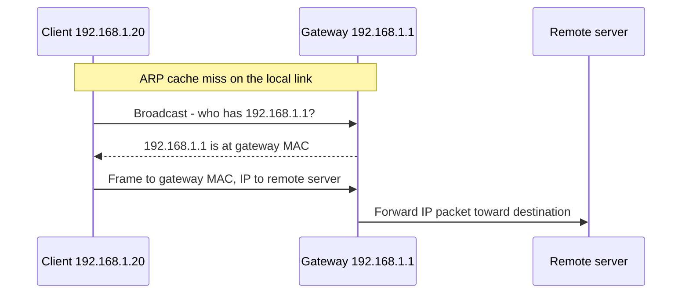
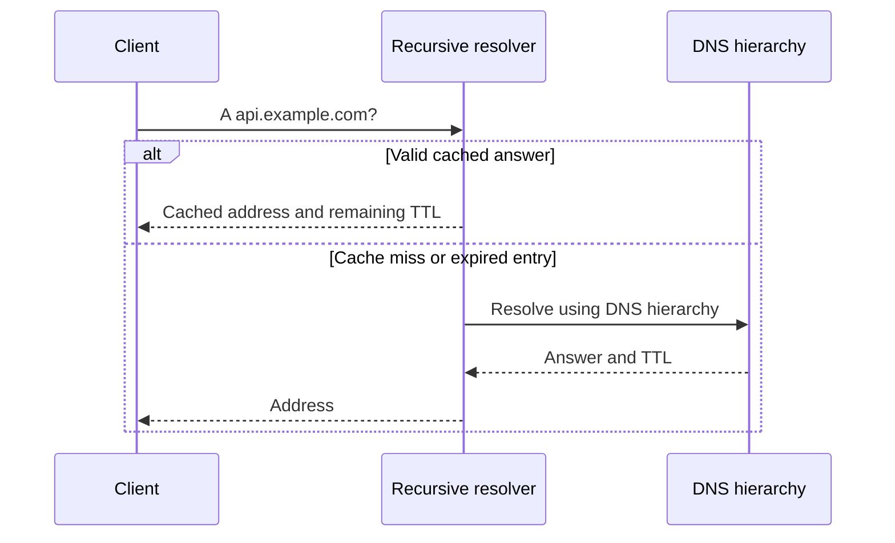
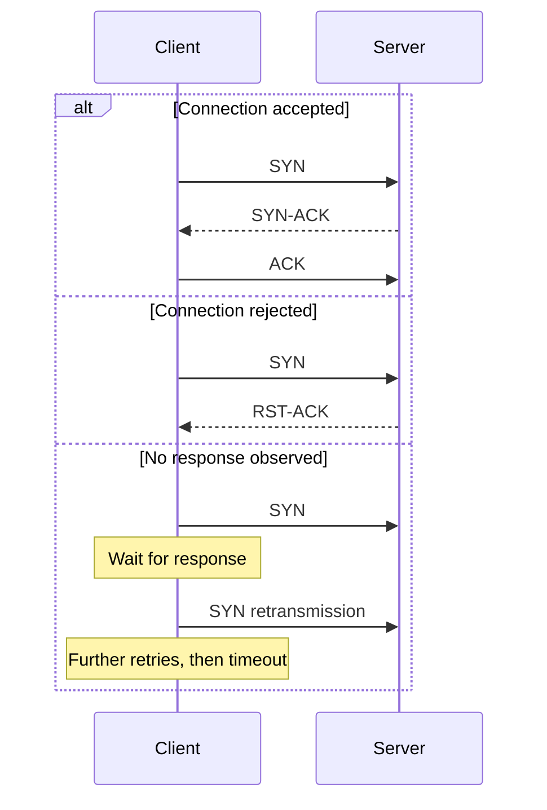
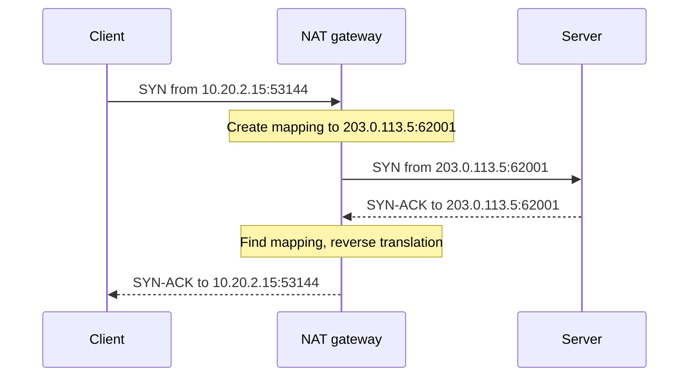
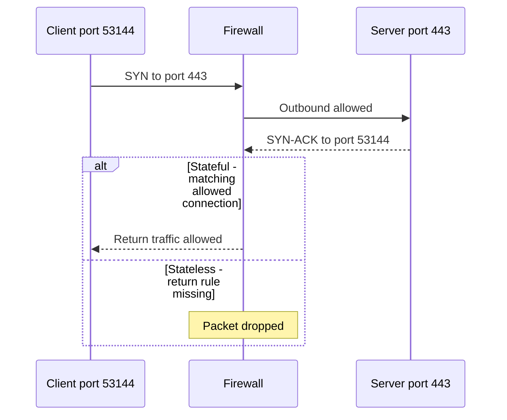
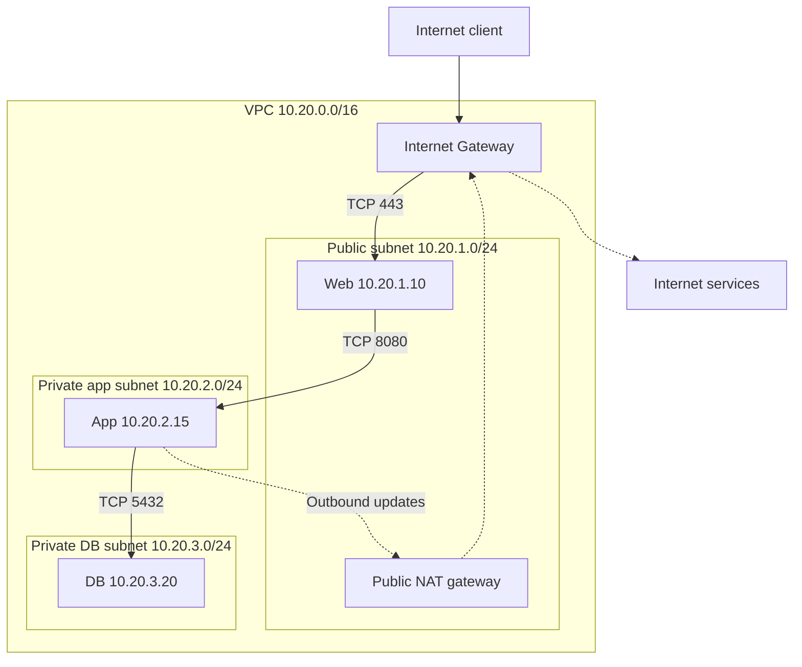
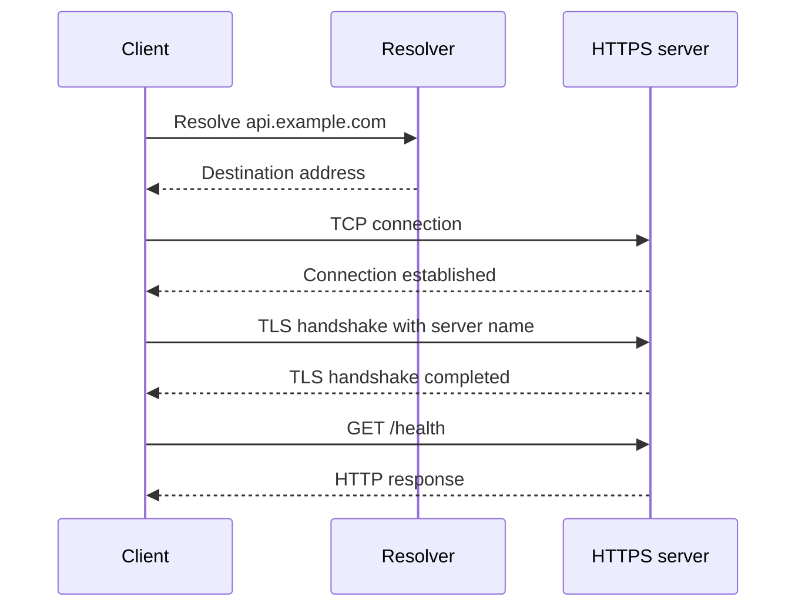
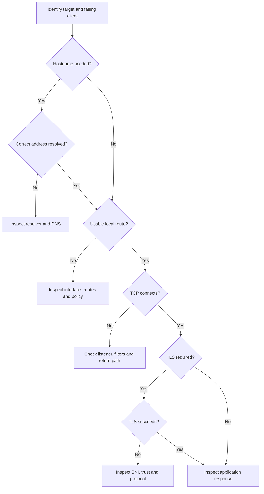

Networking is often taught backward: here are fifty commands, memorize what they do, and hope the next incident looks familiar.

I prefer three questions:

1. **Where is the destination?** The name, address, and port.
2. **How does the packet get there?** The interface, route, next hop, and possibly NAT.
3. **What allows the conversation?** Network policy, a listening socket, the return path, TLS, and the application.

Most of what follows is an attempt to answer those questions. The examples use IPv4 and Linux where convenient, but the reasoning applies to laptops, containers, Windows servers, and cloud VMs.

The addresses, terminal outputs and packet captures are illustrative. Replace them with values from your own environment. `example.com`, `203.0.113.0/24` and `198.51.100.0/24` are reserved for documentation, not test services.

## Start here: the last thing that worked

Suppose an application cannot reach `https://api.example.com/health`. Do not start by changing firewall rules. Start on the machine where the failure occurs.

| Question | Linux command |
|---|---|
| Does the system resolve the name? | `getent ahosts HOST` |
| Which interface and next hop will it use? | `ip route get IP` |
| Can it establish a TCP connection? | `nc -vz -w 3 IP PORT` |
| Does TLS and HTTP work? | `curl -v --connect-timeout 5 https://HOST/` |
| Is the server actually listening? | `sudo ss -lntp` (on the server) |
| What packets are visible? | `sudo tcpdump -ni any 'host IP and tcp port PORT'` |

A successful check narrows the problem. It does not establish that the next check will succeed. If DNS returns multiple addresses, test the one the application actually uses. If the request goes through a proxy or runs in a container, investigate from that context.

## Addresses and subnets

An IP address identifies an interface or logical endpoint at the IP layer. A machine can have several: Ethernet, Wi-Fi, VPN, loopback and virtual interfaces. An address does not tell you whether a service is reachable.

IPv4 has 32 bits; IPv6 has 128. The examples here use IPv4. IPv6 has similar routing principles but different neighbor discovery, address types and fragmentation rules.

### CIDR without memorizing a table

Take `192.168.14.123/22`. The prefix length tells us how many bits belong to the network. The remaining bits identify addresses within that network.

```text
Address:       192.168.14.123
Prefix:        /22
Host bits:     32 - 22 = 10
Address count: 2^10 = 1024
Subnet mask:   255.255.252.0
```

The first two octets account for 16 bits. The third contains six network bits and two host bits. The fourth contains eight host bits. So networks begin every `2^2 = 4` in the third octet.

```text
Third octet:   0–3    4–7    8–11   12–15   16–19  ...
                                      ^
                                     14

floor(14 / 4) * 4 = 12

Network:       192.168.12.0/22
Last address:  192.168.15.255
```

The mask for the changing octet is `256 - 4 = 252`. The same method works for `172.16.77.123/19`: the third-octet block size is `2^5 = 32`, so `floor(77 / 32) * 32 = 64`. The network is `172.16.64.0/19`, and the mask is `255.255.224.0`.

Or, more generally, the network address is the bitwise AND of the IP address and its subnet mask.

| Prefix | Mask | Total IPv4 addresses |
|---|---|---:|
| `/16` | `255.255.0.0` | 65,536 |
| `/22` | `255.255.252.0` | 1,024 |
| `/24` | `255.255.255.0` | 256 |
| `/26` | `255.255.255.192` | 64 |
| `/28` | `255.255.255.240` | 16 |
| `/31` | `255.255.255.254` | 2 |
| `/32` | `255.255.255.255` | 1 |

Total addresses are not necessarily assignable host addresses. In a conventional IPv4 broadcast subnet, the first and last addresses are reserved for network and broadcast. `/31` point-to-point links and `/32` host routes are special cases. Standard AWS and Azure IPv4 subnets typically reserve five addresses, not two.

### Special address ranges

| Range | Meaning |
|---|---|
| `10.0.0.0/8` | RFC 1918 private |
| `172.16.0.0/12` | RFC 1918 private |
| `192.168.0.0/16` | RFC 1918 private |
| `127.0.0.0/8` | IPv4 loopback |
| `169.254.0.0/16` | IPv4 link-local |
| `100.64.0.0/10` | Shared address space, commonly carrier-grade NAT |
| `0.0.0.0/0` | All IPv4 destinations; often a default route |

A public IP may be globally routable, but that does not guarantee a route, an open port or a healthy service. Private addresses can be routed between private networks. Reusing the same private ranges becomes a problem when those networks need to communicate.

Inspect addresses and interfaces on Linux:

```bash
ip -br addr
ip link
ip -s link
```

An interface marked `UP` is administratively enabled. That alone does not establish a working link, an appropriate address or a usable route. DHCP can provide an address, prefix, gateway and DNS configuration; those values can also be configured independently.

## Routing and local delivery

A route tells the kernel where to send traffic for a destination prefix. Look at this simplified routing table:

```text
default via 192.168.1.1 dev eth0
10.20.0.0/16 via 192.168.1.2 dev eth0
10.20.2.0/24 via 192.168.1.3 dev eth0
```

All three routes match `10.20.2.15`. The `/24` is the most specific, so it wins in this table.

```text
Destination: 10.20.2.15

0.0.0.0/0     matches
10.20.0.0/16  matches
10.20.2.0/24  matches  <-- longest prefix
```

Use the kernel to find out what it would actually do:

```bash
ip route
ip route get 10.20.2.15
ip rule
ip route show table all
```

```text
10.20.2.15 via 192.168.1.3 dev eth0 src 192.168.1.20
```

Read that as: send to the next hop `192.168.1.3` through `eth0`, normally using source address `192.168.1.20`. Policy routing can select a different table; metrics and multipath routing can affect the choice among otherwise applicable routes. A route lookup is not a reachability test.

### MAC addresses and ARP

Once the kernel has selected a route, it needs to deliver the packet to the next hop. On an Ethernet-like IPv4 link, ARP resolves that next hop's IP to a MAC address.



The ARP request is a local broadcast; the diagram shows the gateway as the relevant recipient. The gateway does not need to know the MAC of the final server unless that server is on a link directly connected to it.

```text
                        On-link             Off-link
Destination IP          Local server        Remote server
Ethernet destination    Server MAC          Gateway MAC
ARP target              Server IP           Gateway IP
```

That distinction matters. IP addresses guide routing. Link-layer addresses deliver frames on a particular link. Each routed hop normally creates a new link-layer frame. The IP destination generally stays the same unless a device performs address translation or a similar transformation.

```bash
ip neigh
sudo tcpdump -eni eth0 arp
```

A neighbor entry marked `INCOMPLETE` or `FAILED` suggests unresolved local delivery. A cached `STALE` entry is not necessarily a problem; it may still be usable. IPv6 uses Neighbor Discovery instead of ARP.

Cloud networking virtualizes much of this behavior. A guest's neighbor table is not a map of the provider's physical switches.

### The return path

Getting a packet to the destination is only half the job. The destination must also have a way to send a reply.

```text
Client  ----------->  Router A  ----------->  Server
Client  <-----------  Router B  <-----------  Server
```

Asymmetric routing is not inherently wrong. It becomes a problem when stateful firewalls, NAT devices or reverse-path filtering require traffic to follow particular paths or interfaces.

Check routes on both ends. If the server receives SYN packets but the client never receives the SYN-ACK, capture at both endpoints before deciding which device is at fault.

## DNS: finding the address

DNS resolves names to records. `A` records contain IPv4 addresses; `AAAA` records contain IPv6 addresses. A `CNAME` aliases another name. The resolver can return multiple addresses, and the application may select one you did not expect.



The DNS hierarchy is collapsed here. A recursive resolver may use root, TLD and authoritative servers, cached delegations, or an upstream forwarder. The operating system and application can also cache answers or use other name-resolution mechanisms.

```bash
getent ahosts api.example.com
dig api.example.com A
dig api.example.com AAAA
resolvectl status
```

`getent` follows the system's configured name-service rules. `dig` queries DNS. They can disagree because of `/etc/hosts`, search domains, caches, VPN split DNS or resolver selection. `resolvectl` is useful on systems using systemd-resolved.

| Result | What it means |
|---|---|
| `NXDOMAIN` | The name does not exist in this resolver's view |
| `NOERROR` with no requested record | The name may exist but lack that record type |
| `SERVFAIL` | The resolver could not complete the lookup |
| An answer with a TTL | A record was returned; connectivity remains untested |

TTL controls how long a DNS answer can normally be cached. Changing a record does not immediately invalidate every previous answer. Negative answers can be cached too.

To compare resolvers:

```bash
dig @10.20.0.2 api.internal.example
dig @1.1.1.1 api.example.com
```

Use only authorized resolvers for private names. A public resolver cannot normally answer a private zone, and sending internal names to one may disclose information.

## Ports, sockets and TCP

The destination IP gets traffic toward an endpoint. The transport protocol and port identify where to deliver it there. For example:

```text
TCP 10.20.2.15:53144 -> 10.20.3.20:5432
```

`53144` is the client-side ephemeral port. `5432` is the server-side PostgreSQL port. Together with the protocol and addresses, these ports distinguish this flow from other connections.

TCP provides an ordered, reliable byte stream. UDP sends independent datagrams without a TCP-style handshake; applications can implement their own reliability. QUIC is an example, and HTTP/3 uses QUIC over UDP rather than TCP.

### Read the handshake



Test the port directly, then look at packets if necessary:

```bash
nc -vz -w 3 10.20.3.20 5432
sudo tcpdump -ni any 'host 10.20.3.20 and tcp port 5432'
```

A successful handshake might look like this (abbreviated `tcpdump` output):

```text
10.20.2.15.53144 > 10.20.3.20.5432: Flags [S]
10.20.3.20.5432 > 10.20.2.15.53144: Flags [S.]
10.20.2.15.53144 > 10.20.3.20.5432: Flags [.]
```

`[S]` is SYN, `[S.]` is SYN-ACK, `[.]` is ACK. At this point, TCP is established. We have not tested database authentication or whether a query will succeed.

An active rejection might look like:

```text
10.20.2.15.53144 > 10.20.3.20.5432: Flags [S]
10.20.3.20.5432 > 10.20.2.15.53144: Flags [R.]
```

A reset can come from a host without a listener or a device actively rejecting the connection. Check the port, listener and reject rules.

Now compare a timeout:

```text
10.20.2.15.53144 > 10.20.3.20.5432: Flags [S]
10.20.2.15.53144 > 10.20.3.20.5432: Flags [S]
10.20.2.15.53144 > 10.20.3.20.5432: Flags [S]
```

Here we know the client capture saw outbound SYN packets, but no response. We do not know if the server received them. A timeout is not proof of a firewall problem; a failed route, unavailable host or broken return path may look identical.

### Is the service listening?

On the destination machine:

```bash
sudo ss -lntp
sudo ss -ntp
```

```text
State  Recv-Q Send-Q Local Address:Port Peer Address:Port
LISTEN 0      128    127.0.0.1:8080    0.0.0.0:*
```

This service is bound to IPv4 loopback. Opening port 8080 in a cloud security group will not make it reachable on the machine's private address.

| Bind address | Meaning |
|---|---|
| `127.0.0.1:8080` | Local IPv4 loopback only |
| `10.20.2.15:8080` | A specific local IPv4 address |
| `0.0.0.0:8080` | All local IPv4 addresses |
| `[::]:8080` | IPv6 wildcard; IPv4 behavior depends on socket/OS settings |

A listening socket is not proof that remote access is allowed. And a successful TCP handshake is not proof that the application works.

For UDP, use a protocol-specific request (for example `dig` for DNS) or capture traffic. `nc -u` cannot verify a TCP-like handshake because there isn't one.

## NAT: what changes along the way

Network Address Translation rewrites addresses and sometimes ports. Source NAT (SNAT) changes the source; destination NAT (DNAT) changes the destination. Port forwarding is a common use of DNAT.

Consider a private client connecting to a public HTTPS server through an outbound NAT gateway. The gateway rewrites the source address and may select a different source port.



The server is `198.51.100.8:443` in this example. Look at the same flow from each side of the translator:

| Observation point | Source | Destination |
|---|---|---|
| Outbound, before NAT | `10.20.2.15:53144` | `198.51.100.8:443` |
| Outbound, after NAT | `203.0.113.5:62001` | `198.51.100.8:443` |
| Reply, before reverse NAT | `198.51.100.8:443` | `203.0.113.5:62001` |
| Reply, after reverse NAT | `198.51.100.8:443` | `10.20.2.15:53144` |

For this stateful translation, the gateway tracks the flow and uses the mapping when replies arrive. Many clients can share one public address because translations distinguish their flows. Mappings have finite capacity and lifetimes; exhausting ports or connection-tracking resources can cause new connections to fail.

On a Linux gateway that actually performs NAT, these may help:

```bash
sudo nft list ruleset
sudo conntrack -L -p tcp
```

`conntrack` is an optional tool and requires privileges. Running it inside a cloud VM does not reveal the provider's managed NAT state.

NAT is not a firewall. Outbound managed NAT generally permits initiated flows and their replies rather than arbitrary new inbound connections. Inbound policy, forwarding rules and routing are separate concerns.

## Firewalls: allowing the conversation

A route answers where traffic should go. A firewall answers whether it is allowed to pass. These are independent decisions.

A stateful firewall tracks connections and can allow associated return traffic automatically. A stateless filter evaluates packets independently, so rules must account for both directions.



This is a simplified policy example. A stateless filter with an appropriate return rule can allow the SYN-ACK too. A stateful firewall still needs a policy that permits the initial flow, and its connection tracking must be able to associate the reply with that flow.

On Linux, check the firewall tool that actually manages the system:

```bash
sudo nft list ruleset
sudo iptables -L -n -v
sudo ufw status verbose
sudo firewall-cmd --list-all
```

These are alternatives, not four independent firewalls that every Linux host runs. Some distributions use iptables compatibility tooling backed by nftables. Also check where rules apply: input, output and forwarded traffic are not the same.

A packet may encounter several filtering layers before it reaches a listening socket: cloud policy, virtual networking, a host firewall and sometimes a container-level rule. Opening one does not open the others.

## Cloud networking without the marketing names

Cloud providers manage the underlying network infrastructure. The useful concepts remain the same: addresses, subnets, routes, filters, and service endpoints.

| Concept | AWS | Azure | Google Cloud |
|---|---|---|---|
| Virtual network | VPC | VNet | VPC network |
| Subnet | Subnet (one AZ) | Regional subnet | Regional subnet |
| VM | EC2 | VM | Compute Engine |
| Traffic policy | Security group | NSG | VPC firewall rules |
| Routing | Route tables | System routes / UDRs | VPC routes |
| Managed outbound NAT | NAT Gateway | NAT Gateway | Cloud NAT |
| Private service access | VPC endpoint / PrivateLink | Private Endpoint | Private Service Connect |

An AWS VPC and Azure VNet are regional; a Google Cloud VPC network is global with regional subnets. These are analogous concepts, not identical implementations.

### A three-tier network

Suppose we have a web service, an application server and a database. Only the web service needs to receive traffic from the internet.



The arrows show connection initiation or logical outbound paths, not every reply or forwarding hop. This is a single-AZ teaching example. The web VM needs a public IPv4 mapping for the depicted direct internet access, and the public NAT gateway needs an associated public address. In production, an internet-facing load balancer and multiple availability zones would usually be preferable to a lone public web VM.

In AWS, the subnet's route table determines whether there is an Internet Gateway route. A public subnet has that route. A private subnet may instead use NAT for outbound IPv4 traffic.

| Subnet | VPC traffic | Other IPv4 destinations |
|---|---|---|
| Public | `10.20.0.0/16 -> local` | `0.0.0.0/0 -> Internet Gateway` |
| Private app | `10.20.0.0/16 -> local` | `0.0.0.0/0 -> NAT Gateway` (if needed) |
| Private DB | `10.20.0.0/16 -> local` | No default route in this example |

The route does not assign a public IP, and a public IP does not open a security group. The guest OS usually has a simpler routing table pointing to its virtual gateway. `ip route` does not display the cloud provider's route table.

### Which traffic should be allowed?

A minimal inbound policy for the example:

| Destination | Protocol / port | Source |
|---|---|---|
| Web VM | TCP 443 | Internet, if publicly intended |
| App VM | TCP 8080 | Web VM's security group |
| DB VM | TCP 5432 | App VM's security group |

The corresponding outbound policies must allow the initiated connections. AWS security groups are stateful, while AWS network ACLs are stateless subnet-level filters. With restrictive NACLs, check both directions, including the return traffic to ephemeral ports. Azure NSGs are stateful as well, though their configuration and semantics differ.

Inspect the provider's route tables, security policy and actual resource associations. For example, in AWS:

```bash
aws ec2 describe-route-tables --filters 'Name=vpc-id,Values=vpc-REPLACE_ME'
aws ec2 describe-security-groups --group-ids sg-REPLACE_ME
aws ec2 describe-network-acls --filters 'Name=vpc-id,Values=vpc-REPLACE_ME'
```

Use the appropriate AWS region, account, permissions and actual identifiers. A packet dropped by the provider's network policy may never appear in a capture inside the destination VM. Provider flow logs and reachability-analysis tools can be useful, but have their own scope and limitations.

### Other useful cloud terms

- **Load balancer:** accepts traffic at a front-end address and distributes it to backends. Layer 4 primarily deals with connections and ports; Layer 7 can make application-level decisions, such as HTTP routing.
- **Peering:** connects networks through provider-managed routing. Address overlap is often a blocker; peering is not automatically transitive.
- **VPN:** carries traffic through an encrypted tunnel across another network.
- **Transit hub:** centralizes connectivity between multiple networks, such as AWS Transit Gateway or Azure Virtual WAN.
- **Private endpoint:** offers a private network path to a service. Check the DNS answer to see whether the client actually uses that path.
- **Availability Zone:** a fault-isolation boundary that influences subnet placement, routing and resilience.

Whenever a new cloud networking term appears, ask which network owns the destination, how traffic reaches it, and which policy applies.

## TLS and HTTP: after the handshake

An HTTPS request involves more than getting a TCP connection. For an ordinary direct HTTPS connection using TCP, the dependencies look like this:



This collapses the individual TCP and TLS messages. DNS may be cached, connections may be reused, and HTTP/3 follows a different transport path. A proxy can also change which host the client connects to directly.

Use `curl` to see the failure as the application experiences it:

```bash
curl -v --connect-timeout 5 https://api.example.com/health
```

If the TCP connection succeeds but TLS fails, inspect the server name, certificate chain, certificate hostname, dates, system clock, protocol compatibility and possible inspection proxies.

```bash
openssl s_client \
  -connect api.example.com:443 \
  -servername api.example.com \
  -verify_hostname api.example.com \
  -verify_return_error </dev/null
```

`-servername` supplies SNI. `-verify_hostname` checks that the certificate matches the expected name. Those are different operations. The options above assume a modern OpenSSL installation and the appropriate trusted CA store.

A particularly useful test is to bypass normal DNS resolution while preserving the HTTP hostname, TLS SNI and certificate hostname verification:

```bash
curl -v --noproxy '*' \
  --resolve api.example.com:443:10.20.1.10 \
  https://api.example.com/health
```

This tests a specific backend address for the original HTTPS name. Use it only where direct access is permitted. Connecting to `https://10.20.1.10/` instead is not equivalent: hostname-based routing and certificate checks may behave differently.

Once you receive an HTTP response, there is no point treating every failure as a network timeout.

| HTTP status | First place to investigate |
|---|---|
| `401` / `403` | Authentication, authorization, access policy |
| `404` | URL path, hostname routing, resource |
| `429` | Rate limit or overload policy |
| `500` | Application logs |
| `502` | Proxy or gateway received an invalid upstream response |
| `503` | Service unavailable, possibly unhealthy backends |
| `504` | Gateway timeout waiting for an upstream response |

An HTTP response may be generated by a proxy or load balancer rather than the intended backend. A `200` from one health endpoint does not establish that every application operation works either.

For timing, `curl` can report cumulative phases:

```bash
curl -sS -o /dev/null \
  -w 'dns=%{time_namelookup} tcp=%{time_connect} tls=%{time_appconnect} first_byte=%{time_starttransfer} total=%{time_total}\n' \
  https://api.example.com/health
```

For a fresh direct HTTPS/TCP connection, subtract adjacent values to estimate time spent in each phase. Proxies, redirects, DNS caching and reused connections change how to interpret these measurements.

## The network you are actually using

The host you logged into may not be the context from which the failing application sends traffic. Containers, VPNs and proxies are common reasons two programs on the same machine see different results.

### Containers and virtual networks

A Linux container with its own network namespace can have separate interfaces, addresses, routes, sockets and neighbor tables. A common bridge-network setup looks roughly like this:

```text
Container A (eth0) --- veth ---+
                               | Linux bridge --- host routing --- uplink
Container B (eth0) --- veth ---+
```

The diagram describes a typical Linux bridge setup, not every container network mode. Host networking, overlays, CNI plugins and Windows container networks differ. Windows HNS, for example, manages virtual networks and endpoints rather than using the Linux veth mechanism.

Inspect the container's view, not just the host's:

```bash
docker inspect CONTAINER
docker network inspect NETWORK
docker exec CONTAINER ip route
docker exec CONTAINER cat /etc/resolv.conf
```

The commands inside the container require those utilities and Linux-style paths. Minimal images may not include them. For a Kubernetes workload:

```bash
kubectl get pod -o wide
kubectl get svc
kubectl get networkpolicy
kubectl exec POD -- ip route
```

Kubernetes DNS, Services, NetworkPolicies, ingress and container networking are different parts of the path. A healthy host route does not prove that the pod can connect. Also distinguish the container's listening port from the host's published port.

### VPNs and proxies

A VPN can change the route and resolver used for selected destination prefixes without changing the public internet path. This is split tunneling. When troubleshooting, ask whether the route and resolver for the specific target are correct, not merely whether the VPN icon says connected.

```bash
ip route get 10.40.0.12
resolvectl status
```

A proxy may resolve the destination name on behalf of the client. `curl -v` can reveal proxy use and a CONNECT tunnel for HTTPS.

```bash
env | grep -iE '^(http|https|all|no)_proxy='
curl -v https://api.example.com/
curl -v --noproxy '*' https://api.example.com/
```

Only compare with direct access if policy permits it. If proxied traffic works but direct access fails, that may be intentional. Check the proxy address, authentication, proxy-side DNS and `NO_PROXY` exclusions. Avoid sharing output containing credentials or sensitive headers.

## Packet size and the path

`ping`, `traceroute` and `mtr` are useful tools, but they do not directly answer whether a particular service works.

```bash
ping -c 3 10.20.3.20
tracepath 10.20.3.20
traceroute -n 10.20.3.20
sudo traceroute -T -p 443 api.example.com
mtr -rw api.example.com
```

A failed ping may simply mean ICMP Echo is blocked. A `* * *` hop may be a router that forwards packets but does not answer the probe. Apparent loss at an intermediate `mtr` hop does not necessarily mean forwarded traffic is being lost if later hops respond normally. A TCP traceroute is closer to a TCP service test, but it still does not establish application health.

The MTU is the largest IP packet a link can carry without IP fragmentation. A tunnel adds headers, reducing the space available for the original packet. The path MTU is limited by the smallest effective MTU along the path.

```text
Original IP packet: 1500 bytes
Tunnel overhead:      60 bytes  (illustrative)
Outer IP packet:    1560 bytes
Underlying MTU:     1500 bytes

Effective inner MTU: 1440 bytes in this example
```

The exact overhead depends on the encapsulation. With IPv4, an oversized packet may be fragmented or dropped depending on the Don't Fragment flag and path behavior. IPv6 routers do not fragment forwarded packets. Path MTU Discovery relies on feedback such as ICMP Fragmentation Needed (IPv4) or Packet Too Big (IPv6), or transport-specific probing.

If TCP connects but larger transfers hang, consider a path-MTU black hole. Check interface MTUs and the relevant ICMP feedback before changing settings:

```bash
ip link show
tracepath api.example.com
ping -4 -M do -s 1472 10.20.3.20
```

The last command is a Linux iputils example: 1472 bytes of payload plus ordinary 20-byte IPv4 and 8-byte ICMP headers makes a 1500-byte IP packet. Failure is not proof of an MTU issue if Echo traffic is filtered. TCP MSS and IP MTU are related but are not the same measurement.

## Putting it together: investigate, don't guess

This is the order I would normally follow for a direct HTTPS/TCP request. It is a diagnostic order, not the literal sequence of network operations. DNS itself needs connectivity, and IP-based connections may not need DNS at all.



### The app VM cannot reach the database

On the app VM from the cloud example:

```bash
ip route get 10.20.3.20
nc -vz -w 3 10.20.3.20 5432
sudo tcpdump -ni any 'host 10.20.3.20 and tcp port 5432'
```

On the database VM:

```bash
sudo ss -lntp
ip route get 10.20.2.15
sudo tcpdump -ni any 'host 10.20.2.15 and tcp port 5432'
```

Compare captures from the same test. Assuming the correct interfaces and filters are selected:

| Client capture | Server capture | Next investigation |
|---|---|---|
| SYN sent | No SYN observed | Forward path, cloud rules, intermediate devices |
| SYN sent | SYN received, no reply observed | Server listener, host policy, local routing |
| SYN sent, no reply | SYN-ACK sent | Return path, filtering, asymmetric routing |
| RST received | RST sent | Listener, port or active rejection |
| Handshake completed | Handshake completed | Database protocol, TLS, credentials and service logs |

In a NAT or proxy path, the tuples at the two capture points may differ. Account for that when choosing capture filters. Absence of a packet in a capture is evidence only about that observation point and filter, not proof of where it was dropped.

### Other common incidents

| Symptom | Useful next step |
|---|---|
| Service works on localhost, not remotely | Check bind address and compare local/private-IP requests; inspect filters |
| Private VM reaches internal services but not internet | Check DNS, proxy, NAT and provider subnet routes; consider private endpoints |
| Name resolves to an unexpected public address | Check private DNS, split DNS and endpoint configuration |
| IPv4 works but IPv6 fails | Compare `curl -4` and `curl -6`, DNS answers, routes and policy |
| TCP works but HTTPS fails | Check TLS with the actual hostname; use `curl --resolve` if appropriate |
| Small requests work but large requests stall | Check MTU, tunnels, ICMP feedback and retransmissions |

When you need to save a capture for later analysis:

```bash
sudo tcpdump -ni eth0 -w network-incident.pcap \
  'host 10.20.3.20 and tcp port 5432'
```

Stop the capture when the test ends. Choose the actual interface. Captures may contain sensitive addresses, names, tokens or unencrypted payloads. Collect only what is needed, and store and share them carefully.

## Linux, macOS and Windows command reference

The questions remain the same across operating systems. On Windows, the commands below use PowerShell and built-in Windows networking cmdlets where available. Run packet capture and firewall inspection with the required privileges.

| Question | Linux | macOS | Windows / PowerShell |
|---|---|---|---|
| Addresses | `ip -br addr` | `ifconfig` | `Get-NetIPAddress` |
| Interface details | `ip link` | `ifconfig` | `Get-NetAdapter` |
| Route table | `ip route` | `netstat -rn` | `Get-NetRoute` |
| Selected route | `ip route get IP` | `route -n get IP` | `Find-NetRoute -RemoteIPAddress IP` |
| Neighbor cache | `ip neigh` | `arp -a` / `ndp -a` | `Get-NetNeighbor` |
| System name lookup | `getent ahosts HOST` | `dscacheutil -q host -a name HOST` | `[System.Net.Dns]::GetHostAddresses('HOST')` |
| DNS query | `dig HOST A` | `dig HOST A` | `Resolve-DnsName HOST -Type A` |
| DNS configuration | `resolvectl status` | `scutil --dns` | `Get-DnsClientServerAddress` |
| TCP port test | `nc -vz -w 3 HOST PORT` | `nc -vz -G 3 HOST PORT` | `Test-NetConnection HOST -Port PORT` |
| Listening sockets | `sudo ss -lntp` | `sudo lsof -nP -iTCP -sTCP:LISTEN` | `Get-NetTCPConnection -State Listen` |
| TCP connections | `ss -ntp` | `netstat -an -p tcp` | `Get-NetTCPConnection` |
| ICMP Echo | `ping -c 3 HOST` | `ping -c 3 HOST` | `ping.exe -n 3 HOST` |
| Trace route | `traceroute -n HOST` | `traceroute -n HOST` | `tracert.exe -d HOST` |
| Packet capture | `sudo tcpdump -ni any` | `sudo tcpdump -ni en0` | `pktmon.exe` |
| Firewall inspection | `sudo nft list ruleset` | `sudo pfctl -sr` | `Get-NetFirewallRule -PolicyStore ActiveStore` |
| HTTPS trace | `curl -v https://HOST/` | `curl -v https://HOST/` | `curl.exe -v https://HOST/` |

On macOS, `networksetup -listallhardwareports` helps identify the correct interface rather than assuming Wi-Fi is `en0`. On Windows, `Get-NetFirewallRule` lists rules; inspect their associated port and address filters when needed. `pktmon.exe help` shows the capture workflow supported by the installed version. Use `curl.exe` on Windows to avoid the `curl` alias in older Windows PowerShell.

Some tools need additional packages, elevated privileges or a specific OS version. The command outputs and flags may differ between implementations. `HOST`, `IP`, `PORT`, `CONTAINER`, `NETWORK` and `POD` are placeholders.

---

```text
Name resolves       !=  destination is reachable
Route exists        !=  packet arrives
Packet arrives      !=  service is listening
TCP connects        !=  TLS works
TLS works           !=  application is healthy
```

The useful question is rarely whether the network is broken. It is which boundary was the last one that worked, and what evidence we have for the next one.
