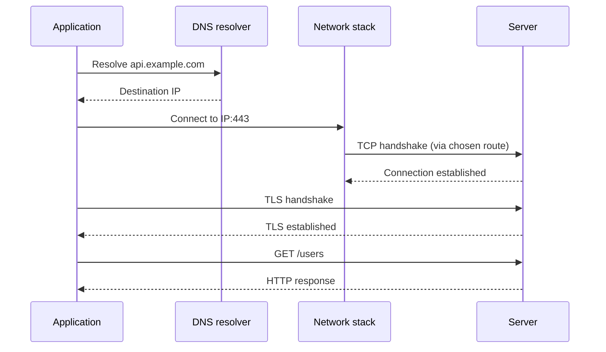
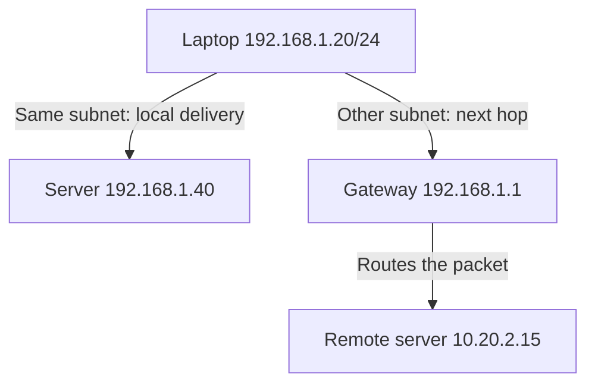
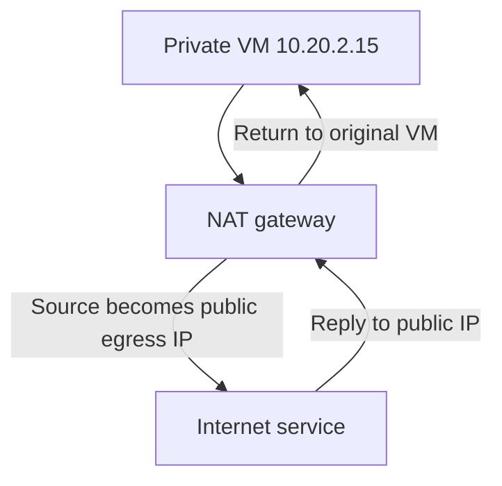
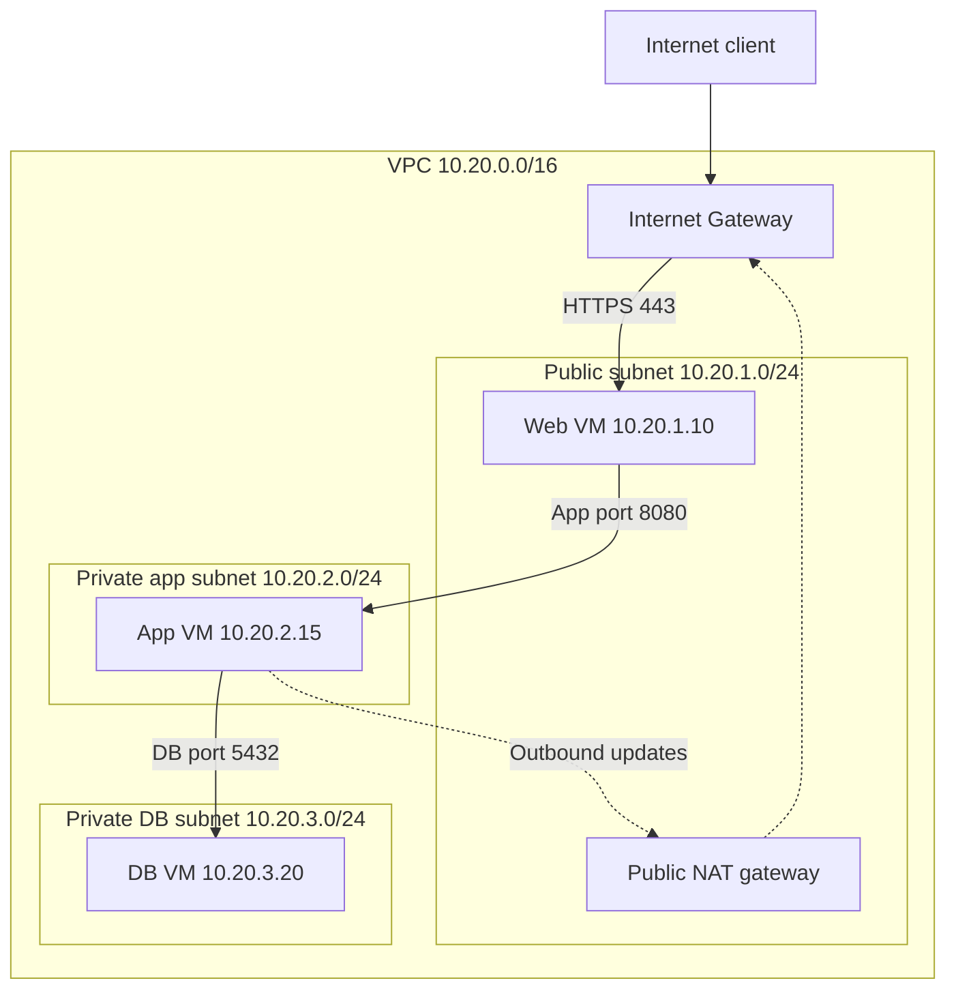
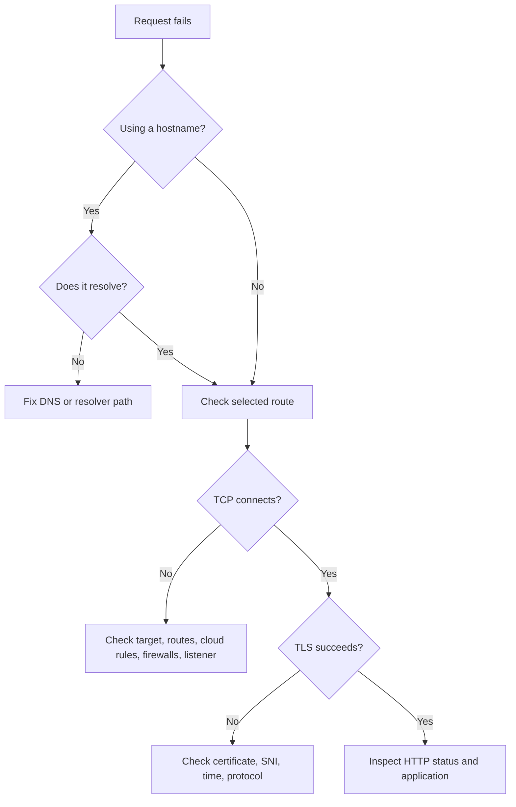

Networking is often taught backward: here are fifty commands, memorize what they do, and hope the next incident looks familiar.

I prefer three questions:

1. **Where is the destination?** IP address, subnet, and DNS.
2. **How does the packet get there?** The local interface, next hop, route table, and maybe NAT.
3. **What allows the conversation?** Firewall rules, a listening port, TLS, and the application.

This is a field guide for answering those questions on a laptop, a Linux server, or a cloud VM. We will build a mental model first, translate it into cloud terminology, and finish with the actual commands. There is no need to memorize every networking protocol.

## Start here: quick diagnosis

When something cannot connect, begin with the failure **as seen from the failing client**. Run one test at a time. A successful check tells you where to investigate next, not that the entire network is healthy.

| Symptom | First useful check | Next question |
|---|---|---|
| Hostname does not resolve | `getent ahosts HOST` | Wrong resolver, VPN, search domain, or DNS record? |
| No usable path to IP | `ip route get IP` | Correct subnet, gateway, and route table? |
| TCP connection times out | `nc -vz -w 3 HOST PORT` | Route, filter, listener, or return path? |
| Connection is refused | `ss -lntp` on server | Is the service listening on the expected IP and port? |
| TCP works, HTTPS fails | `curl -v https://HOST/` | TLS version, SNI, certificate, or proxy? |
| Localhost works, remote client fails | `ss -lntp` on server | Bound to `127.0.0.1` or blocked by security rules? |
| Cloud VM has no outbound internet | `ip route`; `getent ahosts HOST` | NAT gateway, proxy, DNS, or egress policy? |
| One computer works, another fails | Compare DNS, route, and proxy settings | What is different between the two clients? |

`HOST`, `IP`, and `PORT` above are placeholders. If you only remember one rule: **find the last boundary that worked, then test the next one**.

---

## The packet's journey

Suppose a browser opens `https://api.example.com/users`. The application may need to resolve the hostname first. Once it has an address, the operating system chooses a route, establishes a transport connection, negotiates TLS, and sends HTTP traffic. DNS is a *dependency*, not necessarily the first network hop: resolving a name itself sends packets, and connecting to a literal IP may skip DNS.



The diagram deliberately hides the routers, firewalls, and load balancers along the path. Those are the places where things often fail.

## IP addresses and subnets

An **IP address** identifies a network interface at the IP layer. A VM can have more than one IP address. A laptop's Wi-Fi and VPN can have different addresses. The address alone doesn't tell you whether the host is reachable or what service it runs.

IPv4 addresses such as `192.168.1.20` have 32 bits; IPv6 addresses such as `2001:db8::20` have 128. The examples below use IPv4 because it is still what many cloud troubleshooting tickets start with. IPv6 follows similar routing ideas but has different address and neighbor-discovery rules.

### CIDR: the slash is part of the address

Consider `192.168.1.20/24`:

- `192.168.1.20` is an address on the interface.
- `/24` says the first 24 bits identify the network, leaving 8 bits for addresses within it.
- The network is `192.168.1.0/24`, with 256 addresses (`192.168.1.0` through `192.168.1.255`).
- The equivalent subnet mask is `255.255.255.0`.

In a conventional IPv4 LAN, `.0` identifies that network and `.255` is its broadcast address; `.1` through `.254` are typical host addresses. **A cloud subnet is different**: providers reserve additional addresses. AWS and Azure typically reserve five IPv4 addresses per subnet. Don't confuse *total addresses* with *assignable VM addresses*.

| Prefix | Addresses | Example network | Useful intuition |
|---|---:|---|---|
| `/16` | 65,536 | `10.20.0.0/16` | Large private network |
| `/24` | 256 | `10.20.2.0/24` | Common small subnet |
| `/26` | 64 | `10.20.2.0/26` | Smaller subnet |
| `/28` | 16 | `10.20.2.0/28` | Very small subnet |
| `/32` | 1 | `10.20.2.15/32` | Exactly one IPv4 address |
| `/0` | All IPv4 | `0.0.0.0/0` | Default-route destination |

The calculation is `2^(32 - prefix)`. A `/26`, for example, splits the first `/24` into four blocks: `.0–.63`, `.64–.127`, `.128–.191`, and `.192–.255`. `192.168.1.20` and `192.168.1.70` are in the same `/24`, but **not** in the same `/26`.

CIDR is also how we describe routes, firewall source ranges, VPN networks, and VPC address spaces. A poorly planned CIDR range becomes painful when you later connect two networks that overlap.

### What makes a subnet useful?

In a normal Ethernet LAN, interfaces on the same IP subnet can send packets to each other through the local link. For an IPv4 destination outside that subnet, the host normally hands the packet to a **default gateway** (usually a router). The destination IP stays the final destination; the Ethernet frame goes to the gateway's MAC address.



The gateway is not always `192.168.1.1`: that is just a familiar home-network convention. Check the real default route with `ip route`. And do not think of a cloud subnet as literally one shared Ethernet cable: the provider implements routing and neighbor resolution through virtual networking.

### MAC, ARP, and the next hop

A MAC address matters for **local-link delivery**; an IP address matters for **routing toward the destination**. ARP finds the local-link MAC for an IPv4 next hop. It does not discover the MAC of a server across the internet. IPv6 uses Neighbor Discovery rather than ARP.

For an off-subnet IPv4 connection:

```text
Destination IP:    203.0.113.42
Selected next hop: 192.168.1.1
Next-hop MAC:      the gateway's MAC, not the remote server's
```

Try `ip neigh` to see known local neighbors. Cloud VM neighbor tables may expose virtualized addresses instead of physical hardware details.

## Routes, gateways, and NAT

A route is an instruction: *for this destination prefix, send traffic through this interface or next hop*. Linux selects the most specific matching prefix (subject to routing policy, metrics, and the available tables).

```text
default via 192.168.1.1 dev eth0
10.20.0.0/16 via 192.168.1.2 dev eth0
10.20.2.0/24 via 192.168.1.3 dev eth0
```

Traffic for `10.20.2.15` matches all three routes, but the `/24` wins. A `default` route (`0.0.0.0/0`) catches destinations with no more specific match. Inspect the choice rather than guess:

```bash
ip route get 10.20.2.15
```

This shows the route the kernel *would* select. It does not prove that a firewall will allow the packet, that the gateway is alive, or that the remote service is listening.

### Public and private IPs

Private IPv4 networks are defined by RFC 1918:

| Range | CIDR |
|---|---|
| `10.0.0.0` to `10.255.255.255` | `10.0.0.0/8` |
| `172.16.0.0` to `172.31.255.255` | `172.16.0.0/12` |
| `192.168.0.0` to `192.168.255.255` | `192.168.0.0/16` |

These ranges aren't globally routed across the public internet. Different homes and VPCs can reuse them. A **public IP** is globally routable in principle, but its presence does not guarantee the machine is reachable: routes, firewalls, and listeners still matter. `127.0.0.1` is loopback, while `169.254.0.0/16` is IPv4 link-local; neither is an RFC 1918 private range.

### NAT changes addresses, not the destination service

**Network Address Translation (NAT)** rewrites packet addresses and sometimes ports. Two particularly useful terms:

- **SNAT** changes a source address, often allowing a private VM to make an outbound connection using a public egress IP.
- **DNAT** changes a destination address, often forwarding traffic from a public address to a private service.



A NAT gateway normally permits the private VM to *initiate* outbound connections, not strangers on the internet to initiate connections to that VM. NAT is not a substitute for firewall policy. Also, a **cloud NAT gateway** is a managed provider resource; you usually won't see it in the guest Linux routing table.

## DNS, ports, and protocols

**DNS** maps names such as `api.example.com` to records. An `A` record carries an IPv4 address; `AAAA` carries IPv6. DNS may answer with several addresses, and applications may prefer different ones. A successful `dig` query does not show that TCP or HTTP works.

A useful distinction:

```bash
dig api.example.com        # Direct DNS query path
getent hosts api.example.com  # System name-resolution path
```

`getent` can take account of `/etc/hosts`, resolver configuration, and VPN-specific behavior that a direct `dig` invocation might not reproduce. Cloud private DNS names may resolve differently inside and outside a VPC.

An **IP address** gets a packet toward a network endpoint. A **port** identifies a service endpoint there. A client connection might look like:

```text
TCP 10.20.2.15:53144 -> 10.20.3.20:5432
```

`53144` is the client's temporary (ephemeral) port; `5432` is the PostgreSQL server port. TCP performs a handshake and provides reliable ordered bytes. UDP sends datagrams without a TCP-style handshake; QUIC implements reliability and encryption over UDP. HTTPS usually uses TLS over TCP port 443, though HTTP/3 uses QUIC over UDP 443.

A socket that listens on `127.0.0.1:8080` is not remotely reachable merely because the cloud firewall allows port 8080. It is bound to loopback. Check with `ss -lntp` and then check the cloud and host firewalls.

## Cloud networking without the marketing names

Cloud networking applies the same ideas with provider-managed infrastructure. You still need address ranges, subnets, routes, filtering, and service endpoints. The difference is that the cloud provider controls most of the underlying switches and routers.

| Concept | AWS | Azure | Google Cloud |
|---|---|---|---|
| Isolated virtual network | VPC | VNet | VPC network |
| Address range | VPC CIDR | VNet address space | VPC subnets' IP ranges |
| Subnet | Subnet (one AZ) | Subnet (regional) | Subnet (regional) |
| Virtual machine | EC2 | VM | Compute Engine |
| VM traffic firewall | Security Group | NSG | VPC firewall rule |
| Routing | VPC route tables | System routes and UDRs | VPC routes |
| Outbound managed NAT | NAT Gateway | NAT Gateway | Cloud NAT |
| Private service path | VPC endpoint / PrivateLink | Private Endpoint | Private Service Connect |

An AWS VPC and Azure VNet belong to a region; a Google Cloud VPC is global but its subnets are regional. These names describe similar problems, **not identical feature behavior**.

### Three VMs in one VPC

Consider a small web system. We want one entry point from the internet, an app server that isn't directly public, and a database that accepts traffic only from the app.

```text
VPC:                10.20.0.0/16
Public subnet:      10.20.1.0/24
Private app subnet: 10.20.2.0/24
Private DB subnet:  10.20.3.0/24

Web VM:  10.20.1.10  (public IP mapped by the cloud)
App VM:  10.20.2.15  (private only)
DB VM:   10.20.3.20  (private only)
```



This is deliberately a **single-AZ teaching example**, not a production high-availability blueprint. Production applications generally spread services and NAT capacity across more than one Availability Zone; internet-facing load balancers are typically preferable to a lone public web VM.

### Public and private are routing properties

In AWS, a subnet is commonly called *public* when its route table has an internet-bound route through an Internet Gateway. A *private* subnet does not have that route; it may have a default route to a public NAT gateway for outbound IPv4 access.

| AWS subnet | Route for `10.20.0.0/16` | Route for `0.0.0.0/0` |
|---|---|---|
| Public | `local` | Internet Gateway |
| Private app | `local` | NAT Gateway (optional) |
| Private DB | `local` | None, unless explicitly needed |

A route through an Internet Gateway does **not** assign a public IP to a VM. Likewise, an open security group does **not** create a route. Reachability requires the address, route, security policy, listener, and sometimes NAT mapping to align.

Important: the VPC route table is controlled in the cloud API. `ip route` inside a VM shows the **guest's** routing decisions, not the entire provider VPC route table. Both can matter for one packet.

### Security groups, NACLs, and the host firewall

For the example above, a good starting policy is:

| Destination | Allow inbound | From |
|---|---|---|
| Web VM | TCP 443 | Internet, if publicly intended |
| App VM | TCP 8080 | Web VM's security group |
| DB VM | TCP 5432 | App VM's security group |

AWS **security groups are stateful**: return packets for allowed connections are handled automatically. AWS **network ACLs are stateless**: they need rules permitting the relevant traffic in both directions, including return traffic to ephemeral client ports. The Linux host firewall is a separate layer. Azure NSGs are stateful too, but they are not the same product as AWS security groups.

In a cloud, a packet may be dropped **before it ever reaches the guest OS**. Therefore, no SYN observed by `tcpdump` on the destination doesn't automatically mean the client never sent one. Check the cloud controls as well.

### Other cloud terms worth understanding

- **Load balancer:** accepts connections at one front-end address and distributes traffic to healthy backends. An L7 load balancer can make HTTP routing decisions; an L4 load balancer primarily handles connections and ports.
- **Peering:** connects network address spaces using provider routes and policy. Overlapping CIDRs are commonly a blocker; peering is not automatically transitive.
- **VPN:** encrypted network connection across another network, often connecting an office or data center to a cloud VPC.
- **Transit hub:** central routing between many VPCs/networks (for example AWS Transit Gateway or Azure Virtual WAN).
- **Private endpoint:** lets a service be reached through private network addresses without requiring a public internet path; DNS configuration often determines whether you actually use it.
- **Availability Zone:** a fault-isolation boundary. It affects subnet placement and how you design resilient traffic paths.

Don't try to memorize the cloud console. Recognize the underlying question: *who owns this destination prefix, which next hop handles it, and which policy accepts the connection?*

## Three cloud incidents, traced from the VM

### The app VM cannot reach the database

On the app VM:

```bash
ip -br addr
ip route get 10.20.3.20
nc -vz -w 5 10.20.3.20 5432
```

On the database VM:

```bash
sudo ss -lntp | grep 5432
sudo tcpdump -ni any 'tcp port 5432'
```

A timeout could involve cloud security policy, the destination subnet's NACL, a guest firewall, a missing route, or a failed VM. A refusal usually means a host or intermediate device actively rejected the connection. If TCP connects, troubleshoot PostgreSQL credentials, TLS, or the database itself.

For AWS, use the console or CLI to inspect the infrastructure the guest cannot see:

```bash
aws ec2 describe-route-tables --filters 'Name=vpc-id,Values=vpc-REPLACE_ME'
aws ec2 describe-security-groups --group-ids sg-REPLACE_ME
aws ec2 describe-network-acls --filters 'Name=vpc-id,Values=vpc-REPLACE_ME'
```

### A private VM can reach internal servers but not the internet

First rule out name resolution by testing a known IP and a real TCP endpoint, rather than relying only on `ping`. Then check the **private subnet's** route table: does `0.0.0.0/0` point to the intended public NAT gateway? Is the NAT gateway in a public subnet with an Internet Gateway route and an attached public address? Are egress rules and return paths permitted? A valid Linux default route alone cannot answer these questions.

Also check whether the destination can be reached privately through a VPC endpoint. Not every cloud service needs a NAT gateway.

### DNS resolves, but HTTPS still fails

```bash
getent hosts api.example.com
nc -vz -w 5 api.example.com 443
curl -v --connect-timeout 5 https://api.example.com/
```

Keep DNS, TCP, TLS, and HTTP failures separate. A public DNS answer for a service you expected to reach through a private endpoint is a different issue from a security group blocking port 443.



The second half of this guide is a command reference. Use it to locate the **last boundary that worked** rather than treating 'the network' as one black box.

## Diagnose a connection from the failing machine

A useful troubleshooting test asks one question. Don't start by changing security rules or rebooting servers. Start where the failure happens, then compare what the client and the server see.

Suppose the client cannot reach `https://api.example.com/health`. This is the order I normally use on Linux:

```bash
ip -br addr                              # Which addresses do I have?
getent ahosts api.example.com           # How does this host resolve the name?
ip route get 203.0.113.10                # Which route would an IPv4 packet take?
nc -vz -w 3 api.example.com 443          # Can TCP connect?
curl -v --connect-timeout 5 https://api.example.com/health
```

Replace `203.0.113.10` with an address actually returned by DNS; `203.0.113.0/24` is a documentation range, not a real public service. If DNS returns several addresses, check the one your application actually tries. For IPv6, use `ip -6 route get ADDRESS`.

The order is a **diagnostic order**, not a diagram of packet flow. Even a DNS request needs working networking, and an IP-based request may not need DNS.

### Step 1 — Is the local interface usable?

```bash
ip -br addr
ip link
ip -s link
```

A typical summary looks like this:

```text
lo       UNKNOWN  127.0.0.1/8 ::1/128
eth0     UP       10.20.2.15/24
```

`lo` is the loopback interface. `127.0.0.1` refers to this machine, not another VM. An interface reporting `UP` is configured as enabled; that alone does not prove it has link, a valid address, or a working route. On physical interfaces, `ethtool eth0` can show link status and speed. A VM usually has a virtual interface, so those details may not map to a cable.

### Step 2 — Is the name resolving correctly?

```bash
getent ahosts api.example.com
dig api.example.com A
dig api.example.com AAAA
resolvectl status
```

`getent` follows the machine's name-service configuration. `dig` queries DNS directly. They can disagree because of `/etc/hosts`, search domains, VPN split DNS, caching, or different resolvers.

Compare specific resolvers when needed:

```bash
dig @1.1.1.1 api.example.com
dig @10.20.0.2 api.internal.example
```

Only query your corporate/private resolver for names it is authorized to answer. A public resolver will not know private zone records.

| DNS result | First interpretation |
|---|---|
| `NXDOMAIN` | Name does not exist in the resolver's view |
| `SERVFAIL` | Resolver could not complete the lookup |
| Correct A/AAAA response | DNS lookup worked; connection may still fail |
| Private name resolves to public address | Check split DNS, VPN, and private endpoint configuration |

### Step 3 — Where will the packet go?

```bash
ip route
ip route get 10.20.3.20
ip rule
ip route show table all
```

Example:

```text
10.20.3.20 via 10.20.2.1 dev eth0 src 10.20.2.15
```

Linux would send traffic out `eth0`, use `10.20.2.15` as its source, and deliver the frame to next hop `10.20.2.1`. This does **not** prove the gateway can forward traffic or that a firewall permits it.

The most specific matching route normally wins. A route to `10.20.3.0/24` takes precedence over `10.20.0.0/16`, which takes precedence over `0.0.0.0/0`. Policy routing (`ip rule`) can change which table is consulted.

### Step 4 — Does the actual port accept a connection?

```bash
nc -vz -w 3 api.example.com 443
```

A successful TCP connection proves only the TCP handshake. It does not prove TLS, login, application health, or the HTTP endpoint.

| Result | What it suggests | What to inspect |
|---|---|---|
| Connection succeeded | TCP connection was accepted | TLS and application |
| Connection refused | A TCP reject/RST was returned | Listener, wrong port, reject rule |
| Connection timed out | No usable connection response arrived | Routing, filtering, destination, return path |
| Network unreachable | The kernel cannot find a usable path | Local routes and interface |

A timeout is **not proof** of a firewall problem. A silent drop, failed route, unavailable host, or broken return path can look the same.

For UDP, `nc -u` does not provide a comparable handshake test. Use a protocol-specific query, such as `dig` for DNS, or packet capture.

### Step 5 — Does TLS work?

```bash
openssl s_client \
  -connect api.example.com:443 \
  -servername api.example.com \
  -verify_return_error </dev/null
```

Check the certificate hostname and dates, chain verification, negotiated protocol, and SNI (`-servername`). TCP can succeed while TLS fails because of a wrong certificate, a corporate inspection proxy, an outdated client, or an incorrect system clock.

To inspect dates:

```bash
openssl s_client -connect api.example.com:443 \
  -servername api.example.com </dev/null 2>/dev/null |
  openssl x509 -noout -dates -subject -issuer
```

### Step 6 — What did HTTP and the application return?

```bash
curl -v https://api.example.com/health
curl -i https://api.example.com/health
```

A response with a `4xx` or `5xx` status tells you that some HTTP endpoint responded. It does not necessarily prove the intended backend is healthy.

| HTTP status | Typical first check |
|---|---|
| `401` / `403` | Authentication, authorization, proxy policy |
| `404` | Wrong path, host routing, or missing resource |
| `429` | Rate limit or overload policy |
| `500` | Application failure and server logs |
| `502` | Load balancer/proxy received an invalid upstream response |
| `503` | Backend unavailable or service deliberately unavailable |
| `504` | Proxy/load balancer timed out waiting for upstream |

To see where time was spent, `curl` can report cumulative phase times:

```bash
curl -sS -o /dev/null \
  -w 'dns=%{time_namelookup} tcp=%{time_connect} tls=%{time_appconnect} first_byte=%{time_starttransfer} total=%{time_total}\n' \
  https://api.example.com/health
```

For a direct HTTPS/TCP request, the gaps between those values are useful clues. Proxy connections and connection reuse can change their interpretation.

## See what the server is actually doing

If you can log into the destination server, check whether the application is listening and what address it bound to:

```bash
sudo ss -lntp
sudo ss -ntp
sudo lsof -nP -iTCP:8080
```

A service listening on `127.0.0.1:8080` accepts only local IPv4 loopback connections. `0.0.0.0:8080` listens on all local IPv4 interfaces, subject to firewall rules. A specific address such as `10.20.2.15:8080` listens only on that address.

These are different conditions:

```text
process exists  !=  port is listening
port listens    !=  remote clients can connect
TCP connects    !=  TLS works
TLS works       !=  application is healthy
```

If the listener is missing, check the service and its logs. If it is listening but clients time out, inspect both the host firewall and the cloud network controls.

### Host firewalls and cloud rules

On Linux, one of these tools may manage the host firewall:

```bash
sudo nft list ruleset
sudo iptables -L -n -v
sudo ufw status verbose
sudo firewall-cmd --list-all
```

Do not assume all four tools are active. Some Linux distributions expose an iptables compatibility layer backed by nftables.

For AWS, trace the **source and destination security groups**, relevant network ACLs, and route tables. AWS security groups are stateful; network ACLs are stateless. On Azure, inspect NSGs, custom routes, and whether the VM/NIС has the expected address. On Google Cloud, inspect VPC firewall rules, effective routes, and service endpoint configuration. Don't open broad inbound access merely to make a test pass.

### Observe the packets

When commands give conflicting clues, packet capture often decides where to look next:

```bash
sudo tcpdump -ni any 'host 10.20.3.20 and tcp port 5432'
```

For TCP, look for a SYN from the client, a SYN-ACK from the server, and an ACK from the client. Repeated SYNs with no reply suggest a missing response; an RST suggests a rejection. Capture on both endpoints if possible. A client-side trace cannot tell you precisely which middlebox discarded a packet.

Save a capture for later:

```bash
sudo tcpdump -ni eth0 -w network-incident.pcap \
  'host 10.20.3.20 and tcp port 5432'
```

A packet capture may contain sensitive addresses, names, tokens, or unencrypted payloads. Store and share it carefully.

## Proxies, containers, and VPNs

A request might not go directly to the destination. A proxy, VPN, container network namespace, or Kubernetes Service can add another hop.

### Check for a proxy before blaming DNS

```bash
env | grep -iE '^(http|https|all|no)_proxy='
curl -v https://api.example.com/
curl -v --noproxy '*' https://api.example.com/
```

If direct access works and proxied access fails, inspect proxy reachability, authentication, the `NO_PROXY` list, and proxy-side DNS. If proxied access works but direct access fails, that may be intentional network policy; don't bypass it in production.

### A container has its own view of the network

A container may have different DNS, routes, and bind addresses from its host.

```bash
docker exec -it CONTAINER sh
docker inspect CONTAINER
kubectl get pod -o wide
kubectl get svc
kubectl exec -it POD -- sh
```

Once inside the container or pod, check `ip route`, `/etc/resolv.conf`, and the actual application port where those tools are available. Kubernetes DNS, Services, NetworkPolicies, and ingress/load-balancer rules are distinct parts of the path.

### VPN and private DNS

The important question is not just **is the VPN connected?** It is whether the expected subnet route and DNS resolver are active. A split-tunnel VPN may route only corporate prefixes through the tunnel, while public traffic uses the normal gateway.

```bash
ip route get 10.40.0.12
resolvectl status
```

On macOS, use `route -n get 10.40.0.12` and `scutil --dns` instead.

## Read paths and hops with care

```bash
ping -c 3 10.20.3.20
tracepath 10.20.3.20
traceroute -n 10.20.3.20
sudo traceroute -T -p 443 api.example.com
mtr -rw api.example.com
```

`ping` tests ICMP Echo replies, not a particular application port. A failed ping may be normal if ICMP is blocked. A `* * *` hop in traceroute might mean that a router does not answer probes; it does not necessarily mean forwarded traffic is lost. In `mtr`, don't conclude there is packet loss at one hop if later hops show normal replies.

### MTU: when small requests work but large ones fail

The **maximum transmission unit (MTU)** is the largest packet size a link can carry at the IP layer without fragmentation or a different path mechanism. VPNs and tunnels add headers and reduce the available space. A broken path-MTU discovery setup can cause a TCP connection to establish while larger transfers stall.

```bash
ip link show
tracepath api.example.com
```

Check interface MTUs, tunnels, intermediate network devices, and ICMP errors required for path-MTU discovery. Don't blindly set a low MTU everywhere.

## macOS quick equivalents

The troubleshooting ideas are the same; the commands differ. A Mac doesn't ship with Linux `ip`, `ss`, `resolvectl`, or `systemctl` commands.

| Question | Linux | macOS |
|---|---|---|
| Addresses | `ip -br addr` | `ifconfig` |
| Route to destination | `ip route get 8.8.8.8` | `route -n get 8.8.8.8` |
| Route table | `ip route` | `netstat -rn` |
| DNS configuration | `resolvectl status` | `scutil --dns` |
| Name lookup with system rules | `getent hosts example.com` | `dscacheutil -q host -a name example.com` |
| Listening sockets | `sudo ss -lntp` | `sudo lsof -nP -iTCP -sTCP:LISTEN` |
| Neighbors | `ip neigh` | `arp -a` / `ndp -a` |
| Packet capture | `sudo tcpdump -ni eth0` | `sudo tcpdump -ni en0` (check interface first) |

On macOS, `networksetup -listallhardwareports` identifies interface names; don't assume Wi-Fi is `en0`. Common cross-platform tools include `dig`, `nc`, `curl`, `openssl`, `ping`, and `tcpdump`.

## Common incidents: short paths to an answer

### DNS answers, but the connection times out

1. Confirm the IP your application selected with `getent ahosts` or its logs.
2. Inspect `ip route get IP` and any VPN route.
3. Test `nc -vz -w 3 HOST PORT` against the actual service.
4. On the server, inspect `ss -lntp` and firewall rules.
5. In a cloud VPC, check both sides' effective routes and allowed traffic.

Don't conclude that DNS is broken because the application cannot connect. Name resolution and connectivity are different tests.

### The service works locally, but not from another VM

On the server, compare `curl http://127.0.0.1:8080/health` with `curl http://SERVER_PRIVATE_IP:8080/health`. Then inspect the listener with `ss -lntp`, host firewall, and cloud rules. Binding only to localhost is a common cause.

### A private VM cannot download packages

Check the selected default route, whether the subnet has an outbound NAT path or an intentionally configured proxy, and whether DNS can resolve the repository host. A private subnet doesn't automatically have internet egress. For managed services, a private endpoint may eliminate the need for general internet access.

### IPv4 works but IPv6 fails

```bash
curl -4 -v https://api.example.com/
curl -6 -v https://api.example.com/
ip -4 route
ip -6 route
```

IPv4 and IPv6 may use different DNS answers, routes, firewalls, and load balancers. Check them separately.

### TCP succeeds, but HTTPS fails

Now focus on SNI, certificates, cipher/protocol compatibility, proxies, and the clock. `openssl s_client -servername HOST` and `curl -v` are more useful than another ping.

## Fast command reference

| What you need | Command |
|---|---|
| Interfaces and IPs | `ip -br addr` |
| Route chosen for an IP | `ip route get IP` |
| All routes and policy rules | `ip route`; `ip rule` |
| Local neighbors | `ip neigh` |
| System hostname lookup | `getent ahosts HOST` |
| Direct DNS query | `dig HOST A`; `dig HOST AAAA` |
| Resolver configuration | `resolvectl status` |
| TCP port test | `nc -vz -w 3 HOST PORT` |
| Listening ports | `sudo ss -lntp` |
| Connections | `ss -ntp` |
| HTTPS trace | `curl -v https://HOST/PATH` |
| TLS handshake | `openssl s_client -connect HOST:443 -servername HOST` |
| Proxy variables | `env \| grep -i proxy` |
| ICMP reachability | `ping -c 3 HOST` |
| TCP traceroute | `sudo traceroute -T -p 443 HOST` |
| Packet capture | `sudo tcpdump -ni any host IP` |
| Firewall rules | `sudo nft list ruleset` |

Some commands need extra packages or elevated privileges. Replace `HOST`, `IP`, `PORT`, and `PATH` with actual values; they are placeholders, not commands to type literally.

---

The useful question is rarely 'is the network broken?' It is **which boundary was the last one that worked?** Check that boundary, and test the next one.
