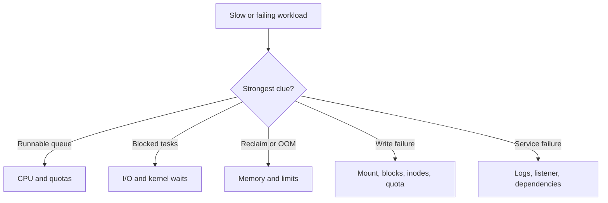
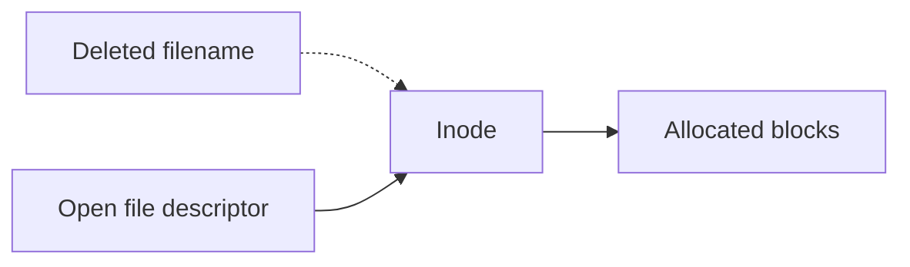

Linux troubleshooting notes for when something is slow, stuck, or broken. Find the symptom, run a few checks, and follow the evidence.

Commands assume Linux. Replace example PIDs (`1234`), paths (`/var/log`), units (`app.service`) and container names (`app`) with your own. Some commands need root privileges or additional packages, especially `sysstat`, `lsof` and `strace`. All sample outputs are illustrative.

## Start here: quick diagnosis

```bash
uptime                         # load and recent trend
free -h                        # available RAM and swap
df -h                         # filesystem space
df -i                         # inode availability
systemctl --failed             # failed systemd units, if applicable
vmstat 1 5                     # five reports; interpret interval samples
```

| Symptom | Start with |
|---|---|
| High CPU usage | `top`, `pidstat -u 1` |
| High load, low CPU | `vmstat 1`, `ps -eo pid,stat,wchan:32,comm` |
| Memory looks full | `free -h`, `cat /proc/pressure/memory` |
| Process killed | `journalctl -k`, container termination reason |
| Disk full / ENOSPC | `df -h /path`, `df -i /path` |
| `df` and `du` disagree | `sudo lsof +L1`, `findmnt` |
| Slow disk | `iostat -xz 1`, `pidstat -d 1` |
| Process stuck | `top -H -p 1234`, `ps -L -p 1234` |
| Too many open files | `/proc/1234/limits`, `/proc/1234/fd` |
| Permission denied | `id`, `namei -l /path` |
| Service active but unavailable | `systemctl status app.service`, `ss -lntp` |
| Container slow on an idle host | `cpu.stat`, `cpu.max` |



Capture the time and scope of the incident. Compare the affected machine or workload with a healthy one if possible. Avoid changing several things at once.

## CPU is high, or load is high but CPUs are idle

```bash
uptime
nproc
top
pidstat -u 1
vmstat 1 5
ps -eo pid,ppid,stat,wchan:32,comm
```

Read the interval reports from `vmstat`. The first report contains averages since boot for many fields, not a fresh one-second sample.

Selected columns from an illustrative four-vCPU host:

```text
 r  b   si   so   us sy id wa st
 9  0    0    0   85 14  1  0  0   # CPU demand
 1 12    0    0    3  2 40 55  0   # blocked work / I/O wait
 2  5 2048 4096    8  4 38 50  0   # active swap traffic
 3  0    0    0   20  5 35  0 40   # hypervisor steal time
```

| Field | Meaning |
|---|---|
| `r` | Runnable tasks (running or waiting for CPU) |
| `b` | Tasks blocked waiting for I/O |
| `si`, `so` | Swap-in and swap-out rates |
| `us`, `sy` | User and kernel CPU time |
| `id`, `wa`, `st` | Idle, I/O wait and hypervisor steal time |

- **High `r` + busy CPUs:** look for CPU saturation.
- **High `b` + idle CPUs:** look for blocked I/O, remote filesystems or other kernel waits.
- **Sustained `si` / `so`:** inspect memory pressure and storage latency.
- **High `st`:** investigate the VM's underlying CPU scheduling or provider metrics.

Linux load average includes runnable tasks and tasks in uninterruptible sleep. It is not CPU utilization. I/O wait is a CPU accounting metric, not disk utilization.

### One thread is the bottleneck

```bash
top -H -p 1234
pidstat -u -t -p 1234 1
ps -L -p 1234 -o pid,tid,psr,stat,pcpu,wchan:24,comm
```

One busy thread can saturate a vCPU while total CPU usage on a four-vCPU VM remains around 25%. More cores will not necessarily speed up that thread. On Linux, `top` in its usual per-CPU mode can show a multithreaded process above 100% CPU.

If host CPUs are idle but the container is slow, check its CPU quota and affinity (see container limits below).

## Memory looks full, or the system is swapping

```bash
free -h
vmstat 1 5
cat /proc/pressure/memory
swapon --show
ps -eo pid,rss,vsz,%mem,comm --sort=-rss | head
```

Compare these illustrative `free -h` summaries:

```text
             total  used  free  buff/cache  available
Healthy      16Gi   4Gi  512Mi       11Gi       11Gi
Pressure     16Gi  15Gi  128Mi      512Mi      300Mi
```

Start with **available**, not free. Linux uses spare memory for cache. A low `available` value is more concerning when accompanied by reclaim stalls, active swapping, rising latency or allocation failures.

| Observation | What it means |
|---|---|
| Low `free`, high `available` | Usually healthy caching |
| Swap used, no active `si` / `so` | Some pages remain swapped out; not proof of pressure |
| Sustained `si` / `so` + stalls | Active paging to/from swap; possible thrashing |
| High memory PSI | Work is spending time stalled on memory pressure |

Pressure Stall Information (PSI), where supported:

```text
$ cat /proc/pressure/memory
some avg10=18.40 avg60=9.20 avg300=3.10 total=19250000
full avg10=5.10 avg60=2.20 avg300=0.70 total=5100000
```

`some avg10=18.40` means at least one task was stalled on memory for about 18.4% of the recent ten-second averaging window. `full` tracks periods when all non-idle tasks were stalled. `total` is cumulative microseconds; compare deltas if sampling it yourself. CPU and I/O PSI are available under `/proc/pressure/cpu` and `/proc/pressure/io` as well.

Do not clear the page cache or disable swap just because the memory graph looks full.

### Which process is using the memory?

```bash
grep -E 'VmSize|VmRSS|VmSwap|VmStk|Threads' /proc/1234/status
cat /proc/1234/smaps_rollup
pidstat -r -p 1234 1
cat /proc/1234/limits
```

| Metric | Useful interpretation |
|---|---|
| VSZ / VmSize | Virtual address space; not actual RAM use |
| RSS / VmRSS | Resident RAM; shared pages may be counted in several processes |
| PSS | Resident shared pages apportioned across processes |
| `minflt/s` | Minor page faults, resolved without backing-storage reads |
| `majflt/s` | Major page faults requiring backing-store I/O |

Page faults are normal; sustained major faults during a slowdown deserve attention. They can come from file mappings as well as swap. A stack overflow is not the same thing as exhausting host RAM; a growing RSS is not by itself proof of a memory leak. Use a heap profiler when investigating application object lifetimes.

## A process disappeared or exited with 137

```bash
sudo journalctl -k --since '-30 min' | grep -Ei 'oom|out of memory|killed process'
# For a systemd service:
systemctl show app.service -p Result -p ExecMainCode -p ExecMainStatus -p NRestarts
journalctl -u app.service --since '-30 min'
# For a Docker container:
docker inspect --format '{{.State.OOMKilled}} {{.State.ExitCode}}' app
```

`137` conventionally means `128 + 9` (SIGKILL); a program can also exit with that number explicitly. It does **not** prove OOM. Look for a kernel OOM record, a container termination reason, or an increase in the relevant cgroup's `oom_kill` counter.

If a cgroup reached its limit, the host can still have plenty of memory. Check both limits and actual usage before raising them. If there is no OOM evidence, inspect orchestrator events, service timeouts and manual termination.

## Disk full, or writes fail despite free space

```bash
findmnt -T /var/log
df -h /var/log
df -i /var/log
lsblk -f
sudo du -xhd1 /var/log | sort -h
```

Inspect the filesystem that contains the failing path, not just `/`.

```text
$ df -h /var/log
Filesystem      Size  Used Avail Use% Mounted on
/dev/sdb1        50G   12G   38G  24% /var/log

$ df -i /var/log
Filesystem      Inodes IUsed IFree IUse% Mounted on
/dev/sdb1       100000 100000    0  100% /var/log
```

This filesystem has data blocks available but no free inodes. Investigate directories accumulating tiny files, caches or temporary artifacts. Inode allocation differs across filesystem types.

| Error or observation | Check |
|---|---|
| `No space left on device` (ENOSPC) | Blocks, inodes, filesystem-specific limits |
| `Disk quota exceeded` (EDQUOT) | User, group or project quota |
| `Read-only file system` (EROFS) | Mount flags and kernel filesystem errors |
| `Permission denied` (EACCES) | File and parent permissions, ACLs, security policy |

If a filesystem unexpectedly becomes read-only, check `journalctl -k` before attempting to remount it. If the path does not exist, inspect its closest existing parent.

### `df` says full, but `du` cannot explain it

```bash
df -h /var/log
sudo du -xhd1 /var/log | sort -h
sudo lsof +L1
```

```text
COMMAND  PID  USER  FD  TYPE  DEVICE    SIZE/OFF  NLINK  NODE  NAME
app     1234  app   7w  REG   8,17   10737418240      0  4321  /var/log/app.log (deleted)
```

A deleted log may still occupy blocks because a running process has it open.



Identify the process and use a supported log reopen or rotation mechanism; a controlled restart may be necessary. Do not blindly truncate a live descriptor or restart a critical database. Other discrepancies include snapshots, reserved blocks, metadata, permissions and files hidden beneath mounts.

## Disk is slow, even with plenty of free space

```bash
iostat -xz 1
pidstat -d 1
sudo iotop -oPa                 # where installed and supported
cat /proc/pressure/io
```

Ignore the initial since-boot report from `iostat` when looking for current performance. Selected columns from two illustrative interval reports (assume comparable devices and workloads):

```text
Device   r/s   w/s  rkB/s  wkB/s  r_await  w_await  aqu-sz  %util
nvme0n1  900   100   7200    800     0.40     0.50    0.41   28.0
nvme0n1  900   100   7200    800    25.00    35.00   26.00   98.0
```

The same throughput and request rate can hide very different latency. In the second sample, average read completion time rose from 0.4 ms to 25 ms and the average outstanding queue grew sharply.

| Metric | Meaning |
|---|---|
| `r/s`, `w/s` | Completed reads/writes per second (IOPS) |
| `rkB/s`, `wkB/s` | Read/write throughput |
| `r_await`, `w_await` | Average completion time, including queueing (ms) |
| `aqu-sz` | Average outstanding I/O |
| `%util` | Time during which the device had I/O in progress |

A rough consistency check for a stable workload: 1,000 IOPS at 26 ms average latency implies about 26 outstanding requests. `%util` alone does not tell you how much capacity is left on parallel SSDs or virtual devices.

Check the process access pattern, device latency, and provisioned cloud volume **and instance** IOPS/throughput caps. Network mounts may require server-side or NFS-specific metrics; local block-device stats do not describe the entire path.

**Gotcha:** a successful `write()` may only mean data reached the page cache. Applications needing durable writes must use the appropriate synchronization (e.g. `fsync()` and, for some file-creation/rename patterns, directory sync). Durability still depends on the filesystem and storage guarantees. Do not benchmark a live production disk without considering impact.

## A process is alive but stuck

```bash
ps -o pid,ppid,stat,wchan:32,etime,cmd -p 1234
ps -L -p 1234 -o pid,tid,stat,wchan:32,comm
top -H -p 1234
pstree -ap 1234
sudo lsof -p 1234
```

| State | Meaning |
|---|---|
| `R` | Running or runnable |
| `S` | Interruptible sleep, often waiting for an event |
| `D` | Uninterruptible sleep, often I/O or a kernel wait |
| `T` | Stopped |
| `Z` | Exited but parent has not collected its status |

Find blocked or zombie tasks:

```bash
ps -eo pid,ppid,stat,wchan:32,comm | awk '$3 ~ /^D/'
ps -eo pid,ppid,stat,comm | awk '$3 ~ /^Z/'
```

A zombie is already dead; killing it will not fix the parent. A task in `D` state may not respond to even SIGKILL until its kernel wait completes. Find the wait rather than repeatedly sending signals.

If process inspection is not enough, a short targeted trace can help:

```bash
sudo timeout 5s strace -f -tt -T -p 1234 \
  -e trace=futex,read,poll,epoll_wait,connect
```

| Repeated or long wait | Next question |
|---|---|
| `futex()` | Lock contention? Idle worker? Deadlock? |
| `read()` | Waiting for input, a pipe, socket or file? |
| `poll()` / `epoll_wait()` | Waiting normally for events, or missing an expected event? |
| `connect()` | Dependency unavailable or slow? |

A syscall wait is a clue, not a diagnosis. Compare multiple threads, application latency and runtime thread dumps. A true deadlock requires evidence of a circular or otherwise unresolvable wait; `futex()` alone proves neither. Tracing can add overhead, requires appropriate permissions, and may expose sensitive data. Use it deliberately.

## Too many open files, or permission denied

### Open file limits

```bash
cat /proc/1234/limits
sudo ls /proc/1234/fd | wc -l
sudo ls -l /proc/1234/fd
sudo lsof -p 1234
```

An FD is a handle to a file, socket, pipe or another kernel resource. Check the process's **Max open files** soft limit and FD count. `ulimit -n` shows the current shell's limit, not necessarily the service's.

`EMFILE` normally indicates a per-process FD limit; `ENFILE` indicates a system-wide open-file table limit. If FD counts grow continuously, investigate leaked sockets/files before simply increasing the limit. For systemd units, inspect `LimitNOFILE`.

### Permissions

```bash
id
namei -l /var/log/app.log
stat /var/log/app.log
getfacl /var/log/app.log       # if installed
findmnt -T /var/log/app.log
```

Directory traversal requires execute/search permission on each parent directory. Check the **service's identity**, not just your own shell's. Also inspect ACLs, SELinux/AppArmor, mount flags and container user mappings where relevant. Do not fix access by recursively granting `777`.

## Service is running, but the application is unavailable

```bash
systemctl status app.service
systemctl show app.service -p MainPID -p Result -p NRestarts
journalctl -u app.service --since '-30 min'
sudo ss -lntp
curl -v --connect-timeout 3 --max-time 10 http://127.0.0.1:8080/health
```

Use the actual service protocol, hostname and endpoint; a health endpoint is only an example.

| Observation | Next step |
|---|---|
| Unit failed or repeatedly restarting | Inspect logs and exit status |
| Active, but no listener | Initialization, configuration, worker state |
| Only listens on loopback | Check intended bind address |
| Local request works, remote fails | Routes, filtering, proxy or load balancer |
| TCP succeeds, request hangs | Workers, locks, upstream dependencies |
| HTTP error response | Application or proxy logs |

`active (running)` is not a health check. Reproduce the original failed operation. For remote connection failures, use the [networking notes](/2026/07/30/networking-useful-stuff.html).

### Works manually, fails under systemd

```bash
systemctl cat app.service
systemctl show app.service \
  -p User -p Group -p WorkingDirectory -p ExecStart \
  -p MainPID -p LimitNOFILE -p LimitNPROC -p TasksMax
```

Compare user/groups, working directory, `PATH`, environment, permissions, limits and unit sandboxing. A shell expands variables and interprets pipes and redirects; systemd's `ExecStart=` has its own syntax and does not implicitly invoke a shell. A process started via `exec` may keep the same PID while replacing its program; follow the actual process tree rather than guessing from names.

Inspect environment values only if necessary and do not paste secrets into tickets or logs.

## Container is slow or killed while the host looks healthy

```bash
docker stats --no-stream
docker inspect --format '{{.State.Pid}} {{.State.OOMKilled}} {{.State.ExitCode}}' app
cat /proc/1234/cgroup
```

For cgroup v2, locate the actual workload's cgroup. On a conventional host with a unified cgroup v2 mount at `/sys/fs/cgroup`, a systemd unit can be inspected like this (use an active unit):

```bash
cg=$(systemctl show app.service -p ControlGroup --value)
if [[ -n $cg && $cg != / ]]; then
    base="/sys/fs/cgroup$cg"
    cat "$base/cpu.max" "$base/cpu.stat"
    cat "$base/memory.current" "$base/memory.max" "$base/memory.events"
    cat "$base/pids.current" "$base/pids.max" "$base/pids.events"
fi
```

For a container PID, use its `/proc/PID/cgroup` membership and the host's cgroup mount instead. Mounts and namespace-relative paths can differ; verify the path. Inside a container with a cgroup mount rooted at its own group, the files may appear directly under `/sys/fs/cgroup`. Parent groups can impose tighter limits than the leaf group. cgroup v1 uses different files.

### CPU quota

```text
$ cat cpu.max
100000 100000

$ cat cpu.stat
usage_usec  65000000
nr_periods  1000
nr_throttled 820
throttled_usec 31000000
```

Quota divided by period gives nominal CPU capacity: here, one CPU's worth of time. `max 100000` means no quota at that level. Rising `nr_throttled` and `throttled_usec` during the slowdown indicate quota pressure; compare counter deltas, not lifetime totals. Throttled time is not necessarily wall-clock request delay.

A workload may have many runnable threads but be restricted to one CPU's worth of execution, even while other host CPUs are idle. Also check cpuset/affinity, parent quotas and contention.

### Memory and task limits

```text
$ cat memory.current
2100000000
$ cat memory.max
2147483648
$ cat memory.events
low 0
high 152
max 278
oom 3
oom_kill 1
```

- `memory.current`: cgroup memory accounting, not one process's RSS.
- `memory.max`: hard limit in bytes, or `max` (no limit at this level).
- `high`, `max`, `oom`, `oom_kill`: cumulative events; inspect increases and correlate with incident time. `memory.high` can trigger reclaim/throttling even without a kill.
- `pids.current` / `pids.max`: task count (including threads). A PID limit can cause fork/thread creation failures even with spare CPU and RAM.

For Kubernetes:

```bash
kubectl describe pod app
kubectl logs app --previous       # select container with -c if needed
kubectl top pod app               # requires metrics API
kubectl get events --sort-by=.lastTimestamp
```

`CrashLoopBackOff` is a retry symptom, not a cause. Check the previous termination reason, logs and resource limits. For cloud VMs, compare guest metrics with instance/volume quotas, burst credits and provider events.

## Read logs before restarting

```bash
journalctl -u app.service --since '-30 min'
sudo journalctl -k --since '-30 min'
journalctl --since '-30 min' -p warning
date -Is
timedatectl
```

Kernel logs can reveal OOM kills, filesystem errors, device failures and hung tasks. Look for the first meaningful error, not only the latest stack trace. Check deployments, configuration changes and clock drift if failures began suddenly. A warning-only filter can hide useful context; use unfiltered logs when needed.

Before restarting, capture the timestamp, relevant logs, process/thread state, resource counters and service configuration. Keep captures private if they contain credentials, command arguments or personal data.

Restarting can be the correct mitigation. It is not evidence of the root cause. Prefer a controlled service stop or SIGTERM when appropriate; SIGKILL gives the process no opportunity to clean up.

After mitigation, repeat the **actual failing operation** and watch for recurrence.

## Useful distinctions to remember

| Observation | Does not prove |
|---|---|
| High load | CPU saturation |
| Low free RAM | Memory pressure |
| High RSS | Memory leak |
| High disk `%util` | All storage capacity exhausted |
| Free filesystem blocks | Writes can succeed |
| Exit code 137 | OOM kill |
| Process exists | Work is progressing |
| Service is active | Application is healthy |
| Restart helped | Root cause is fixed |

Find the last boundary that worked. Test the next one.
