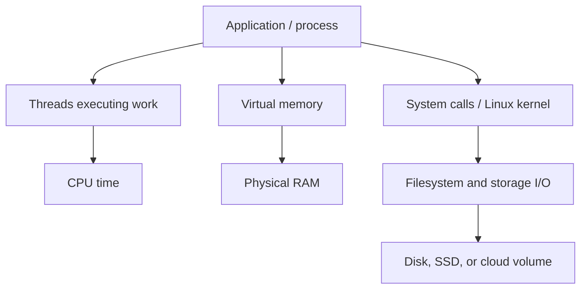
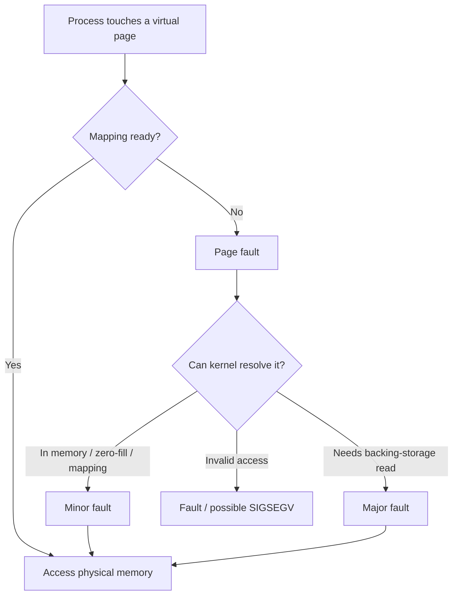
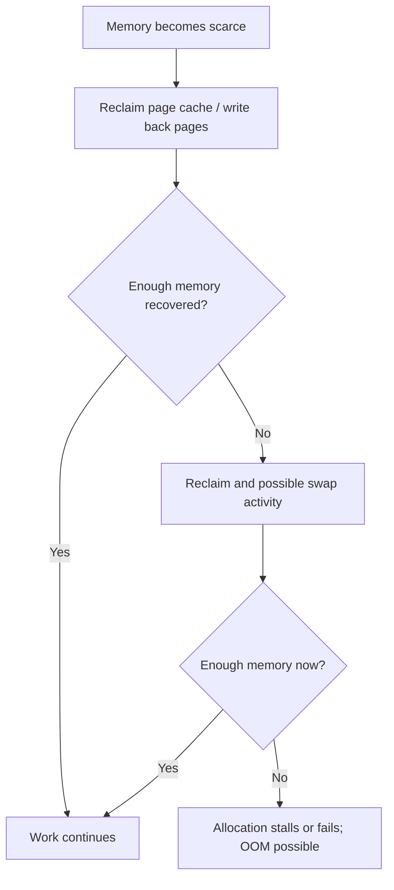
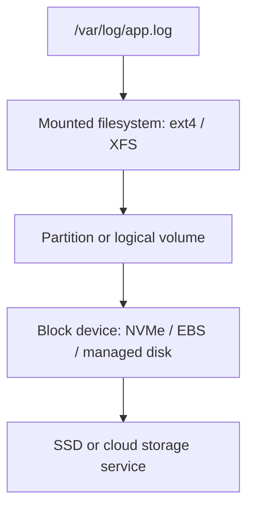
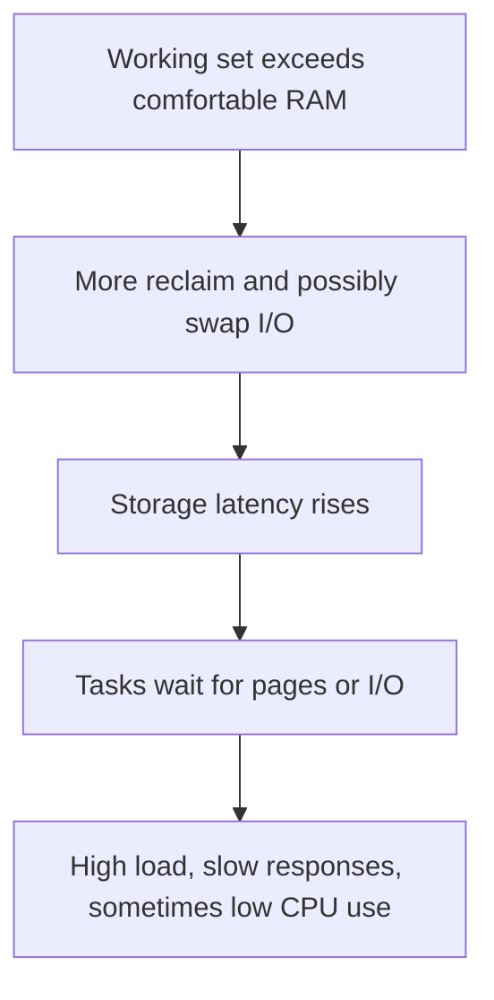
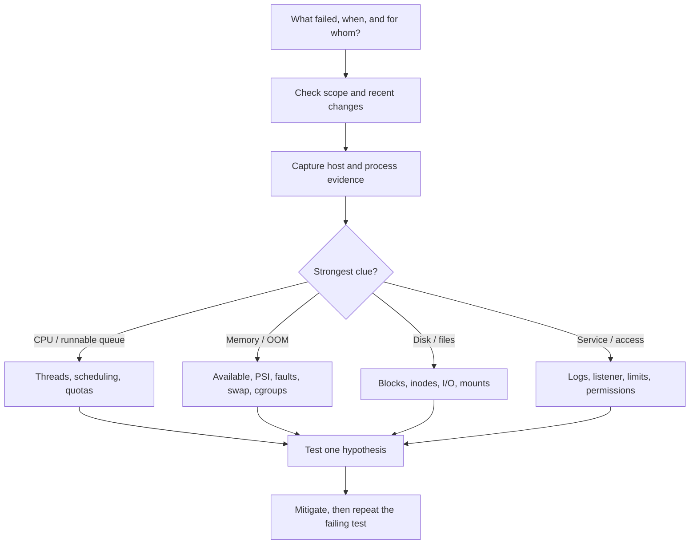

A machine is slow. A service has stopped responding. An application says *No space left on device*, although the disk looks half empty. Or a container disappears while the host still has plenty of RAM.

These sound like different problems. They become much easier to investigate once you understand what the machine is doing: **running work on CPUs, keeping data in memory, and waiting for storage or other resources**.

This is not an operating-systems textbook or a collection of magical commands. The goal is to understand enough of Linux to ask the next useful question, test it, and stop guessing.

You can use this guide on its own. It starts inside the machine, with no cloud account or special tooling required.

---

## Start here: quick diagnosis

A slow or broken system can have several causes at once. Begin with low-impact checks, then follow the strongest clue. These commands inspect the machine; they do not change it.

| Symptom | First useful check | What to investigate next |
|---|---|---|
| Machine feels slow | `uptime`; `top`; `vmstat 1` | CPU queue, blocked tasks, memory pressure, or I/O? |
| High load, low CPU use | `vmstat 1`; `ps -eo pid,stat,wchan:32,comm` | Tasks waiting in D state? |
| Suspected memory pressure | `free -h`; `cat /proc/pressure/memory` | Reclaim stalls, swap activity, cgroup limit? |
| Process disappeared | `journalctl -k --since '-30 min'` | OOM, signal, service restart, or crash? |
| `No space left on device` | `df -h PATH`; `df -i PATH` | Blocks, inodes, quota, or wrong mount? |
| Disk has space but work is slow | `iostat -xz 1`; `pidstat -d 1` | Latency, queueing, IOPS, or throughput? |
| Service is `active` but unresponsive | `systemctl status UNIT`; `ss -lntp` | Healthy listener and application? |
| `Permission denied` | `id`; `namei -l PATH` | Parent directories, service identity, ACLs? |
| Container is OOM-killed | `docker inspect CONTAINER` or `kubectl describe pod POD` | Container memory limit rather than host RAM? |

Replace the capitalized placeholders with real paths and names. Not every command is installed by default; `iostat` and `pidstat` are commonly provided by `sysstat`.

---

## One machine, several resources

An application does not run directly on a disk. It is a process, made of one or more threads, running instructions on CPUs. It uses virtual memory. The kernel schedules the work and handles things such as file access, storage requests, and network I/O.



Each resource can be healthy on its own while the application is not. A process might have plenty of memory but be waiting on a slow disk. A disk might have free space but no usable inodes. A service might be running while none of its workers can make progress.

The first habit is therefore to separate **what you observe** from **what you conclude**.

| Observation | What it tells you | What it does **not** tell you |
|---|---|---|
| CPU is 15% busy | Most aggregate CPU time is not busy | One critical thread cannot be CPU-bound |
| Load average is high | Tasks are runnable or waiting in uninterruptible sleep | The CPUs are necessarily saturated |
| `free` shows little unused RAM | Linux is using RAM | There is necessarily memory pressure |
| `df -h` shows free space | This filesystem has free data blocks | Inodes, quotas, and other mounts are fine |
| `systemctl` says `active` | The unit is active by systemd's definition | The application is serving requests |

We will build these distinctions one at a time, then use them in a troubleshooting workflow.

## CPU: cores, threads, and work waiting to run

A **CPU core** executes instructions. The operating system sees **logical CPUs**, also called hardware threads; one physical core may expose more than one. A cloud VM's **vCPU** is a scheduling abstraction, not a guarantee of one dedicated physical core.

A **process** owns resources such as an address space and open files. A **thread** is a unit of execution within that process. Several threads from the same process may run at the same time on different logical CPUs.

Imagine a VM with four vCPUs and an application that does its most important work on one thread. That thread can use an entire vCPU while the other three are nearly idle. The host might show around 25% total CPU utilization, yet that application has reached its single-thread limit.

```bash
nproc                       # logical CPUs available to this process
lscpu                       # CPU topology and features
top                         # host-wide and per-process usage
top -H -p <pid>             # threads belonging to one process
pidstat -u -t -p <pid> 1    # CPU usage by thread
```

**CPU utilization** describes time spent doing work. **CPU saturation** describes work that wants CPU time but cannot get it promptly. High utilization can be normal; a growing runnable queue or increasing latency tells you more about whether it is a problem.

### Why load average is not CPU percentage

`uptime` might show:

```text
load average: 12.4, 10.8, 8.1
```

These are exponentially smoothed load averages over roughly 1, 5, and 15 minutes. On Linux, the load count includes tasks ready to run **and** tasks in uninterruptible sleep, commonly while waiting for I/O.

A load average of 8 on a machine with 8 logical CPUs is not automatically bad. A load of 8 on a 2-vCPU machine deserves investigation, but first determine whether the tasks are trying to use CPU or are blocked elsewhere.

```bash
uptime
vmstat 1
ps -eo pid,ppid,stat,wchan:32,comm
```

In `vmstat`, `r` is the number of runnable tasks and `b` is the number blocked waiting for I/O. In `top`, `us` is user-space CPU time, `sy` kernel time, `id` idle time, `wa` I/O-wait time, and `st` time stolen by the hypervisor. These percentages describe different things; `wa` is not a percentage of disk utilization.

A process stuck in `D` state may raise load even while it consumes almost no CPU. That is why killing the busiest process is not a universal solution.

## Memory: what a process thinks it has

Processes do not normally work with raw physical RAM addresses. They operate in a **virtual address space**. The kernel and CPU's memory-management hardware translate virtual addresses into physical memory where appropriate.

Virtual memory gives processes separate address spaces, supports shared libraries and memory-mapped files, and allows the system to manage which pages are resident in RAM.

A process's address space includes several kinds of regions:

```text
Typical process mappings (not drawn to scale)

thread stacks     function-call state
mmap regions      libraries, files, anonymous memory
heap              one source of dynamic allocations
code/data         executable instructions, globals
```

This is a conceptual grouping, **not a literal map of addresses**. Actual positions vary because of the architecture, runtime, and address-space randomization. Modern allocators also use memory mappings for large allocations, so not every dynamic allocation appears in the single region labelled `[heap]`.

### Stack and heap are different

The **stack** holds function-call state: return information, saved registers, and often local variables. A multithreaded process usually has a separate stack for each thread. Stacks typically have limits and can overflow through deep or accidental recursion.

The **heap** is one source of dynamic memory used for objects whose lifetimes are not tied to a single function call. Allocators and language runtimes manage it. Heap growth can be normal, but an ever-growing collection of objects that are no longer needed may indicate a leak.

| | Stack | Heap and dynamic allocations |
|---|---|---|
| Typical use | Call frames and local execution state | Objects with flexible lifetimes |
| Managed by | Call convention, compiler, runtime | Allocator or language runtime |
| Typical failure | Stack overflow, possible `SIGSEGV` | Allocation failure, leak, memory pressure, OOM |
| Scope | Usually per thread | Often shared across threads in a process |

**A stack overflow is not the same as running out of system RAM.** One thread can exhaust its stack limit while most RAM remains available. Conversely, a process can grow its dynamic allocations until the system or its container reaches a memory limit.

Useful inspections:

```bash
ulimit -s                           # this shell's stack limit, in KiB
cat /proc/<pid>/limits             # limits for an existing process
grep -E 'VmSize|VmRSS|VmData|VmStk|VmSwap|Threads' /proc/<pid>/status
cat /proc/<pid>/maps | grep -E '\[heap\]|\[stack\]'
cat /proc/<pid>/smaps_rollup
```

`VmStk` is the mapped stack segment size, **not an exact count of actively used stack bytes**. `VmData` is not an exact measurement of live heap objects. For a real leak, use the application's profiler when possible; the kernel cannot tell you which objects are still useful.

### RSS, VSZ, and the page cache

`VSZ` or `VmSize` is virtual address space reserved or mapped by a process. It is not the amount of physical RAM that process currently occupies. `RSS` or `VmRSS` is resident memory, but can count shared pages in multiple processes; proportional set size (`PSS`) is often more useful when comparing shared-memory costs.

Linux also uses spare RAM to cache filesystem data. This is intentional: reading cached data is generally cheaper than going back to storage.

```bash
free -h
ps -eo pid,user,rss,%mem,etime,cmd --sort=-rss | head
```

When reading `free`, start with **`available`**, not just `free`. A low `free` number often means the system is making good use of RAM. A persistently low `available` value *alongside stalls, reclaim activity, or swapping* is more concerning.

## Pages and page faults: the missing piece

Linux manages memory in **pages** rather than moving single bytes between physical memory and backing storage. A common base-page size on x86-64 is 4 KiB, but page sizes vary by architecture and huge pages are also possible.

```bash
getconf PAGE_SIZE
```

Page tables map virtual pages to physical frames or describe how a page should be obtained. Not every mapped page has to be resident in RAM immediately.



A **page fault is not necessarily an error**. Faults happen during ordinary program startup, first access to newly allocated memory, and copy-on-write operations.

A **minor fault** can be resolved without reading data from storage. A **major fault** requires reading the page from backing storage. Sustained major faults can be expensive, but they are not proof of swapping: memory-mapped file access can cause major faults too.

```bash
pidstat -r -p <pid> 1
```

Look at `minflt/s` and `majflt/s` while watching application latency. One high number in isolation is not a diagnosis.

### Swap, paging, and reclaim

When memory gets scarce, the kernel first tries to reclaim memory. It may discard clean cache pages that can be read again, write back dirty file-backed pages, and move eligible anonymous pages to configured swap.

**Paging** broadly means working with memory in pages. **Swapping** means using swap space as backing storage for eligible memory pages. An out-of-swap condition is not the same thing as a low paging rate.



A system can become extremely sluggish before it runs out of memory. If processes repeatedly fault on pages that must be read from disk and the kernel spends much of its time reclaiming memory, it may **thrash**: lots of I/O, little useful progress.

The practical distinctions are:

| Signal | Interpretation |
|---|---|
| Low `MemFree` | Often normal; RAM is being used for cache |
| Low `MemAvailable` | Potential pressure; look for stalls and reclaim |
| Swap used | Not automatically bad; pages can remain swapped out |
| Sustained `si` / `so` | Active swap traffic, potentially costly |
| High memory PSI | Workloads spending time stalled by memory pressure |
| OOM message | A memory allocation could not be satisfied under the relevant policy or limit |

Inspect the behavior, not just the amount allocated:

```bash
free -h
swapon --show
vmstat 1
cat /proc/pressure/memory
cat /proc/meminfo | grep -E 'MemAvailable|SwapFree|CommitLimit|Committed_AS'
```

In `vmstat`, `si` and `so` are swap-in and swap-out rates. In `/proc/pressure/memory`, `some` describes periods when at least one task was stalled on memory; `full` describes periods when all non-idle tasks were stalled. Pressure Stall Information is particularly useful when CPU usage looks fine but work stops making progress.

Also keep **memory commitment** separate from resident RAM. Depending on Linux's overcommit configuration, a virtual-memory allocation can fail even before the machine's RAM is full. Inspect the policy only when allocation failures suggest it:

```bash
sysctl vm.overcommit_memory
cat /proc/meminfo | grep -E 'CommitLimit|Committed_AS'
```

### When the OOM killer intervenes

If the kernel cannot satisfy memory demands, it may select a process to kill. A container can encounter its own memory limit and be OOM-killed even while the host has free RAM.

```bash
journalctl -k --since '-30 min' | grep -Ei 'oom|out of memory|killed process'
dmesg -T | grep -Ei 'oom|out of memory|killed process'
```

An application exiting with `Killed` or exit code `137` is a **clue**, not conclusive proof of an OOM kill: `137` indicates termination by `SIGKILL`, which can have other causes. Confirm with kernel, container, or orchestrator evidence.

## Storage: from a filename to a block device

Storage has several layers that are easy to confuse. A **block device** presents addressable blocks; a **partition** divides a device; a **logical volume** can combine or divide storage; a **filesystem** provides files, directories, names, metadata, and permissions; a **mount point** makes that filesystem accessible at a path.



Not every system uses all of these layers. A network filesystem such as NFS follows a different storage path. Always ask **which filesystem contains the failing path**, not just whether `/` has space.

```bash
lsblk -f
findmnt
findmnt -T /var/log/app.log
df -h /var/log
```

### What an inode actually is

A file is more than its bytes. On common Unix filesystems, an **inode** stores metadata such as ownership, permissions, timestamps, size, and references to file data. A directory maps a filename to an inode number.

```text
/var/log/
  app.log ───────> inode 12345
                     ├── owner and permissions
                     ├── timestamps and size
                     └── where the file's data lives
```

The filename is **not** stored in the inode in this simplified model. Multiple directory entries can point to the same inode: those are **hard links**. A symbolic link is a different file containing a path reference.

This explains why `No space left on device` does not always mean the disk has run out of bytes. A filesystem may run out of available inodes or hit a quota even when data blocks remain free.

```bash
df -h /var         # data space
df -i /var         # inode availability
ls -i /var/log/app.log
stat /var/log/app.log
```

Filesystems manage inodes differently. ext4 commonly has inode counts determined at filesystem creation, while XFS can allocate them dynamically within filesystem limits. Don't assume every filesystem has the same fixed inode budget.

### Why `df` and `du` sometimes disagree

`df` reports space allocated on the filesystem. `du` walks visible files and directories to account for their blocks. They can disagree because their accounting and visibility are different.

A classic failure is an application writing to a huge log file. Someone deletes its filename, but the application still has the file open. The directory entry is gone; the inode and blocks remain allocated until the last open reference is released.

```bash
df -h /var
du -xhd1 /var | sort -h
sudo lsof +L1
```

If you find a deleted-but-open file, identify the owning process and the safest way to close or rotate it. Do not automatically restart a database or critical service just to free blocks.

Other causes of disagreement include snapshots, mount points, permissions, reserved blocks, and filesystem metadata.

## Disk I/O: free space does not mean fast storage

**Capacity** tells you how much data fits. **Performance** tells you how quickly I/O requests complete.

Four measurements matter:

| Metric | Meaning |
|---|---|
| IOPS | Operations completed per second |
| Throughput | Bytes transferred per second, often MB/s |
| Latency | Time an I/O operation takes to complete |
| Queue depth | Operations outstanding and waiting or being processed |

Reading 100,000 small files can be limited by operations and metadata lookups. Reading one very large file sequentially may be limited by throughput. A nearly empty SSD can be slow if requests are delayed or a cloud volume has reached a provisioned performance limit.

```bash
iostat -xz 1
pidstat -d 1
sudo iotop -oPa      # if installed
```

In `iostat`, `r/s` and `w/s` are request rates, `rkB/s` and `wkB/s` describe throughput, `await` is average completion latency including time queued, and `aqu-sz` measures average outstanding requests. `%util` is the fraction of elapsed time during which the device had I/O in progress; **100% does not universally mean a modern parallel SSD is saturated**.

Look at latency, queues, throughput, the application's access pattern, and device limits together. On cloud VMs, both the volume and the instance may impose IOPS and throughput caps. Disk size alone is not the whole story.

Some I/O problems are failures, not just performance problems. If a filesystem suddenly becomes read-only, check kernel messages before attempting to remount it read-write:

```bash
findmnt -T /affected/path
journalctl -k --since '-30 min'
```

## How resource problems cascade

CPU, memory, and storage are not independent boxes. One bottleneck can make another subsystem look guilty.



This is one possible failure chain, not a rule. It explains why **the resource showing the symptom is not necessarily the resource causing the problem**.

## Processes: alive is not the same as progressing

Linux exposes process state through `ps`. The common one-letter states are:

| State | Meaning |
|---|---|
| `R` | Running or runnable |
| `S` | Interruptible sleep, often waiting for an event |
| `D` | Uninterruptible sleep, often waiting for I/O |
| `T` | Stopped |
| `Z` | Zombie: exited, not yet reaped by its parent |

```bash
pgrep -af <name>
ps -fp <pid>
ps -o pid,ppid,user,stat,%cpu,%mem,rss,vsz,etime,wchan:24,cmd -p <pid>
pstree -ap
ps -eo pid,ppid,stat,wchan:32,comm
```

A task in `D` state may be waiting on local storage, NFS, or a device operation. Frequent or prolonged `D` states are evidence to investigate, not proof of one particular disk failure.

```bash
ps -eo pid,stat,wchan:32,comm | awk '$2 ~ /^D/'
```

A zombie is already finished. It consumes a process-table entry but does not keep running; its parent must collect its exit status.

```bash
ps -eo pid,ppid,stat,comm | awk '$3 ~ /^Z/'
```

For a hung process, use the lightest observation first:

```bash
top -H -p <pid>
lsof -p <pid>
ps -o pid,stat,wchan:32,etime,cmd -p <pid>
```

If necessary, `strace -p <pid>` can show repeated system calls such as `futex()`, `read()`, `poll()`, or `connect()`. It can introduce overhead and expose secrets from arguments or data, so it is not a harmless default on production services.

### File descriptors and permissions

A file descriptor is a process-local handle to an open file, socket, pipe, or other kernel-managed resource. A process can hit its open-file limit even when memory and storage look fine.

```bash
cat /proc/<pid>/limits
ls /proc/<pid>/fd | wc -l
lsof -p <pid>
ulimit -n                         # limit for this shell, not necessarily the service
```

For `Permission denied`, inspect more than the file itself. Every parent directory must allow traversal, and services may run under different users or security policies.

```bash
id
ls -l /path/to/file
namei -l /path/to/file
getfacl /path/to/file           # if ACL tools are installed
```

Also consider mount options, SELinux, AppArmor, container user mappings, and read-only filesystems.

## Services: from process health to application health

`systemd` can tell you whether a service unit is active, but an active process may be stuck, misconfigured, or unable to reach its dependencies. Probe the service itself.

```bash
systemctl status <service>
systemctl --failed
systemctl cat <service>
systemctl show <service> -p User -p Group -p ExecStart -p MainPID -p Result -p NRestarts
journalctl -u <service> -n 100
journalctl -u <service> --since '-30 min'
ss -ltnp
```

If an application works when launched by hand but fails under systemd, compare the service user, groups, environment, working directory, `PATH`, `HOME`, limits, and dependencies. A shell session and a systemd unit are not identical environments.

Check whether the process listens on the expected address and port. Then repeat the **actual failing request**. A bound socket alone does not prove application health.

### Logs, kernel messages, and time

Work backwards from the time the problem began. Look for the **first meaningful error**, not just the last exception, because later errors may be consequences.

```bash
journalctl -u <service> --since '-30 min'
journalctl -k --since '-30 min'
tail -n 100 /path/to/application.log
grep -C 5 -i error /path/to/application.log
```

Kernel logs are particularly valuable for OOM kills, disk I/O errors, filesystem remounts, driver failures, and hardware warnings.

Bad system time can also break TLS, authentication, tokens, and log ordering:

```bash
date
timedatectl
chronyc tracking                    # if chrony is used
```

Before changing anything, check recent deployments, package upgrades, configuration edits, and resource-limit changes.

```bash
journalctl --since '-1 hour'
grep -Ei 'install|upgrade|remove' /var/log/dpkg.log  # Debian/Ubuntu
dnf history                                         # RHEL/Fedora
```

A normal termination request uses `SIGTERM` (`kill <pid>`). `SIGKILL` (`kill -9 <pid>`) stops a process without giving it an opportunity to clean up. Neither should substitute for understanding why the process failed.

## Containers and cloud VMs: another set of limits

Containers share their host kernel, but they can have their own limits on memory, CPU, and process counts. A 2 GiB container may be OOM-killed on a host with 20 GiB available. A container can also be **CPU-throttled** when it exhausts its configured CPU quota even though the host CPUs have idle time.

```bash
docker ps -a
docker stats
docker inspect <container>
docker logs <container>
```

On a modern cgroup v2 system, the relevant cgroup files may include:

```bash
cat /sys/fs/cgroup/memory.current
cat /sys/fs/cgroup/memory.max
cat /sys/fs/cgroup/memory.events
cat /sys/fs/cgroup/cpu.stat
cat /sys/fs/cgroup/memory.pressure
```

These paths describe **the cgroup in which you are running**. To inspect another service or container, locate its cgroup path rather than assuming the top-level files refer to that workload. In `cpu.stat`, rising `nr_throttled` and `throttled_usec` can reveal CPU quota pressure. In `memory.events`, `oom` and `oom_kill` counts help confirm memory-limit failures.

For Kubernetes:

```bash
kubectl get pods -o wide
kubectl describe pod <pod>
kubectl logs <pod> --previous
kubectl get events --sort-by=.lastTimestamp
kubectl top pod <pod>                # requires metrics-server
```

`CrashLoopBackOff` is a restart/backoff symptom. Look at the previous container's logs and termination reason. `OOMKilled` points toward a memory-limit event; compare limits, usage, and the application's memory behavior rather than simply raising the limit without investigation.

For cloud VMs, distinguish **guest** metrics from **provider** limits and events. The guest can tell you about its processes, memory, block-device latencies, and kernel errors. The cloud platform can tell you whether the VM or attached volume has performance limits, burst credits, maintenance events, or other external constraints.

## A troubleshooting workflow that preserves evidence

When something breaks, avoid jumping straight to a restart. Use the shortest chain of tests that separates possible causes.



A first pass on a Linux host can be small:

```bash
uptime
free -h
df -h
df -i
systemctl --failed
ps aux --sort=-%cpu | head
ps aux --sort=-%mem | head
vmstat 1
```

Add `iostat -xz 1` when storage is implicated. Use `journalctl` to inspect the time of the incident. These commands do not diagnose the problem by themselves; they tell you where to look next.

### Case 1: load is high, but the CPUs are idle

First check `vmstat 1`, `iostat -xz 1`, and `ps -eo pid,stat,wchan:32,comm`. Suppose load is 15, CPUs are mostly idle, and many threads are in `D` state waiting on a mounted filesystem. The next hypothesis is not 'we need more CPU'. Investigate the storage path, mount, kernel messages, and any remote dependency.

**Lesson:** Linux load includes blocked work, not only CPU demand.

### Case 2: `No space left on device`, but `df -h` looks fine

```bash
df -h /affected/path
df -i /affected/path
findmnt -T /affected/path
```

If inode usage is 100%, check for directories accumulating huge numbers of tiny files. If inodes remain, investigate quotas, the precise mount, filesystem constraints, and application errors. If `df` reports full but `du` cannot explain it, use `lsof +L1` to look for deleted-but-open files.

**Lesson:** capacity, inode count, quotas, and visibility are different checks.

### Case 3: an application becomes slow while memory looks full

```bash
free -h
vmstat 1
cat /proc/pressure/memory
pidstat -r -p <pid> 1
```

Low `free` alone might be healthy page cache. But low `available`, repeated memory stalls, swap-in/swap-out, and major faults during slow requests suggest genuine pressure. Check whether the application grew its working set, whether the container reached a limit, and whether storage latency is amplifying the slowdown.

**Lesson:** investigate reclaim and stalled work, not just used bytes.

### Case 4: a container vanishes with exit code 137

Check the container termination reason, `memory.events`, previous logs, and kernel messages. A confirmed OOM kill may reflect a too-small limit, increased application memory demand, or a leak. `137` alone is not proof: an operator or orchestrator can also send `SIGKILL`.

**Lesson:** distinguish a symptom from the mechanism that caused it.

### Case 5: systemd says active, but the API is unavailable

```bash
systemctl status <service>
journalctl -u <service> -n 100
ss -ltnp
```

Find out whether the service listens on the expected port, whether its workers are blocked, and whether its dependencies respond. Use the networking guide to trace DNS, routing, TCP, TLS, and HTTP when the evidence points outside the host.

**Lesson:** process health and application health are different things.

## Restart as mitigation, not investigation

Restarting may be the right immediate mitigation, especially during an incident. But it can also destroy evidence: process state, open files, in-memory counters, and the exact conditions that caused a hang.

When practical, capture the failure time, logs, process state, resource metrics, open files, kernel messages, and current configuration first. Then restart if needed. Don't change several variables at once unless safety or service restoration requires it.

Verification means repeating the original failing action, not merely seeing `active (running)` in `systemctl`. Afterward, watch for recurrence and keep three ideas distinct:

- **Mitigation:** restarting a stuck service restores it temporarily.
- **Root cause:** a specific memory leak or broken dependency caused it to hang.
- **Prevention:** fixing the code or dependency, testing the change, and setting an appropriate alert reduces recurrence.

## Fast command reference

The explanations above are the model. The following is a compact set of commands to use when that model points to a particular resource.

| Question | Commands |
|---|---|
| What is the host doing? | `uptime`, `top`, `vmstat 1`, `systemctl --failed` |
| Which process or thread uses CPU? | `ps aux --sort=-%cpu`, `pidstat -u -t -p <pid> 1` |
| Is it memory pressure? | `free -h`, `vmstat 1`, `cat /proc/pressure/memory` |
| Is it a process's memory? | `/proc/<pid>/status`, `/proc/<pid>/smaps_rollup`, `pidstat -r -p <pid> 1` |
| Was it killed by OOM? | `journalctl -k`, cgroup `memory.events`, container termination reason |
| Which filesystem holds the path? | `findmnt -T /path`, `lsblk -f` |
| Are blocks or inodes exhausted? | `df -h /path`, `df -i /path` |
| Where did space go? | `du -xhd1 /path`, `lsof +L1` |
| Is storage slow? | `iostat -xz 1`, `pidstat -d 1` |
| Why won't the service start? | `systemctl status`, `systemctl cat`, `journalctl -u` |
| Is the process stuck? | `ps ... wchan`, `top -H`, then carefully `strace` if needed |
| Is it a permission or limit issue? | `namei -l`, `getfacl`, `/proc/<pid>/limits` |
| Is the container throttled? | cgroup `cpu.stat`, `docker stats`, `kubectl describe pod` |

`pidstat`, `iostat`, and `iotop` may require installing their respective tools (`sysstat` provides the first two on many distributions). Some `/proc` and cgroup fields vary with kernel version, container setup, or permissions.

---

Most troubleshooting isn't knowing a magical command. It is understanding the machine well enough to distinguish a busy CPU from a blocked task, a full disk from exhausted inodes, and healthy caching from memory thrashing.

Find the **last thing that worked**, identify the boundary where it stopped, and make the next test small enough to teach you something.
