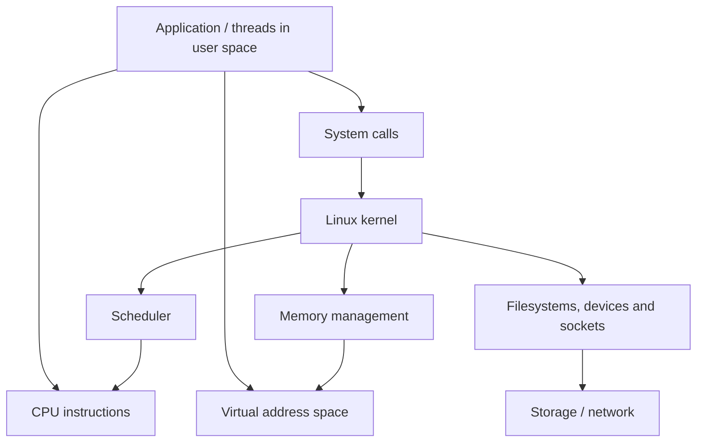
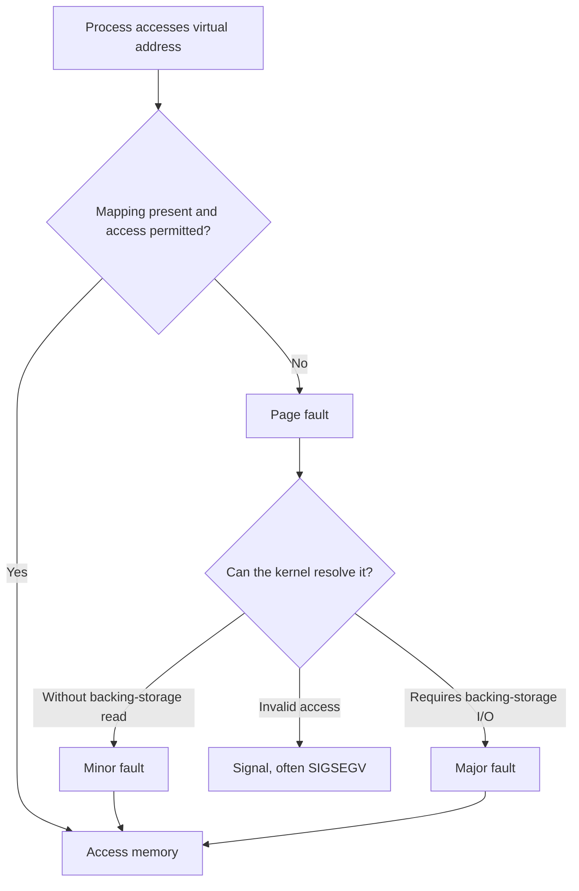
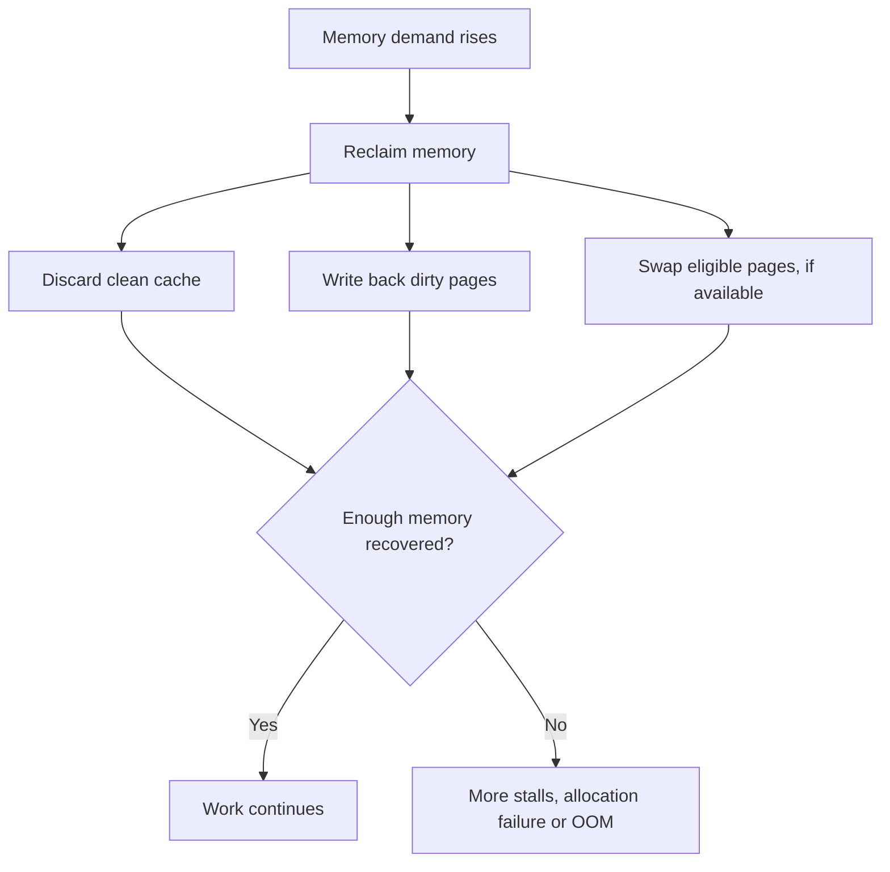
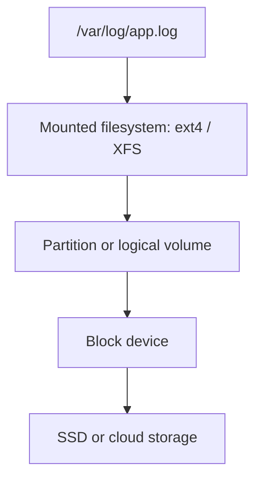
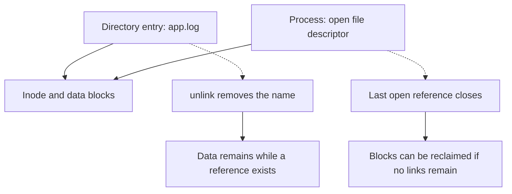
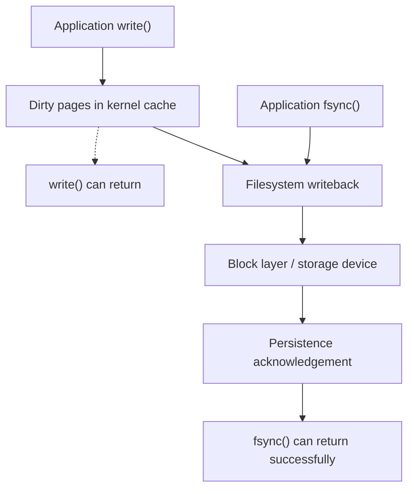
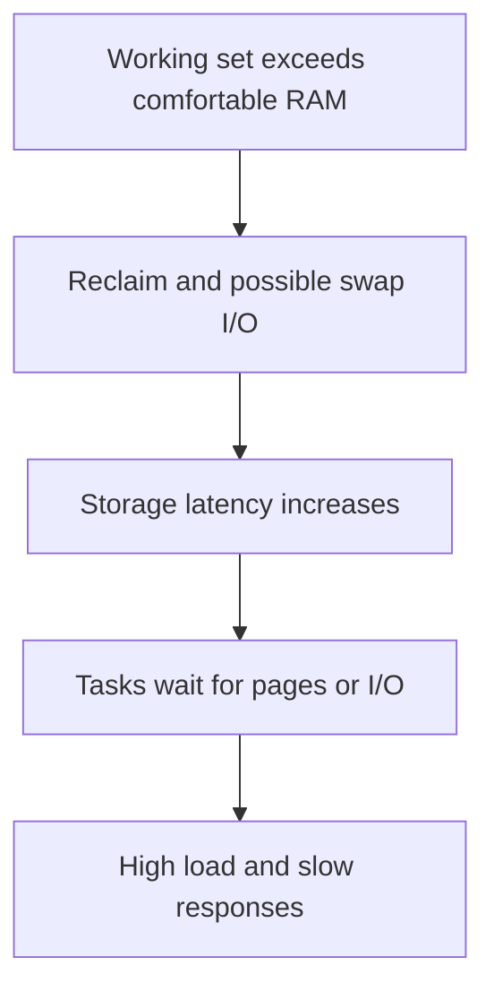
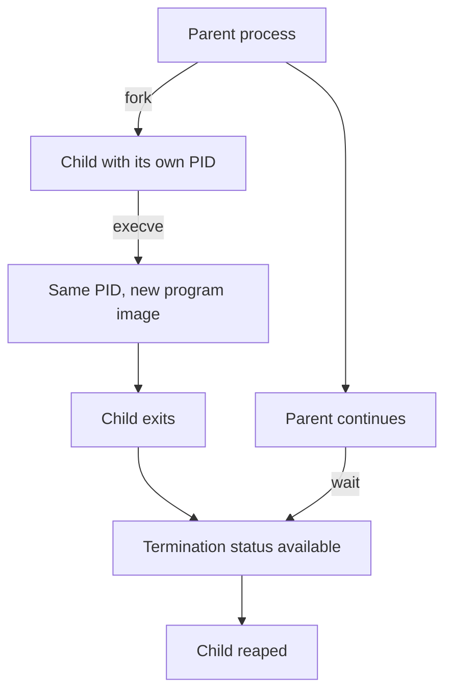
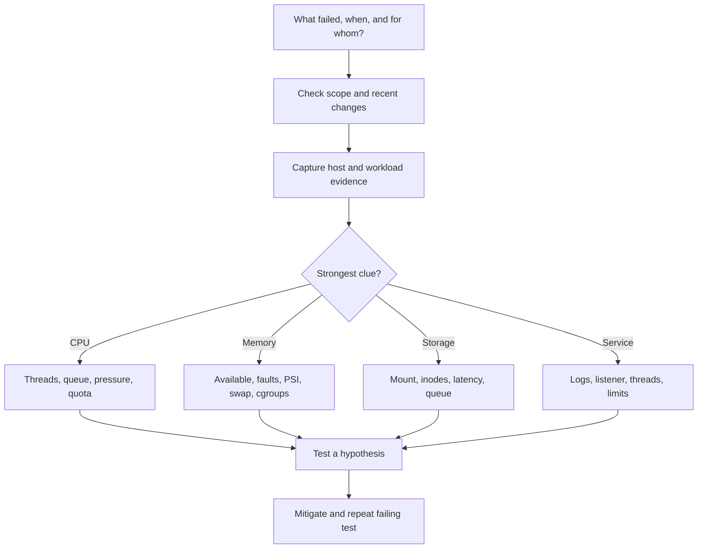

A machine is slow. A service has stopped responding. An application says *No space left on device*, although the disk looks half empty. Or a container disappears while the host still has plenty of RAM.

These sound like different problems. They become much easier to investigate once you understand what the machine is doing: running work on CPUs, keeping data in memory, and waiting for storage or other resources.

This is not an operating-systems textbook or a collection of magical commands. The goal is to understand enough of Linux to ask the next useful question, test it, and stop guessing.

It helps to think in terms of **capacity, demand, and progress**. How much of a resource exists? How much work wants it? Is the work actually getting done?

The command outputs in this article are illustrative, not captures from a production incident. They are intentionally small enough to read. Commands assume Linux; some require elevated privileges or packages such as `sysstat`, `lsof`, and `strace`. Replace example paths, process IDs, and service names with the ones on your machine.

---

## Start here: quick diagnosis

Begin with low-impact checks, then follow the strongest clue. You do not need to run every command in this table for every incident.

| Symptom | First useful check | What to investigate next |
|---|---|---|
| Machine feels slow | `uptime`; `top`; `vmstat 1` | CPU queue, blocked tasks, memory pressure, or I/O? |
| High load, low CPU use | `vmstat 1`; `ps -eo pid,stat,wchan:32,comm` | Tasks waiting in D state? |
| Suspected memory pressure | `free -h`; `cat /proc/pressure/memory` | Reclaim stalls, swapping, cgroup limit? |
| Process disappeared | `journalctl -k --since '-30 min'` | OOM, signal, crash, or service restart? |
| No space left on device | `df -h PATH`; `df -i PATH` | Blocks, inodes, quota, or wrong mount? |
| Disk has space but work is slow | `iostat -xz 1`; `pidstat -d 1` | Latency, queueing, IOPS, or throughput? |
| Service is active but unresponsive | `systemctl status UNIT`; `ss -lntp` | Listener, workers, or dependency? |
| Permission denied | `id`; `namei -l PATH` | Parent directories, identity, ACLs, security policy? |
| Container slow while host is idle | cgroup `cpu.stat`; `docker stats` | CPU quota or another workload limit? |
| Cannot create more threads | cgroup `pids.current`; `pids.max`; process limits | PID/thread limit, memory, or user limit? |

Take note of the time, the affected workload, and whether other workloads are affected. A host-wide metric may hide a problem in one process, thread, or container.

---

## One machine, several resources

An application is a program executing as one or more processes. Its threads run instructions on CPUs, access virtual memory, and request services from the kernel. The kernel schedules work and manages access to files, devices, and network interfaces.



**User space** is where ordinary applications run. **Kernel space** is where the privileged operating-system code runs. An application does not need a system call for every instruction, but it normally needs the kernel to open a file, create a socket, start a process, or request a memory mapping.

For example, `openat()` opens a file, `read()` requests bytes, `write()` sends bytes to an open descriptor, and `close()` releases the descriptor. A successful system call is not the same thing as a successful application operation. A successful `write()`, for instance, may have copied data into a kernel buffer without making it durable yet.

The distinction also helps when reading CPU statistics: high user CPU and high system CPU point toward different kinds of work, although neither alone establishes the cause of a slowdown.

### Observations are not conclusions

| Observation | What it tells you | What it does **not** tell you |
|---|---|---|
| CPU is 15% busy | Aggregate CPU utilization is low | A critical thread cannot be CPU-bound |
| Load average is high | Runnable or uninterruptible tasks contribute to load | CPUs are necessarily saturated |
| Little unused RAM | RAM is in use | There is necessarily memory pressure |
| `df -h` shows free space | The filesystem has available data capacity | Inodes, quotas, and other mounts are fine |
| A process exists | It has not disappeared | Its workers are making progress |
| `systemctl` says active | The unit is active by systemd's definition | The application is serving requests |

Whenever possible, combine an observation of demand with an observation of delay: runnable tasks and CPU pressure, reclaim activity and memory stalls, outstanding I/O and latency.

## CPU: cores, threads, and work waiting to run

A **CPU core** executes instructions. The operating system sees **logical CPUs**, also called hardware threads; one physical core may expose more than one. A cloud VM's vCPU is a scheduling abstraction, not a guarantee of one dedicated physical core.

A process owns resources such as an address space and open files. A thread is a unit of execution within that process. Several threads may run at the same time on different logical CPUs.

Imagine a VM with four vCPUs and an application whose critical work happens on one thread. That thread can occupy an entire vCPU while the other three are almost idle. The host may show about 25% aggregate CPU utilization, yet the application has hit its single-thread limit.

```bash
nproc
lscpu
top -H -p 1234
pidstat -u -t -p 1234 1
```

`nproc` is a useful starting point for available processing units, but CPU affinity, cpusets, quota, and tool versions affect how much work the application can actually execute. Check the workload's effective limits too.

**CPU utilization** describes time spent doing work. **CPU saturation** describes work that wants CPU time but cannot get it promptly. High utilization may be perfectly healthy. A growing runnable queue and increasing response time are stronger clues that demand is exceeding available CPU service.

### Why load average is not CPU percentage

`uptime` might show:

```text
load average: 12.4, 10.8, 8.1
```

These are exponentially smoothed load averages over roughly 1, 5, and 15 minutes. On Linux, load includes runnable tasks and tasks in uninterruptible sleep, commonly waiting for I/O.

A load of 8 on an eight-logical-CPU machine is not automatically bad. A load of 8 on a two-vCPU machine deserves investigation, but first establish whether tasks want CPU or are blocked elsewhere.

```bash
uptime
vmstat 1 5
ps -eo pid,ppid,stat,wchan:32,comm
cat /proc/pressure/cpu
```

### Read `vmstat`, not just its CPU columns

`vmstat` is a particularly good first tool because it reports several subsystems together. With an interval specified, its first report normally includes rate and CPU averages since boot; subsequent reports show the sampling interval. Focus on those later samples when investigating a current incident.

Selected columns from illustrative interval samples on a four-vCPU host:

```text
         procs    swap       io          cpu
          r  b   si  so     bi    bo    us sy id wa st
sample A  9  0    0   0      0    24    89  9  2  0  0
sample B  1  7    0   0    800   120     5  3 72 20  0
sample C  2  4 4096 8192  15000 22000   12 10 43 35  0
sample D  6  0    0   0      0    12    45  5  5  0 45
```

| Field | Meaning |
|---|---|
| `r` | Runnable tasks, including running tasks |
| `b` | Tasks blocked waiting for I/O |
| `si`, `so` | Swap-in and swap-out rates |
| `bi`, `bo` | Block-device input and output rates |
| `us`, `sy` | User-space and kernel CPU time |
| `id`, `wa` | Idle time and CPU time accounted as I/O wait |
| `st` | CPU time stolen by the hypervisor |

Read the rows as hypotheses, not diagnoses:

- A suggests CPU contention: there are more runnable tasks than four vCPUs and very little idle CPU.
- B suggests blocked work: CPU is mostly idle, but many tasks are blocked. Investigate storage, devices, or a remote filesystem.
- C suggests active swapping and storage activity. Look at memory pressure, major faults, and application latency.
- D suggests a VM losing substantial CPU time to the hypervisor. Check guest activity and provider-side evidence.

`wa` is not disk utilization. I/O wait accounting is imperfect, especially on multicore systems. A low `wa` also does not rule out an application waiting for storage or a remote service.

A single sample can be misleading. Look for the pattern while the problem is happening.

### CPU quota is another kind of bottleneck

A workload can have access to a host's logical CPUs but be limited in how much CPU time it can use. A container configured for half a CPU can be throttled even when every other CPU is idle. We will inspect the actual quota and throttling counters in the container section rather than infer them from host percentages.

## Memory: what a process thinks it has

Processes normally operate in a **virtual address space**, not with raw physical RAM addresses. The kernel and CPU's memory-management hardware translate virtual addresses into physical memory where appropriate.

Virtual memory isolates address spaces, enables shared libraries and memory-mapped files, and lets the kernel control which pages are resident in RAM.

```text
Typical process mappings (not drawn to scale)

thread stacks     function-call state
mmap regions      libraries, files, anonymous memory
heap              one source of dynamic allocations
code/data         executable instructions, globals
```

This is a grouping of regions, not a literal address map. Their positions vary with architecture, runtime, and address-space randomization. Allocators also commonly obtain large allocations using memory mappings.

### Stack and heap are different

The stack holds function-call state, saved registers, and often local variables. Each thread normally has its own stack. Deep recursion may exhaust a thread's stack limit while the rest of the system still has plenty of RAM.

The heap is one source of dynamic allocations whose lifetime is not tied to a single function call. A growing heap may be normal caching, allocator retention, or a leak. The kernel cannot tell which application objects are still useful.

| | Stack | Heap and dynamic allocations |
|---|---|---|
| Typical use | Call frames and local execution state | Objects with flexible lifetimes |
| Managed by | Compiler, calling convention, runtime | Allocator or language runtime |
| Typical failure | Stack overflow, possibly SIGSEGV | Allocation failure, leak, pressure, OOM |
| Scope | Usually per thread | Often shared by threads in a process |

```bash
pid=1234
ulimit -s
cat "/proc/$pid/limits"
grep -E 'VmSize|VmRSS|VmData|VmStk|VmSwap|Threads' "/proc/$pid/status"
grep -E '\[heap\]|\[stack\]' "/proc/$pid/maps"
cat "/proc/$pid/smaps_rollup"
```

`VmStk` is the mapped stack segment size, not actively used stack bytes. `VmData` does not measure live heap objects exactly. An application-level profiler is often the right next tool for a suspected leak.

### RSS, VSZ, and shared memory

| Measurement | Meaning |
|---|---|
| VSZ / VmSize | Size of the process's virtual mappings |
| RSS / VmRSS | Pages currently resident and accounted to the process |
| PSS | Resident shared pages divided proportionally among their mappings |
| VmSwap | Swap usage reported for certain private anonymous mappings; not total system swap |

If two processes map the same 100 MiB library, both may include its resident pages in RSS. Adding their RSS values can double-count shared memory. PSS is often more informative when estimating their combined memory footprint.

Large virtual mappings are also not proof of large physical memory use. A process may reserve address space long before touching most of it.

### Read `free` with care

Linux uses spare RAM for useful cache. Reading cached file data is usually cheaper than fetching it from storage.

```bash
free -h
ps -eo pid,user,rss,%mem,etime,cmd --sort=-rss | head
```

Two illustrative snapshots from machines with 16 GiB RAM:

```text
Healthy cache-heavy host:
               total    used    free  shared  buff/cache  available
Mem:            16Gi   5.5Gi   500Mi   200Mi         10Gi       10Gi
Swap:            4Gi   128Mi   3.9Gi

Host with possible memory pressure:
               total    used    free  shared  buff/cache  available
Mem:            16Gi    15Gi   150Mi   200Mi        850Mi      400Mi
Swap:            4Gi   3.6Gi   410Mi
```

These are rounded illustrative numbers; accounting conventions differ between versions. `available` is an estimate of memory that can be made available for new work without swapping, not simply `free + buff/cache`.

The first machine has very little unused RAM but substantial available memory. The second deserves investigation, especially if slow requests coincide with reclaim, swap I/O, or memory stalls. Neither snapshot proves a leak.

## Pages and page faults: the missing piece

Linux manages memory in pages. A common base-page size on x86-64 is 4 KiB; other page sizes and huge pages exist.

```bash
getconf PAGE_SIZE
```

Page tables describe virtual-to-physical mappings and access permissions. A mapping may exist without its data already being resident. When an access cannot proceed with the current mapping, the processor can raise a page fault for the kernel to handle.



A page fault is not necessarily an error. First access to newly allocated memory, loading a file mapping, and copy-on-write are ordinary reasons for faults. A minor fault does not need to fetch the page from backing storage; a major fault normally does.

```bash
pidstat -r -p 1234 1
```

Selected illustrative columns:

```text
  PID  minflt/s  majflt/s      VSZ      RSS  Command
 1234   1800.00      0.00  4120000  1200000  worker
 5678     65.00    120.00  8200000  4500000  importer
```

The first process is resolving many minor faults without major faults in this sample. The second is seeing repeated major faults. Investigate the latter if latency is high, but remember that reading a memory-mapped file can cause major faults without any swap activity.

### Swap, paging, and reclaim

When memory becomes scarce, Linux tries to reclaim pages. It may discard clean file cache, write back dirty file-backed pages, and move eligible anonymous pages to swap if configured. Reclaim can happen in the background or in the allocating task's path, and the mechanisms are not a fixed sequence.



Paging is the broader idea of managing memory in pages. Swapping uses a swap area as backing storage. A system can become extremely slow before it runs out of memory: repeated reclaim and refaulting can cause **thrashing**, where much of the activity is spent recovering pages rather than doing useful work.

```bash
free -h
swapon --show
vmstat 1 5
cat /proc/pressure/memory
grep -E 'MemAvailable|SwapFree|CommitLimit|Committed_AS|Dirty|Writeback' /proc/meminfo
```

Swap used is not automatically bad. Pages may stay swapped out for a long time without harming the active workload. Sustained `si` and `so`, major faults, low available memory, and rising memory stalls are more useful together.

### Pressure Stall Information (PSI)

PSI measures time lost to resource stalls. Where supported by the kernel, the host exposes CPU, memory, and I/O pressure under `/proc/pressure/`. Cgroup v2 can expose pressure for individual workloads too.

An illustrative memory-pressure report:

```text
$ cat /proc/pressure/memory
some avg10=18.50 avg60=7.20 avg300=2.10 total=125000000
full avg10=4.10 avg60=1.20 avg300=0.30 total=26000000
```

`some` means at least one task was stalled on memory. `full` means all non-idle tasks in the measured scope were simultaneously stalled. The `avg10`, `avg60`, and `avg300` values are recent time-based percentages over different averaging windows. `total` is cumulative stall time in microseconds.

This example suggests recent stalls have become more pronounced. The `full` value is particularly useful when investigating periods in which the workload makes no progress. Compare changes with application latency and previous baselines; no single PSI threshold diagnoses every application.

Memory commitment is separate from resident RAM. Linux's overcommit policy can affect whether an allocation is accepted before pages are touched. `Committed_AS` is not the amount of RAM currently used. When allocation failures suggest a commitment issue:

```bash
sysctl vm.overcommit_memory
grep -E 'CommitLimit|Committed_AS' /proc/meminfo
```

### When the OOM killer intervenes

When memory demand cannot be satisfied under the relevant constraints, Linux may kill a process to recover memory. A container may reach its own memory limit even when the host has plenty of free RAM.

```bash
journalctl -k --since '-30 min' | grep -Ei 'oom|out of memory|killed process'
dmesg -T | grep -Ei 'oom|out of memory|killed process'
```

Exit code `137` is consistent with termination by `SIGKILL` (128 + 9). It is not proof of an OOM kill: a user, supervisor, or orchestrator may also send that signal, and a program can explicitly return that numeric exit code. Confirm the mechanism with kernel logs, cgroup events, or the container's termination reason.

## Storage: from a filename to a block device

A block device presents addressable blocks. A partition divides a device. Logical volumes can combine or divide storage. A filesystem organizes files, names, permissions, and metadata. A mount point exposes a filesystem at a path.



Not every machine uses every layer. A network filesystem such as NFS follows a different path. Always identify which filesystem contains the failing path, not just whether `/` has free space.

```bash
lsblk -f
findmnt
findmnt -T /var/log
df -h /var/log
```

### What an inode actually is

On common Unix filesystems, an inode stores metadata such as ownership, permissions, timestamps, file size, and references to file data. A directory maps a filename to an inode number.

```text
/var/log/
  app.log --------+--> inode 12345
  app-copy.log ---+      |-- owner and permissions
                          |-- timestamps and size
                          +-- references to file data
```

Both names can point to the same inode: these are hard links. A symbolic link instead stores a pathname and has its own inode. An inode number is meaningful within its filesystem, not globally unique across all mounts.

A filesystem may exhaust usable inodes even when data blocks remain available. Filesystems manage inode capacity differently; ext4 commonly has an inode budget determined at creation, while XFS can allocate inodes dynamically within its constraints.

```bash
df -h /var
df -i /var
ls -i /var/log/app.log
stat /var/log/app.log
```

Illustrative output:

```text
$ df -h /var
Filesystem      Size  Used Avail Use% Mounted on
/dev/vdb1        50G   18G   30G  38% /var

$ df -i /var
Filesystem      Inodes IUsed IFree IUse% Mounted on
/dev/vdb1      1000000 1000000     0  100% /var
```

This explains why creating a new file may fail while the filesystem has 30 GiB available. Look for accumulating small files, caches, or temporary directories. Do not assume deleting one large file will solve inode exhaustion.

### Why `df` and `du` sometimes disagree

`df` reports filesystem-level capacity and allocation. `du` walks the visible directory tree and counts allocated file blocks. They answer different questions.

Suppose an application writes a large log file. Someone removes its name, but the application still has it open. The directory entry is gone while the open reference keeps the inode and its data alive.



```bash
df -h /var
du -xhd1 /var | sort -h
sudo lsof +L1
```

Look for large deleted files in the affected filesystem. Identify their owners and the safest way to rotate, reopen, or close them. Do not restart a database blindly to recover disk space.

Other reasons for disagreement include snapshots, mount points hiding files, permissions, reserved blocks, filesystem metadata, sparse files, compression, and copy-on-write accounting. A quota can also prevent allocation despite globally available space.

## Disk I/O: free space does not mean fast storage

Capacity tells you how much data fits. Performance tells you how quickly operations complete.

| Metric | Meaning |
|---|---|
| IOPS | I/O operations per second |
| Throughput | Bytes transferred per second |
| Latency | Time an operation takes to complete |
| Queue depth | Outstanding operations, waiting or being serviced |

Reading 100,000 small files may be limited by metadata and operation latency. Reading one very large file sequentially may be limited by bandwidth. On cloud VMs, both the volume and the instance may impose IOPS and throughput limits; a nearly empty SSD is not necessarily fast.

```bash
iostat -xz 1 5
pidstat -d 1 5
sudo iotop -oPa       # if installed; options vary by implementation
```

### Read `iostat` in context

The first report usually summarizes activity since boot. Use later interval samples for the incident (or `iostat -yxz 1 5` to omit the initial report on versions supporting `-y`).

Selected illustrative columns from two intervals on the same device:

```text
Device     r/s   w/s   rkB/s   wkB/s  r_await  w_await  aqu-sz  %util
nvme0n1    800   200   12800    3200     0.30     0.50    0.34   28.0
nvme0n1    800   200   12800    3200    18.00    42.00   22.80   98.0
```

Both intervals complete about 1,000 operations per second at similar throughput. In the second, average completion time and outstanding work are much higher. The workload may be queueing behind a limit or a slower backend. Check application latency, volume metrics, and other processes using the same storage.

The numbers are internally related: if rates are stable, 800 reads/s at 18 ms plus 200 writes/s at 42 ms imply roughly 22.8 outstanding requests on average. That is a useful queueing intuition, not an exact accounting formula for every sampling interval.

`r_await` and `w_await` include queueing and service time; they are averages, not tail latencies. `aqu-sz` is an average number of outstanding requests. `%util` measures time with I/O in progress and is not a universal saturation gauge for parallel SSDs or RAID. A device can have spare capacity at 100% busy time, or the actual bottleneck may be somewhere else in a virtualized storage path.

Avoid running benchmarks on a busy production volume just to confirm it is slow. Existing metrics, process-level I/O and provider limits often answer the question without creating extra load.

### Buffered writes and durability

When an application calls `write()`, the kernel may accept its bytes into the page cache and return before the storage device persists them. These modified cache pages are called dirty pages. Writeback later sends them toward storage.



This is the common buffered-I/O path, not the behavior of every direct-I/O or synchronous configuration. Language runtimes may also buffer output before it even reaches the kernel.

A successful `write()` is not necessarily a durable write. `fsync()` requests synchronization of file data and relevant metadata and waits for the storage stack to report completion; the guarantee depends on the filesystem and storage honoring that contract. Errors must still be checked. If a program creates or atomically replaces a file using `rename()`, synchronizing the containing directory may also be required for crash durability on Linux. Atomic visibility and durability are separate properties.

```bash
grep -E '^(Dirty|Writeback):' /proc/meminfo
iostat -xz 1
```

High dirty-page counts, delayed writeback, and slow synchronous operations may explain why a service that appeared fast suddenly stalls. Applications may spend time waiting for `fsync()` while the CPU is mostly idle.

For more detail, see the Linux [`fsync(2)` manual](https://man7.org/linux/man-pages/man2/fsync.2.html). Do not disable synchronization to improve a database benchmark unless you understand and accept the durability implications.

If a filesystem becomes read-only unexpectedly, inspect the mount and kernel logs before attempting to remount it read-write:

```bash
findmnt -T /affected/path
journalctl -k --since '-30 min'
```

## How resource problems cascade

CPU, memory, and storage are not independent boxes. One bottleneck can make another subsystem appear responsible.



Another common chain: a database becomes slow, application requests accumulate, worker threads remain occupied, and more objects stay in memory. The application may eventually hit its memory or connection limit even though the initial problem was a dependency.

This is why timeline matters. Which metric changed first? Which workload is affected? Which resource is waiting on which other resource? A correlated symptom is not automatically the cause.

## Processes: alive is not the same as progressing

### How programs become processes

A program on disk is not a running process. In the traditional Unix model, a parent creates a child with `fork()`, and the child uses `execve()` to replace its program image with another program. Modern libraries can also use other mechanisms, such as `posix_spawn()`. The parent can collect the child's termination status with `wait()` or a related call.



`fork()` does not normally copy every physical page immediately: private mappings use copy-on-write. Parent and child can inherit open file descriptors referring to the same underlying open file descriptions. `execve()` replaces the address space, but preserves the PID and descriptors not marked close-on-exec, among other inherited properties.

This explains why a process can leave descendants behind, why children may inherit unexpected open files, and why killing one PID is not necessarily enough to stop a whole service. Supervisors generally manage groups of processes for this reason.

```bash
ps -eo pid,ppid,stat,comm
pstree -ap
```

### Process states and blocked work

| State | Meaning |
|---|---|
| `R` | Running or runnable |
| `S` | Interruptible sleep, often waiting for an event |
| `D` | Uninterruptible sleep, often waiting for I/O |
| `T` | Stopped |
| `Z` | Zombie: terminated but not yet reaped |

These are snapshots. A healthy server may spend most of its time in `S` waiting for work. A task in `D` may be waiting on local storage, NFS, a driver, or another kernel operation. Prolonged `D` states deserve investigation; they do not prove that a physical disk is failing.

```bash
pid=1234
ps -fp "$pid"
ps -o pid,ppid,user,stat,%cpu,%mem,rss,vsz,etime,wchan:24,cmd -p "$pid"
ps -eo pid,stat,wchan:32,comm | awk '$2 ~ /^D/'
ps -eo pid,ppid,stat,comm | awk '$3 ~ /^Z/'
```

A zombie has already finished executing. Its parent must collect its status; sending a signal to the zombie itself does not solve that problem. A task in an uninterruptible kernel wait may not disappear immediately even after `SIGKILL` is sent.

### Locks, contention, and deadlocks

Threads often share resources. Locks protect those resources from conflicting access. A mutex can make one thread wait while another holds it. This is normal until the critical section takes too long, too many workers contend for it, or work stops entirely.

A deadlock is more specific than a slow lock: two or more participants cannot proceed because each is waiting for a resource that another holds.

```text
Thread A holds lock X; waits for lock Y.
Thread B holds lock Y; waits for lock X.
Neither can continue.
```

A queue of requests, an exhausted worker pool, or a slow dependency can produce similar symptoms without a deadlock. Check how the threads are spending their time:

```bash
pid=1234
top -H -p "$pid"
ps -L -p "$pid" -o pid,tid,stat,wchan:32,comm
sudo lsof -p "$pid"
```

Illustrative thread snapshot:

```text
  PID   TID STAT WCHAN                COMMAND
 1234  1234 Sl   ep_poll              server
 1234  1241 Sl   futex_wait_queue     worker
 1234  1242 Sl   futex_wait_queue     worker
 1234  1243 Rl   -                    worker
```

The main thread may be waiting for events, two workers are sleeping in a futex-related wait, and another is runnable. This does not prove a deadlock. Futexes are used by many normal synchronization mechanisms, including mutexes and condition variables.

If light inspection is insufficient, a short, carefully authorized trace can show which system calls are blocking:

```bash
sudo strace -tt -T -f -p 1234
```

`-tt` adds timestamps, `-T` shows syscall durations, and `-f` follows descendants and attaches to threads for a multithreaded process. Stop the trace when enough evidence has been collected. Attaching can introduce overhead, affect timing, and expose sensitive data. A language-specific thread dump or profiler may be more useful for a user-space lock, busy loop, or runtime pause. A syscall trace cannot identify every user-space bottleneck.

### File descriptors and permissions

A file descriptor is a process-local handle to an open file, socket, pipe, or other kernel-managed object. Each process has a descriptor table; multiple descriptors can refer to the same underlying open file description. An application can exhaust descriptors even when memory and storage look healthy.

```bash
pid=1234
cat "/proc/$pid/limits"
ls -1 "/proc/$pid/fd" | wc -l
sudo lsof -p "$pid"
ulimit -n    # limit for this shell, not necessarily the service
```

If opening sockets starts failing with `Too many open files`, compare the observed descriptor count with the process's soft limit. `EMFILE` normally means a per-process descriptor limit; `ENFILE` is a system-wide open-file table problem. Raising the limit may buy time but will not fix a descriptor leak. Watch whether descriptors continue accumulating with traffic.

For `Permission denied`, inspect the identity that actually runs the process, and check all parent directories as well as the file. Traversing a directory requires the appropriate search permission.

```bash
id
ls -l /path/to/file
namei -l /path/to/file
getfacl /path/to/file
```

Also consider mount options, ACLs, SELinux, AppArmor, container user mappings, and read-only filesystems. A permission check as your own user, especially as root, may not reproduce the service's environment.

## Services: from process health to application health

`systemd` can tell you whether a service unit is active. That is useful, but an active service may be stuck, misconfigured, or unable to reach a dependency.

```bash
unit=example.service
systemctl status "$unit"
systemctl --failed
systemctl cat "$unit"
systemctl show "$unit" -p User -p Group -p ExecStart -p MainPID -p Result -p NRestarts
journalctl -u "$unit" -n 100
journalctl -u "$unit" --since '-30 min'
ss -ltnp
```

If a service works when launched manually but fails under systemd, compare its user, groups, environment, working directory, `PATH`, `HOME`, limits, filesystem visibility, and dependencies. Environment variables may contain secrets; do not dump them into public incident reports.

A running process, a listening socket, a successful TCP connection, and a healthy application are four separate observations. Repeat the actual failing request rather than stopping when you find a listening socket. See [Networking, But Only the Useful Stuff](/2026/07/30/networking-useful-stuff.html) for the DNS, routing, TCP, TLS and HTTP boundaries.

### Logs, kernel messages, and time

Work backwards from the failure time. Look for the first meaningful error, not just the last exception; later errors may be consequences. Check whether the application or host restarted during that period.

```bash
journalctl -u example.service --since '-30 min'
journalctl -k --since '-30 min'
tail -n 100 /path/to/application.log
grep -C 5 -i error /path/to/application.log
```

Kernel logs are particularly useful for OOM events, I/O errors, filesystem remounts, driver failures, and hardware warnings. An absence of a particular log line is not proof that a failure never happened: logs can rotate, be rate-limited, or be inaccessible.

Bad system time can also affect TLS certificates, authentication tokens, and event ordering.

```bash
date -Is
timedatectl
chronyc tracking      # if chrony is used
```

Before changing anything, compare with recent deployments, package upgrades, configuration edits, and limit changes. A change close to the failure is a useful lead, not proof of causation.

```bash
journalctl --since '-1 hour'
grep -Ei 'install|upgrade|remove' /var/log/dpkg.log  # Debian/Ubuntu
dnf history                                      # RHEL/Fedora
```

A normal termination request uses `SIGTERM`, allowing a process the opportunity to clean up if it handles that signal. `SIGKILL` cannot be caught or handled. Use a supervisor's normal stop procedure where appropriate; do not use `kill -9` as a first debugging step.

## Containers and cloud VMs: another set of limits

A Linux container shares a kernel with its host (which may itself be a VM). Namespaces change what resources a process can see; cgroups account for and control how much of certain resources a workload can use. These are separate concepts.

A container with a 2 GiB memory limit may be OOM-killed while the host has 20 GiB available. A container may hit a task-count limit even when the host has room for more processes. A CPU-limited service may be slow despite low host-wide CPU utilization.

```bash
docker ps -a
docker stats --no-stream
docker inspect CONTAINER
docker logs CONTAINER
```

### Find the workload's cgroup

On a host using cgroup v2, locate the running process's cgroup before inspecting its counters. For example, for a systemd service on a typical host with the unified hierarchy mounted at `/sys/fs/cgroup`:

```bash
unit=example.service
systemctl show "$unit" -p ControlGroup -p MainPID
pid=1234
cat "/proc/$pid/cgroup"
findmnt -t cgroup2
```

An illustrative process membership:

```text
0::/system.slice/example.service
```

On that host, the corresponding directory would be `/sys/fs/cgroup/system.slice/example.service`. Set the path from the actual output, then inspect the files that exist and are readable:

```bash
cg=/sys/fs/cgroup/system.slice/example.service
cat "$cg/memory.current"
cat "$cg/memory.max"
cat "$cg/memory.events"
cat "$cg/cpu.max"
cat "$cg/cpu.stat"
cat "$cg/pids.current"
cat "$cg/pids.max"
```

These paths are examples, not universal layouts. Cgroup namespaces, mount roots, legacy cgroup v1, delegated controllers, and container runtimes can change the path and available files. Inside a container, the cgroup path may appear as `/`. A host's root cgroup metrics are not automatically the metrics of a particular service. Parent cgroups may impose tighter limits than the immediate one.

### CPU throttling: idle host, slow container

On cgroup v2, `cpu.max` contains a bandwidth quota and a period, in microseconds. For ordinary fair-class workloads, a value of `50000 100000` allows a sustained budget of half a CPU: 50 ms of CPU time per 100 ms period, subject to other limits. Multiple threads can consume that budget concurrently. `max 100000` indicates no quota at that level.

Suppose a multithreaded worker consumes its allowed CPU budget early in a period. It can be throttled until the budget becomes available again even though other CPUs are idle.

```text
$ cat cpu.max
50000 100000

$ cat cpu.stat                  # before the slow interval
usage_usec  42000000
user_usec   35000000
system_usec  7000000
nr_periods       800
nr_throttled     110
throttled_usec 5500000

$ cat cpu.stat                  # 10 seconds later
usage_usec  47000000
user_usec   39500000
system_usec  7500000
nr_periods       900
nr_throttled     200
throttled_usec 10000000
```

The counters are cumulative. In this illustrative interval, the workload used about five CPU-seconds over ten wall-clock seconds, and throttling was recorded in 90 of the 100 additional accounted periods. That is evidence of sustained quota pressure. It does not mean every request lost exactly the same fraction of its time: throttled time accounting and request latency are different measurements.

Before adding host CPUs, check the configured quota, parent limits, workload concurrency, and application latency. CPU pressure, affinity, and hypervisor steal time answer different questions. Do not infer quota from `nproc` alone.

### Memory and task-count limits

`memory.current` reports memory charged to the cgroup and its descendants; it is not merely the sum of process RSS. `memory.max` is the configured hard limit at that level, and `memory.high` can cause reclaim pressure before a hard-limit OOM occurs. The value `max` means no limit at that level for the relevant setting.

Illustrative counters from a service with a 2 GiB limit:

```text
$ cat memory.max
2147483648

$ cat memory.events
low 0
high 82
max 17
oom 3
oom_kill 1
```

`max` counts occasions when usage was about to exceed the hard boundary; `oom` and `oom_kill` describe different stages or outcomes of memory pressure. Counters can include descendants. Compare changes over time and correlate with the incident, rather than assuming a historical nonzero counter proves the current failure.

A cgroup may have lost a process and subsequently dropped well below its limit, so a healthy-looking `memory.current` after a restart does not disprove the earlier OOM.

If thread creation or process creation starts failing, inspect `pids.current`, `pids.max`, and the `pids.events` counter where available. The PID controller counts tasks, including threads. Also inspect process resource limits and memory conditions; a failed `fork()` does not uniquely identify a cgroup PID limit.

The Linux kernel's [cgroup v2 documentation](https://docs.kernel.org/admin-guide/cgroup-v2.html) is the reference for these interfaces.

### Kubernetes and cloud-specific evidence

```bash
kubectl get pods -o wide
kubectl describe pod POD
kubectl logs POD --previous
kubectl get events --sort-by=.lastTimestamp
kubectl top pod POD
```

`kubectl top` requires a metrics API. `CrashLoopBackOff` is a restart/backoff condition, not a root cause. Inspect the last termination reason, previous container logs, probes, events, resource limits, and changes to the workload. For pods with multiple containers, specify the relevant container with `-c`.

On cloud VMs, compare guest evidence with provider evidence. A guest can show CPU time, memory pressure, storage delays and kernel errors. The provider may show CPU burst credits, volume throughput or IOPS limits, instance-level storage bandwidth, or maintenance events. A busy virtual disk is not necessarily a physical SSD bottleneck.

## A troubleshooting workflow that preserves evidence

When something breaks, use the shortest chain of tests that separates possible causes. You do not need to investigate every subsystem before restoring service, especially during a serious incident.



A small first pass on a host:

```bash
uptime
free -h
df -h
df -i
systemctl --failed
ps aux --sort=-%cpu | head
ps aux --sort=-%mem | head
vmstat 1 5
```

For an I/O problem, add `iostat -xz 1 5`. For a container-specific problem, inspect the workload's cgroup. Capture intervals while the problem happens and keep timestamps, units and scope with the measurements. Averages since boot or snapshots after a restart can hide a short incident.

### Case 1: load is high, but CPUs are mostly idle

Suppose load is 15, `vmstat` shows many blocked tasks, and several threads are in `D` state. `iostat` shows that the disk is completing operations with higher-than-usual latency. Inspect the storage path and the affected processes, then check mount and kernel evidence. If the tasks are waiting on NFS, local block-device statistics may not capture the bottleneck.

**Lesson:** load includes blocked work. Buying more CPU might accomplish nothing.

### Case 2: no space left on device, but `df -h` looks fine

```bash
df -h /affected/path
df -i /affected/path
findmnt -T /affected/path
```

If inodes are exhausted, investigate small-file accumulation. If both inode and block availability are healthy, inspect quotas, mount namespaces, filesystem constraints and the application's actual failing path. If `df` reports used space that `du` cannot explain, check deleted-but-open files with `lsof +L1`.

**Lesson:** byte capacity, inode capacity, quotas and filesystem visibility are different checks.

### Case 3: a host is slow and memory looks full

```bash
free -h
vmstat 1 5
cat /proc/pressure/memory
pidstat -r -p 1234 1 5
```

If available memory is healthy and there are no meaningful stalls or swap rates, cache may not be the problem. If available memory is low, pressure and major faults are rising, and swap traffic coincides with slow requests, investigate the working set, reclaim, cgroup limits and storage performance. Measure the application's memory growth over time before declaring a leak.

**Lesson:** look for loss of progress, not just allocated bytes.

### Case 4: a container vanishes with exit code 137

Check the last termination reason, previous logs, kernel messages, and changes in cgroup memory events. A confirmed OOM kill may reflect an insufficient limit, a larger workload or a leak. If there is no OOM evidence, consider administrative termination, supervisor timeouts or another source of `SIGKILL`.

**Lesson:** distinguish a symptom from its mechanism.

### Case 5: systemd says active, but the API is unavailable

```bash
systemctl status example.service
journalctl -u example.service -n 100
ss -ltnp
```

Confirm the expected listener and repeat the actual request. If connections are accepted but responses stall, inspect threads, worker pools, file descriptors, locks and downstream dependencies. If the request never connects, trace the networking boundaries instead.

**Lesson:** process health, connection health and application health are separate.

### Case 6: a container is slow, but the host is mostly idle

Compare the affected workload's `cpu.max` and changes in `cpu.stat` against request latency. Rising throttling counters and CPU consumption near the effective quota suggest quota pressure. If throttling is not increasing, look at locks, storage, upstream services or other limits instead of assuming CPU is the cause.

**Lesson:** available host capacity is not necessarily available to a particular workload.

## Restart as mitigation, not investigation

Restarting may be the right immediate mitigation. But it can destroy evidence: process state, open files, in-memory counters, and the conditions that caused a hang.

When practical, capture the failure time, logs, process state, resource metrics, relevant open files, kernel messages, and configuration first. Avoid collecting unnecessary sensitive data, and avoid generating extra load on a machine already in distress.

Verification means repeating the original failing action, not merely seeing `active (running)` in `systemctl`. Afterward, watch for recurrence and keep three ideas distinct:

- **Mitigation:** restarting a stuck service restores it temporarily.
- **Root cause:** a specific memory leak or failed dependency caused it to hang.
- **Prevention:** correcting the underlying problem, testing the fix and monitoring relevant signals reduces recurrence.

Do not confuse an intervention that worked with proof of the original cause. A restart can change many variables at once.

## Fast command reference

| Question | Commands |
|---|---|
| What is the host doing? | `uptime`, `top`, `vmstat 1 5` |
| Which process or thread uses CPU? | `ps aux --sort=-%cpu`, `top -H -p PID`, `pidstat -u -t -p PID 1` |
| Are tasks stalled? | `/proc/pressure/cpu`, `/proc/pressure/memory`, `/proc/pressure/io` |
| Is memory pressure real? | `free -h`, `vmstat 1`, `swapon --show` |
| Is it a process's memory? | `/proc/PID/status`, `/proc/PID/smaps_rollup`, `pidstat -r -p PID 1` |
| Was there an OOM kill? | `journalctl -k`, cgroup `memory.events`, container termination reason |
| Which filesystem contains a path? | `findmnt -T PATH`, `lsblk -f` |
| Are blocks or inodes exhausted? | `df -h PATH`, `df -i PATH` |
| Where did space go? | `du -xhd1 PATH`, `lsof +L1` |
| Is storage slow? | `iostat -xz 1`, `pidstat -d 1` |
| Is writeback accumulating? | `/proc/meminfo` (`Dirty`, `Writeback`) |
| Why will the service not start? | `systemctl status UNIT`, `systemctl cat UNIT`, `journalctl -u UNIT` |
| Is a process stuck? | `ps -L`, `top -H`, wait channels, then carefully `strace` or a profiler |
| Is there a permission or descriptor limit? | `namei -l PATH`, `getfacl PATH`, `/proc/PID/limits`, `/proc/PID/fd` |
| Is a workload throttled? | its cgroup `cpu.max`, `cpu.stat` and parent limits |
| Has a workload exhausted its task limit? | its cgroup `pids.current`, `pids.max`, `pids.events` |

Use `man vmstat`, `man iostat`, and the kernel documentation when a counter is unfamiliar; versions and accounting conventions matter. These are inspection tools, not automatic root-cause detectors.

---

Most troubleshooting is not knowing a magical command. It is understanding the machine well enough to distinguish a busy CPU from a blocked task, a full disk from exhausted inodes, healthy caching from memory thrashing, and a resource that exists from one that the workload is allowed to use.

Find the last thing that worked, identify the boundary where it stopped, and make the next test small enough to teach you something.
