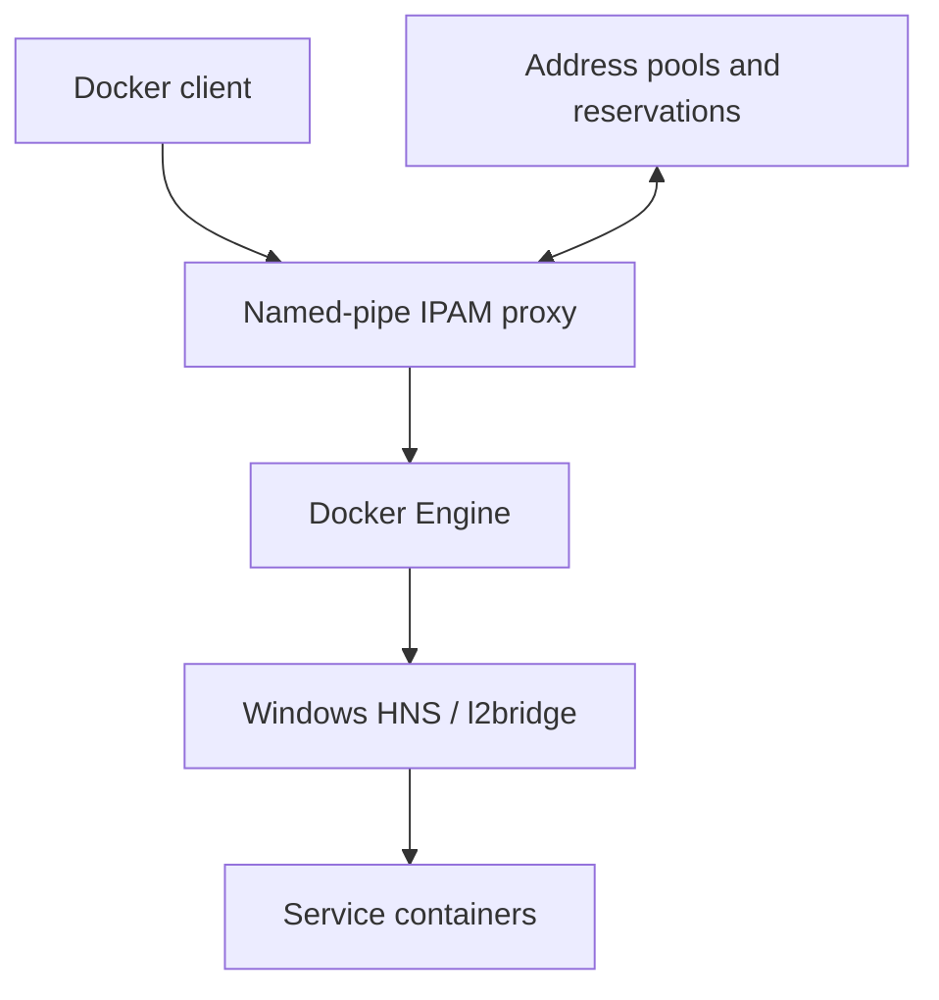
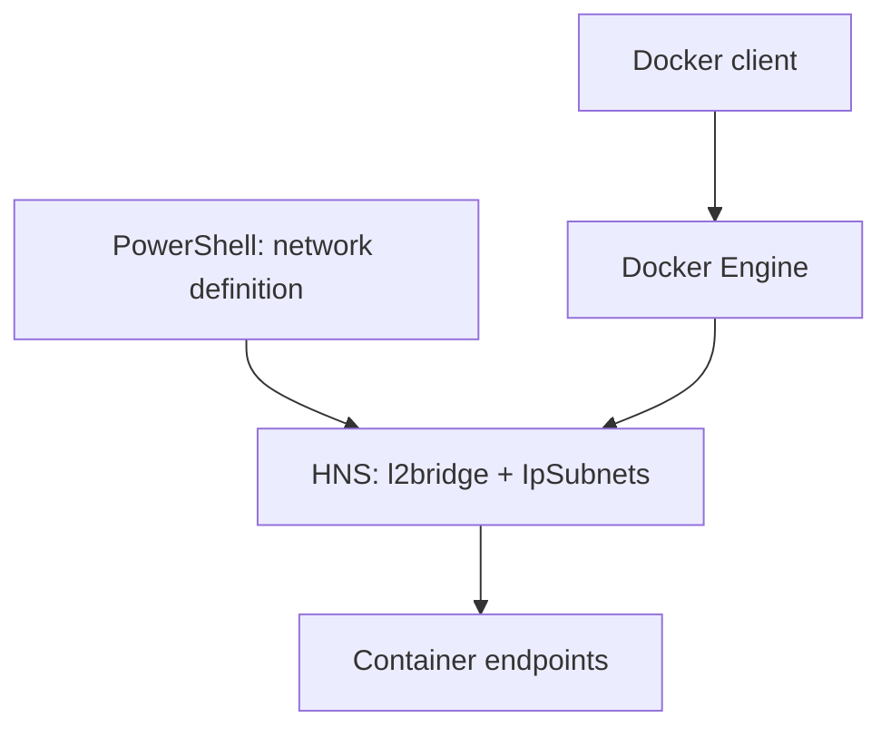
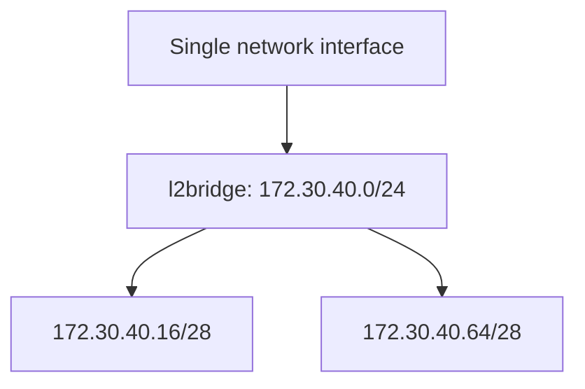
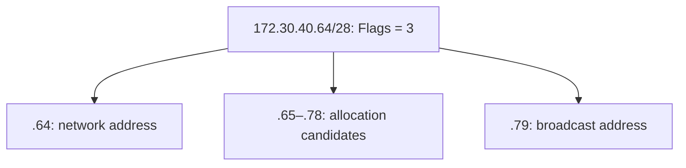
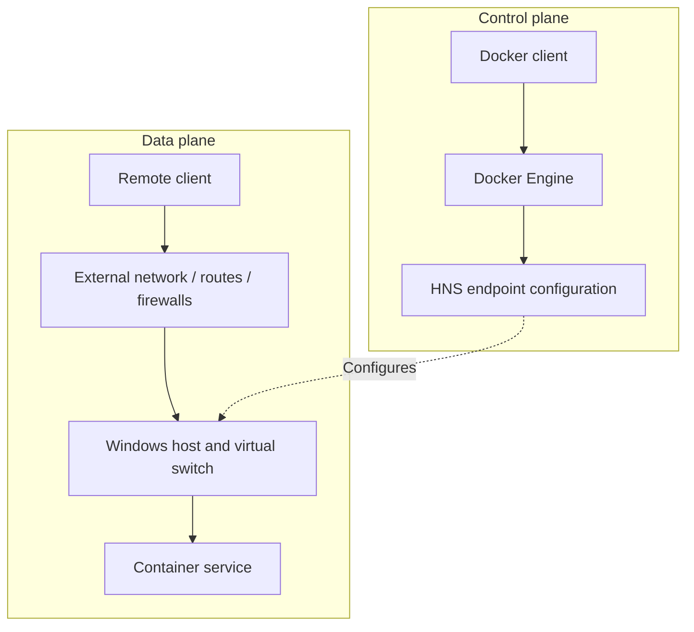

I spent time figuring out how to build an IP allocator around Docker. Then I found that Windows already had one. When I started working with multiple address blocks, I brought the allocator back. Eventually, I found two flags that could do the job instead.

The problem was simple enough. I wanted to run several Windows containers, give each one an IP address from an allowed private range, and let another machine reach each service directly. I didn't want to publish a different host port for every container, and I didn't want the application creating a container to choose its IP address manually.

My first solution was a proxy in front of the Docker Engine API. It would choose an unused address and add it to the container creation request. There was a lot more to maintain than I expected.

Later, I discovered that Host Networking Service (HNS) could express the allocation range directly. That simplified the design, but the next round of testing exposed a problem I hadn't accounted for: not every address in an allocation block behaved the same way.

## The problem: one IP per service

Imagine three services listening on port `8080`.

With published Docker ports, clients connect to one host address with different port numbers:

| Service | Client connects to |
| --- | --- |
| A | `172.30.10.5:18080` |
| B | `172.30.10.5:18081` |
| C | `172.30.10.5:18082` |

I wanted this instead:

| Service | Client connects to |
| --- | --- |
| A | `172.30.40.20:8080` |
| B | `172.30.40.21:8080` |
| C | `172.30.40.22:8080` |

Published ports are usually easier. But separate IPs are useful when many services listen on the same port or a client expects a different network endpoint for each service.

Docker already knows how to give containers IP addresses. The missing piece was selecting them from **a specific, smaller pool** without putting allocation logic into every client.

There is an important distinction here: *any free IP from an allowed range* is not the same as *a permanent IP for a particular service*. I only needed the first. Persistent service identities would require another layer of state.

## Why the normal Docker interface wasn't enough

On Windows, Docker delegates container networking to **Host Networking Service (HNS)**. One useful network driver is `l2bridge`. Containers can have separate IP addresses, while the networking stack performs MAC address rewriting so they share the host's MAC address on the external network.

On Linux, I might have reached for `docker network create --ip-range`. But Microsoft's [Windows container networking documentation](https://learn.microsoft.com/en-us/virtualization/windowscontainers/container-networking/architecture) lists `--ip-range` and `--ipam-driver` among the unsupported `docker network create` options on Windows.

I could specify a broader subnet through the Docker interface, but I couldn't express the smaller allocation range in the way I wanted.

At first, I treated this as an IP allocation problem to solve outside Docker. What I missed was that **a limitation in Docker's Windows interface is not necessarily a limitation in HNS**.

## First attempt: a proxy in front of Docker Engine

Docker clients speak HTTP to the Docker Engine. On Windows, local communication commonly uses a named pipe. That made a proxy tempting: listen on one pipe, change the occasional request, and forward it to the real Engine pipe.



This was **an Engine API proxy, not a Docker IPAM plugin**. I wasn't replacing Docker's container management or Windows networking. I was only choosing an IP before Docker handled the request.

For a container created on `service-net`, an incoming networking configuration might contain:

```json
{
  "NetworkingConfig": {
    "EndpointsConfig": {
      "service-net": {}
    }
  }
}
```

The proxy would insert an explicit address:

```json
{
  "NetworkingConfig": {
    "EndpointsConfig": {
      "service-net": {
        "IPAMConfig": {
          "IPv4Address": "172.30.40.20"
        }
      }
    }
  }
}
```

Those are excerpts from the API request, not complete create requests. Docker Engine's endpoint settings support this field, `IPAMConfig.IPv4Address`.

The proxy would also need to handle `POST /networks/{id}/connect`: a client can create a container first and connect it to the managed network later. It would need to leave unrelated networks alone and decide what to do when a client requests a specific address.

The request rewrite was easy. The rest wasn't.

### Concurrency makes a small allocator complicated

Suppose two requests arrive together. Both query Docker for occupied addresses. Both see the same free IP. Both choose it. A lock only around the lookup does not solve the race if the lock is released before the Engine has accepted the request.

An allocator needs something closer to **reserve → forward → reconcile**:

1. Reserve an available address while holding a lock.
2. Treat the reservation as occupied while Docker processes the request.
3. Record what Docker accepted and what HNS actually attached.
4. Release or repair failed reservations only after checking the resulting container and endpoint state.
5. Recover those reservations after the proxy or Docker restarts.

That last detail matters. A successful container-create response does not necessarily mean the later start and network attachment will succeed. A container can remain in `Created` after a failed start.

And the allocator isn't the only problem. A general-purpose Engine API proxy has to forward streaming logs, events, chunked HTTP responses, and bidirectional interactive sessions. A prototype that works for `docker inspect` can still break `docker logs -f` or `docker exec -it`.

PowerShell and .NET named-pipe streams made a convenient experiment. They did not make a transparent, production-quality proxy free.

I was building a service to compensate for a network option I couldn't express through Docker. That was the part worth reconsidering.

## The discovery: HNS already understands IP subnets

HNS supports nested IP allocation blocks within a parent subnet. Microsoft documents this capability for Windows Server 2022 and 2025 in [multiple-subnet support](https://learn.microsoft.com/en-us/virtualization/windowscontainers/container-networking/multi-subnet).

The first configuration looked roughly like this:

```json
{
  "Name": "service-net",
  "Type": "l2bridge",
  "Subnets": [
    {
      "AddressPrefix": "172.30.40.0/24",
      "GatewayAddress": "172.30.40.1",
      "IpSubnets": [
        { "IpAddressPrefix": "172.30.40.16/28" }
      ]
    }
  ]
}
```

The `/24` describes the parent network. The nested `/28` describes a smaller allocation block. It does not require sixteen additional network interfaces or sixteen different Docker networks.

I submitted the network definition directly to HNS. Once Docker recognized the resulting network, it could create containers normally and HNS could assign addresses from the smaller pool.



No address-rewriting proxy in the creation path. No IP reservation database of my own. I also didn't need to manually create a host endpoint just to get this particular setup running, although other `l2bridge` designs with routed custom subnets may require a host gateway endpoint and routes.

This doesn't mean an HNS-created network is automatically usable by Docker in every environment. Discovery, routing and connectivity have to be checked separately.

## One interface, multiple delegated prefixes

A single allocation block is enough until the host needs more addresses than the block contains.

For example, [AWS EC2 prefix delegation](https://docs.aws.amazon.com/AWSEC2/latest/UserGuide/ec2-prefix-eni.html) allows an eligible network interface to receive IPv4 `/28` blocks rather than individual secondary addresses. Each block represents 16 addresses but counts as one address slot on the interface. A single interface can own several such blocks, subject to its instance-specific limits.

Suppose the interface owns these two non-contiguous blocks within the same `/24`:

| Allocation block | Address range |
| --- | --- |
| `172.30.40.16/28` | `172.30.40.16`–`172.30.40.31` |
| `172.30.40.64/28` | `172.30.40.64`–`172.30.40.79` |

The addresses between the two blocks are not necessarily ours. Giving Docker the entire `/24` as an unrestricted allocation pool would therefore be wrong.

HNS can describe both blocks under a single parent subnet, with the same gateway and network adapter:



The distinction matters because Docker's general support for multiple subnets is not the same as support for multiple nested HNS allocation blocks. The former depends on the network driver. In the latter configuration, Docker may only expose the parent subnet in `docker network inspect`, while HNS holds the actual allocation blocks. Inspecting Docker alone is not enough to establish which addresses HNS can allocate.

## The resource allocation error

The early tests were encouraging. Several containers started successfully, each with a different IP from the intended pool. But another container failed during network attachment. Docker reported a generic compute-system creation error; the HNS event log pointed more specifically to endpoint attachment and IP configuration.

I initially suspected resource exhaustion. I looked at the size of the host, Windows desktop heap, dynamic TCP/UDP port ranges and the interaction between Host Compute Service (HCS) and HNS.

Increasing host resources helped with parallel startup, but it didn't eliminate the attachment problem. I also observed a separate incident in which all running containers exited around the capacity of a single `/28`. I didn't capture enough diagnostic information to establish why that happened. Ordinary address-pool exhaustion should reject a new allocation, not terminate existing workloads.

There was another distraction. A stale variable in my PowerShell session made a few HNS endpoints look as though Docker had lost track of them. Refreshing the inspection data made that mismatch disappear. In one failed-start snapshot, there was no additional visible HNS endpoint. Neither observation proves that all failed operations clean up perfectly.

Sometimes the thing being debugged is the debugging script.

The useful discovery came from changing which address was assigned rather than changing the size of the machine. In my tests, allowing the first and last addresses of the delegated blocks caused attachment errors. Excluding those addresses avoided the problem.

That is a narrower finding than saying HNS ran out of resources. The address-specific failure was reproducible; the exact internal reason for rejecting those addresses was not established. It also doesn't explain the separate incident where all containers exited.

## The return of the proxy

I brought the proxy back because it could enforce a conservative allocation policy across every delegated block.

For a block such as `172.30.40.64/28`, the policy was simple:

| Address | Treatment |
| --- | --- |
| `172.30.40.64` | Skip the first address |
| `172.30.40.65`–`172.30.40.78` | Allocation candidates |
| `172.30.40.79` | Skip the last address |

The allocator could also exclude addresses already occupied by Docker containers or HNS endpoints, plus explicitly reserved host and management addresses. It could walk the permitted blocks in a predictable order and reject a request when none had a free address.

This worked as a way to avoid the problematic IPs. But I was back to maintaining a proxy just to express an allocation policy. Before accepting that design, I went back to the HNS schema.

## Two flags

The [HCN schema](https://learn.microsoft.com/en-us/virtualization/api/hcn/hns_schema#ipsubnetflags) defines `IPSubnetFlags`, available from schema version 2.5. The two relevant values in the HNS helper enum are:

| Flag | Value |
| --- | ---: |
| `EnableBroadcast` | `1` |
| `ReserveNetworkAddress` | `2` |

They are bit flags, so they can be combined:

```powershell
$flags = 1 -bor 2  # 3
```

Or, if the HNS PowerShell helper exposes the enum:

```powershell
$flags = [int][IPSubnetFlags]::EnableBroadcast -bor
         [int][IPSubnetFlags]::ReserveNetworkAddress
```

The first flag enables the block's broadcast semantics; the second reserves its network address. In my tested setup, the combination made HNS avoid the two problematic boundary addresses during ordinary allocation. I no longer needed the proxy to enforce that exclusion.



There is a subtle point here. A delegated prefix is not necessarily a separate conventional IPv4 subnet. In a routed allocation model, the boundary addresses can be ordinary workload addresses. Microsoft even discusses that use case in its Calico documentation. AWS prefix delegation itself is not imposing a general 14-address limit on every `/28`.

The reservation policy is a compatibility choice for the Windows configuration I tested. With these flags, two `/28` blocks have 28 interior address candidates before any other reservations. It is not a guarantee that the host can run 28 containers.

## The resulting HNS configuration

Here is a simplified, generic network definition. The addresses and adapter name are illustrative; substitute values actually assigned to your host.

```powershell
# Elevated PowerShell session; use an HNS helper appropriate to the host.
$nic = 'Ethernet' # Verify with Get-NetAdapter
$prefixes = @(
    '172.30.40.16/28'
    '172.30.40.64/28'
)

$flags = 1 -bor 2 # EnableBroadcast | ReserveNetworkAddress

$definition = @{
    Name = 'service-net'
    Type = 'l2bridge'
    NetworkAdapterName = $nic
    Subnets = @(
        @{
            AddressPrefix = '172.30.40.0/24'
            GatewayAddress = '172.30.40.1'
            IpSubnets = @(
                foreach ($prefix in $prefixes) {
                    @{
                        IpAddressPrefix = $prefix
                        Flags = $flags
                    }
                }
            )
        }
    )
}

$json = $definition | ConvertTo-Json -Depth 10
Invoke-HnsRequest -Method POST -Type networks -Data $json
```

This is the legacy HNS request shape, not an HCN v2 JSON document. `Invoke-HnsRequest` comes from an HNS PowerShell helper, not standard PowerShell on every Windows machine. The tested implementation submitted the equivalent request through the native `HNSCall` interface in `vmcompute.dll` and checked the response. The example above illustrates the configuration rather than reproducing the native interop implementation.

Microsoft also documents a v2 helper, `New-HnsNetwork`, which accepts `-IPSubnets`. Its schema and adapter-binding details should be checked against the installed module before substituting it for the legacy request.

Creating or rebinding a network can interrupt host connectivity. This example is for provisioning a new network on a test host, not replacing an existing network with active endpoints. Verify adapter identity, prefix ownership, subnet overlap and the gateway before creating it. If an existing network has a different definition, inspect it rather than silently deleting it.

Read the network back and check its actual settings, including the flags on each block. A successful API response alone is not sufficient. Docker may also need to discover the HNS network during daemon initialization; plan any necessary service restart as maintenance, since running containers can be affected.

```powershell
$net = Get-HnsNetwork |
    Where-Object Name -eq 'service-net'

$net | ConvertTo-Json -Depth 30

$net.Subnets | ForEach-Object { $_.IpSubnets } |
    Select-Object IpAddressPrefix, Flags

docker network inspect service-net
```

Check that Docker's network references the intended HNS network ID, rather than another network with the same name. The `com.docker.network.windowsshim.hnsid` option is useful when exposed by the Windows driver. A matching parent subnet does not establish that all allocation blocks are being used correctly.

## IP allocation is not connectivity

There's another distinction I don't want to lose: HNS assigning an IP and another machine reaching that IP are not the same thing.



A container can have a valid address in `docker inspect` but still be unreachable from another machine. The external network must know how to deliver packets to that address, and replies must find their way back. Address ownership, routes, firewall rules, and the service listener all matter.

A small set of useful Windows checks:

```powershell
Get-NetAdapter | Format-Table Name, ifIndex, Status

$net = Get-HnsNetwork | Where-Object Name -eq 'service-net'
Get-HnsEndpoint | Where-Object VirtualNetwork -eq $net.ID |
    Select-Object ID, IPAddress, PrefixLength, GatewayAddress, State

docker network inspect service-net
```

For attachment failures, the HNS Admin event log can be more informative than repeatedly reading Docker's one-line error:

```powershell
Get-WinEvent -FilterHashtable @{
    LogName = 'Microsoft-Windows-Host-Network-Service-Admin'
    StartTime = (Get-Date).AddHours(-2)
} -ErrorAction SilentlyContinue |
    Select-Object TimeCreated, Id, Message |
    Format-List
```

These commands inspect the network and recent errors; they don't change anything. If an incident happened more than two hours ago, widen the event window.

## What is solved, and what isn't

The flags worked in my tests. They removed the need for the proxy to skip the problematic addresses. That is the result I can attribute to the configuration change.

There are still separate questions worth testing:

- Does automatic allocation continue into the next block when the first block is exhausted, with no proxy involved?
- Do repeated create/remove cycles release the expected endpoints and addresses?
- Do parallel starts remain reliable at the intended container density?
- Can remote clients reach containers in every configured block?

I have not established that desktop heap or dynamic port-range changes are required. Nor have I established the cause of the earlier simultaneous container exits. Those are separate host-capacity and runtime investigations. The fact that HNS accepts a network configuration is not a guarantee of reliable container startup at every scale.

For future tests, I would compare a network with the reservation flags against one without them, holding the host, image, isolation mode and startup concurrency constant. I would also record the actual allocated IPs, container exit states and HNS endpoint records rather than relying on container count alone.

## Do I still need the proxy?

For this address-exclusion problem, no. HNS already provides the policy I was trying to implement. If native allocation also crosses the block boundary reliably under the intended load, there is no reason to keep a transparent Engine API proxy for this use case.

A separate allocator or controller could still make sense for permanent service IPs, tenant-specific pools or policies the native network configuration cannot express. But those are different requirements.

I built an allocator because I couldn't express the allocation policy through Docker. I found HNS and removed the allocator. I brought it back when the boundary addresses caused failures. Then I found two flags that expressed the missing policy in HNS itself.

The proxy wasn't wasted effort. It helped me understand which addresses failed, how Docker and HNS interact, and what the native allocator needed to do differently.

Sometimes writing more software is how you discover that you need less software.

## References

- [Windows container networking architecture — Microsoft Learn](https://learn.microsoft.com/en-us/virtualization/windowscontainers/container-networking/architecture)
- [Windows container network drivers and IPAM — Microsoft Learn](https://learn.microsoft.com/en-us/virtualization/windowscontainers/container-networking/network-drivers-topologies)
- [Multiple subnet support in HNS — Microsoft Learn](https://learn.microsoft.com/en-us/virtualization/windowscontainers/container-networking/multi-subnet)
- [HCN schema: IPSubnetFlags — Microsoft Learn](https://learn.microsoft.com/en-us/virtualization/api/hcn/hns_schema#ipsubnetflags)
- [Advanced Windows container networking — Microsoft Learn](https://learn.microsoft.com/en-us/virtualization/windowscontainers/container-networking/advanced)
- [Docker Engine API reference — Docker Docs](https://docs.docker.com/reference/api/engine/)
- [Docker network create — Docker Docs](https://docs.docker.com/reference/cli/docker/network/create/)
- [Prefix delegation for EC2 network interfaces — AWS](https://docs.aws.amazon.com/AWSEC2/latest/UserGuide/ec2-prefix-eni.html)
