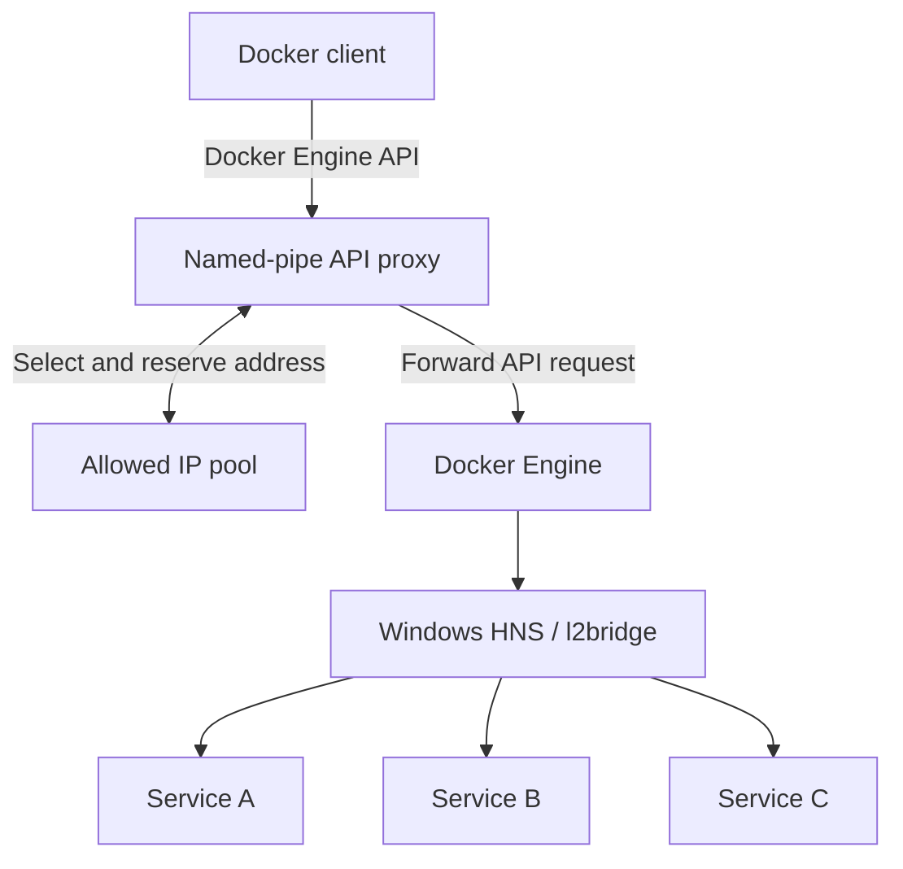
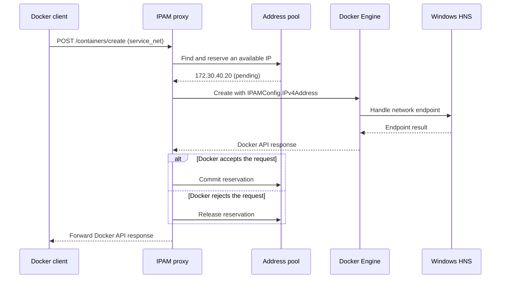
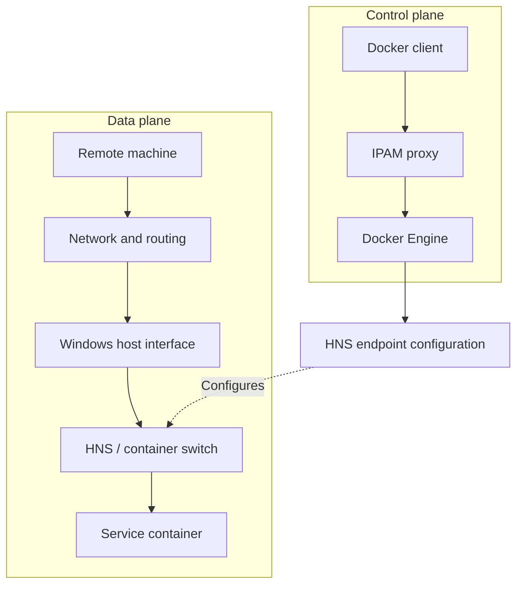

Why Docker on Windows? Simple. Because Windows containers need Windows.

A Windows container isn't just a Linux container with a different image. It depends on the Windows kernel, so I needed a Windows container host. That could be a physical machine or a Windows VM, but Linux alone wasn't going to run these containers.

The task sounded straightforward: run several small services, give each one its own private IP address, and make those addresses reachable from another machine.

Starting the containers was easy. Networking them was another story.

The usual Docker approach is to publish ports on the host. That works well for many applications, but it was not what I wanted here. I wanted each service to look like a separate endpoint on the network, without assigning host ports by hand.

So I put a small proxy in front of the Docker Engine API. Instead of letting every client choose an IP, the proxy selects one from an allowed pool and inserts it into the request before Docker sees it.

It is a fairly small idea. The surrounding details are where things get unpleasant.

## Why bother with individual IP addresses?

Suppose three services expose the same port.

With published ports, a client connects through different ports on the Windows host:

| Service | Client connects to |
| --- | --- |
| Service A | `172.30.10.5:18080` |
| Service B | `172.30.10.5:18081` |
| Service C | `172.30.10.5:18082` |

With individually addressed containers, the port can stay the same:

| Service | Client connects to |
| --- | --- |
| Service A | `172.30.40.20:8080` |
| Service B | `172.30.40.21:8080` |
| Service C | `172.30.40.22:8080` |

Neither model is universally better. Published ports are usually simpler. Separate container addresses are useful when clients expect one address per service, when many services share the same port, or when the number of endpoints changes frequently.

The requirement is not merely "give every container an IP." Docker already does that. I needed to **control which IPs it assigned**, and I wanted that rule to apply to clients using the normal Docker API.

## What is different about Docker networking on Windows?

Docker on Windows uses the **Host Networking Service (HNS)** to manage container networks and endpoints. Depending on the network driver, Hyper-V networking is also involved.

A useful option is `l2bridge`. It lets containers have their own IP addresses while sharing a host-side network interface. It also rewrites MAC addresses as part of its normal operation.

Windows does not support every Docker networking option familiar from Linux. Microsoft's Windows container networking documentation lists `--ip-range` and `--ipam-driver` among the unsupported `docker network create` options.

That ruled out an easy way to plug in a custom allocator at network-creation time.

There is another interface, though. The Docker Engine API accepts an explicit address for a container's network endpoint through `IPAMConfig.IPv4Address`.

So rather than replacing Docker's IPAM implementation, I decided to supply the address just before the request reached Docker.

## The idea: proxy the Docker Engine API

On Windows, local Docker clients can communicate with the Engine over a **named pipe**. A proxy can listen on one named pipe and forward requests to the Engine on another.



The proxy only needs to understand requests that create or attach network endpoints. Everything else should pass through unchanged.

This is **not a Docker IPAM plugin**. It is an HTTP API proxy with a small address-allocation policy. Docker still owns the containers, and HNS still owns the network endpoints.

The division of responsibility is simple:

- Docker clients ask for containers.
- The proxy chooses addresses for networks it manages.
- Docker Engine and HNS create the actual endpoints.

## A small IPAM proxy demo

Imagine a Docker client creates **Service A** on a network named `service_net`. The client does not request a particular address.

The proxy sees the create request, finds an unused IP in the allowed pool, adds it to the endpoint configuration, and forwards the request.



The interesting part is the request rewrite, not a new command for the user to remember.

The relevant portion of the incoming JSON might look like this:

```json
{
  "NetworkingConfig": {
    "EndpointsConfig": {
      "service_net": {}
    }
  }
}
```

The proxy forwards a request containing:

```json
{
  "NetworkingConfig": {
    "EndpointsConfig": {
      "service_net": {
        "IPAMConfig": {
          "IPv4Address": "172.30.40.20"
        }
      }
    }
  }
}
```

These are only the networking fields, not complete container-create requests.

If Docker accepts the configuration, inspecting the container should show the selected address under that network. The next service can receive `172.30.40.21`, then `172.30.40.22`, and so on.

The client does not need to know the pool, and the proxy does not need to create the container itself.

There is one more operation to handle: `POST /networks/{id}/connect`. A container can be created first and attached to another network later. If that attachment bypasses the allocator, the address policy is inconsistent.

The proxy also needs to leave unrelated networks alone and handle explicit client-requested addresses according to a clear policy.

## Selecting an address is not the difficult part

The obvious allocator is:

1. Read the allowed address ranges and reservations.
2. Check which addresses are already in use.
3. Choose an available address.
4. Add it to the Docker request.

It works for one request at a time.

Now suppose two clients create containers simultaneously. Both check Docker before either container exists. Both see `172.30.40.20` as available. Both select it.

A lock around the lookup helps, but only if the address remains reserved after the lookup ends. Releasing a mutex before Docker has accepted the request still leaves a race.

The safer model is **reserve → forward → commit or release**. Addresses awaiting an Engine response count as occupied. After a proxy restart, the allocator must reconcile its state with the endpoints Docker actually knows about.

It also needs to reserve gateway and infrastructure addresses and refuse allocations outside the managed network.

At a few containers, inspecting Docker every time is inexpensive. At hundreds of containers with concurrent creates, a small inventory plus reconciliation can be more efficient.

A successful one-container demo proves the request rewrite works. It does not prove the allocator is safe under concurrency or that its recovery behavior is correct.

## HTTP forwarding is where the simple idea gets ugly

I chose PowerShell and .NET named-pipe streams for the experiment. Those APIs are already available on Windows, and it kept the prototype self-contained.

But writing a transparent proxy is much harder than changing a JSON field.

Docker Engine speaks HTTP over the pipe. Some requests and responses have a `Content-Length`; others use chunked transfer encoding. Logs and events may stream for a long time. Interactive sessions can upgrade the connection and exchange raw bytes in both directions.

If the proxy buffers every response as text, `docker inspect` may work while `docker logs -f` or an interactive session fails.

The useful rule is to **parse only what needs changing**:

- For managed container creation and network attachment, read and validate the request body, with a size limit.
- Rewrite only the relevant endpoint configuration.
- Forward unrelated requests and response bodies as byte streams.
- Preserve status codes, headers, error bodies, and connection behavior.
- Support chunked transfer and bidirectional upgraded streams.
- Bound concurrency and clean up both ends when a client disconnects.

PowerShell is convenient for a Windows prototype, but I would not assume it is the best language for a high-throughput, general-purpose API proxy.

## An assigned IP is not necessarily a reachable IP

The proxy deals with the **control plane**: which IP a container requests. It is not in the **data plane**: the packets that travel between a running service and another machine.



This separation matters because an address can look correct in `docker inspect` while a connection from another machine still times out.

The host may be able to reach a container while a remote client cannot. Possible causes include network routes, return-path selection, firewall rules, or how the physical network handles the container addresses.

A few useful commands on Windows are:

```powershell
Get-NetAdapter | Format-Table Name, ifIndex, MacAddress, Status
Get-NetRoute -AddressFamily IPv4 -IncludeAllCompartments
Get-NetNeighbor -AddressFamily IPv4

docker network inspect service_net
```

For tougher problems, `pktmon` can trace packets across Windows networking components. A changed MAC address is not automatically a fault: `l2bridge` performs MAC rewriting by design. What matters is whether the final packet follows the correct path.

**Docker assigning an address and another machine reaching that address are two separate tests.**

## One endpoint or hundreds?

The proxy can enforce the same allocation rule whether there are three services or three hundred. It doesn't need a physical NIC for every container.

That does not mean that hundreds of containers will automatically be reachable from the rest of a network. The network still needs an address plan and a valid delivery path. A single host interface can carry traffic for many container addresses if routing and HNS are set up accordingly.

There is also a difference between an *available IP from a pool* and a *stable IP belonging to a service*. If a service must keep its address after it is deleted and recreated, the allocator needs a persistent service-to-address mapping.

And address capacity is not compute capacity. Memory, CPU, startup time, and Windows container overhead need separate measurements.

## What I would test before relying on it

I would test the Docker API proxy and the actual network separately.

For the proxy: create without an IP, create with an explicit IP, attach to a network later, create many containers at once, retry failed requests, restart the proxy during allocation, and exercise logs, events, and interactive sessions.

For the network: verify local connectivity, then connect to a real listening service from a different machine. Test replies, not just incoming packets. Reboot the Windows host and repeat.

The direct Docker Engine pipe also needs to be protected. Docker API access is highly privileged, and a client that bypasses the proxy bypasses the address policy. A broken proxy can make Docker appear unavailable even when the Engine is fine, so the two should be monitored separately.

## Keep it boring

The whole reason for the proxy is to avoid teaching every Docker client a special address-allocation workflow. Its job is narrow: **choose a permitted address, include it in the right Engine API request, and get out of the way**.

It should not become a replacement for Docker, HNS, or a network router. It should not rewrite requests that do not need rewriting. And it should not pretend that a correctly allocated IP guarantees connectivity.

Windows container networking has enough moving parts already. One small, predictable layer is useful. Another mysterious one is not.

## References

- [Windows container networking architecture](https://learn.microsoft.com/en-us/virtualization/windowscontainers/container-networking/architecture)
- [Windows container network drivers and topologies](https://learn.microsoft.com/en-us/virtualization/windowscontainers/container-networking/network-drivers-topologies)
- [Advanced Windows container networking](https://learn.microsoft.com/en-us/virtualization/windowscontainers/container-networking/advanced)
- [Docker Engine API reference](https://docs.docker.com/reference/api/engine/)
