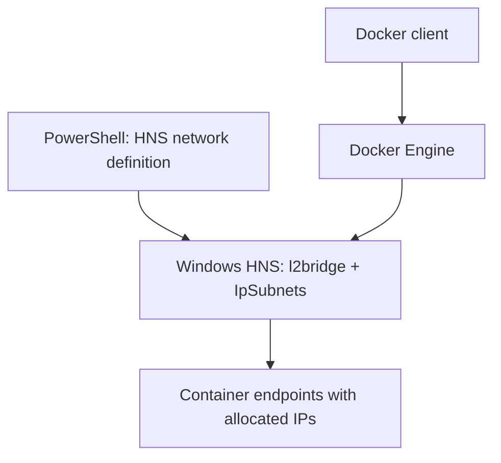
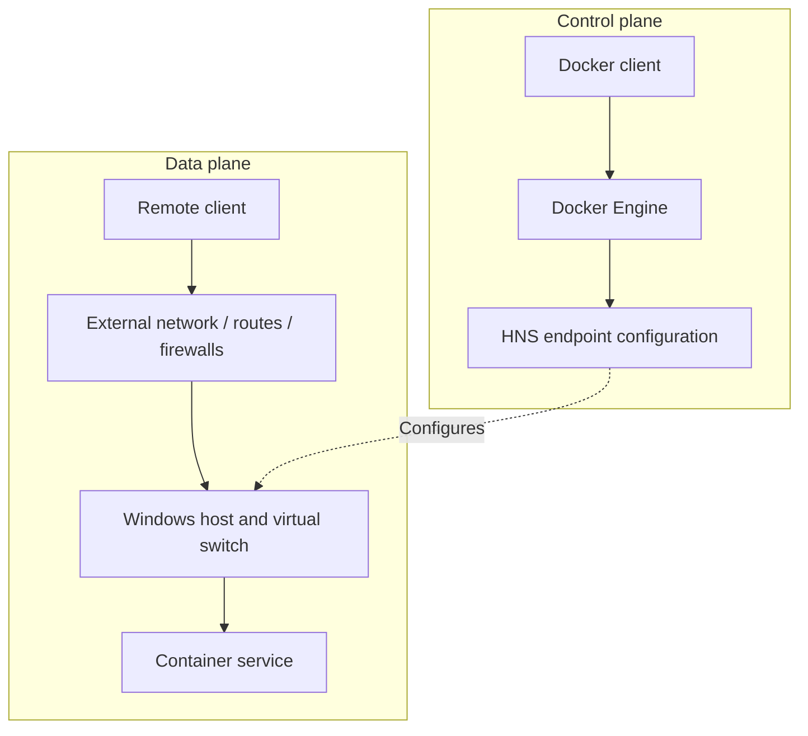

I spent time figuring out how to build an IP allocator around Docker. Then I found that Windows already had one.

The problem was simple enough. I wanted to run several Windows containers, give each one an IP address from a specific private range, and let another machine reach each service directly. I didn't want to publish a different host port for every container, and I didn't want the application creating a container to choose its IP address manually.

My first solution was a small proxy in front of the Docker Engine API. It would choose an unused address and add it to the container creation request. That worked as an idea, but there was a lot more to maintain than I expected.

Later, while investigating Host Networking Service (HNS), I found a simpler approach: create an `l2bridge` network through HNS, with a narrower `IpSubnets` range inside the parent subnet. Docker could then create containers normally, and HNS would assign the addresses.

So the story changed. It went from *how I built an IPAM proxy* to *why I didn't need one for this particular job*.

## The problem: one IP per service

Imagine three services listening on port `8080`.

With published Docker ports, clients connect to one host address with different port numbers:

| Service | Client connects to |
| --- | --- |
| A | `172.30.10.5:18080` |
| B | `172.30.10.5:18081` |
| C | `172.30.10.5:18082` |

I wanted this instead:

| Service | Client connects to |
| --- | --- |
| A | `172.30.40.20:8080` |
| B | `172.30.40.21:8080` |
| C | `172.30.40.22:8080` |

Published ports are usually easier. But separate IPs are useful when many services listen on the same port or a client expects a different network endpoint for each service.

Docker already knows how to give containers IP addresses. The missing piece was selecting them from **a specific, smaller pool** without putting allocation logic into every client.

There is an important distinction here: *any free IP from an allowed range* is not the same as *a permanent IP for a particular service*. I only needed the first. Persistent service identities would require another layer of state.

## Why the normal Docker interface wasn't enough

On Windows, Docker delegates container networking to **Host Networking Service (HNS)**. One useful network driver is `l2bridge`. Containers can have separate IP addresses, while the networking stack performs MAC address rewriting so they share the host's MAC address on the external network.

On Linux, I might have reached for `docker network create --ip-range`. But Microsoft's [Windows container networking documentation](https://learn.microsoft.com/en-us/virtualization/windowscontainers/container-networking/architecture) lists `--ip-range` and `--ipam-driver` among the unsupported `docker network create` options on Windows.

I could specify a broader subnet through the Docker interface, but I couldn't express the smaller allocation range in the way I wanted.

At first, I treated this as an IP allocation problem to solve outside Docker. What I missed was that **a limitation in Docker's Windows interface is not necessarily a limitation in HNS**.

## First attempt: a proxy in front of Docker Engine

Docker clients speak HTTP to the Docker Engine. On Windows, local communication commonly uses a named pipe. That made a proxy tempting: listen on one pipe, change the occasional request, and forward it to the real Engine pipe.


This was **an Engine API proxy, not a Docker IPAM plugin**. I wasn't replacing Docker's container management or Windows networking. I was only choosing an IP before Docker handled the request.

For a container created on `service-net`, an incoming networking configuration might contain:

```json
{
  "NetworkingConfig": {
    "EndpointsConfig": {
      "service-net": {}
    }
  }
}
```

The proxy would insert an explicit address:

```json
{
  "NetworkingConfig": {
    "EndpointsConfig": {
      "service-net": {
        "IPAMConfig": {
          "IPv4Address": "172.30.40.20"
        }
      }
    }
  }
}
```

Those are excerpts from the API request, not complete create requests. Docker Engine's endpoint settings support this field, `IPAMConfig.IPv4Address`.

The proxy would also need to handle `POST /networks/{id}/connect`: a client can create a container first and connect it to the managed network later. It would need to leave unrelated networks alone and decide what to do when a client requests a specific address.

The request rewrite was easy. The rest wasn't.

### Concurrency makes a small allocator complicated

Suppose two requests arrive together. Both query Docker for occupied addresses. Both see the same free IP. Both choose it. A lock only around the lookup does not solve the race if the lock is released before the Engine has accepted the request.

An allocator needs something closer to **reserve → forward → reconcile**:

1. Reserve an available address while holding a lock.
2. Treat the reservation as occupied while Docker processes the request.
3. Record what Docker accepted and what HNS actually attached.
4. Release or repair failed reservations only after checking the resulting container and endpoint state.
5. Recover those reservations after the proxy or Docker restarts.

That last detail matters. A successful container-create response does not necessarily mean the later start and network attachment will succeed. A container can remain in `Created` after a failed start.

And the allocator isn't the only problem. A general-purpose Engine API proxy has to forward streaming logs, events, chunked HTTP responses, and bidirectional interactive sessions. A prototype that works for `docker inspect` can still break `docker logs -f` or `docker exec -it`.

PowerShell and .NET named-pipe streams made a convenient experiment. They did not make a transparent, production-quality proxy free.

I was building a service to compensate for a network option I couldn't express through Docker. That was the part worth reconsidering.

## The discovery: HNS already understands IP subnets

HNS exposes a network definition with a parent subnet and a nested `IpSubnets` allocation range. Microsoft documents this in [multiple-subnet support](https://learn.microsoft.com/en-us/virtualization/windowscontainers/container-networking/multi-subnet).

The key part looks like this:

```json
{
  "Name": "service-net",
  "Type": "l2bridge",
  "Subnets": [
    {
      "AddressPrefix": "172.30.40.0/24",
      "GatewayAddress": "172.30.40.1",
      "IpSubnets": [
        { "IpAddressPrefix": "172.30.40.16/28" }
      ]
    }
  ]
}
```

The `/24` describes the parent network. The nested `/28` is the narrower block from which endpoints can receive addresses. It does **not** create sixteen additional network interfaces or sixteen different Docker networks.

On the Windows host, I submitted this shape directly to HNS using the PowerShell helper. Here is a simplified version of the setup:

```powershell
# Run in an elevated PowerShell session with an HNS helper installed.
# Replace these examples with your own network and adapter settings.
$nic = 'Ethernet' # Verify with Get-NetAdapter

$definition = @{
    Name = 'service-net'
    Type = 'l2bridge'
    NetworkAdapterName = $nic
    Subnets = @(
        @{
            AddressPrefix = '172.30.40.0/24'
            GatewayAddress = '172.30.40.1'
            IpSubnets = @(
                @{ IpAddressPrefix = '172.30.40.16/28' }
            )
        }
    )
}

$json = $definition | ConvertTo-Json -Depth 10
Invoke-HnsRequest -Method POST -Type networks -Data $json
```

`Invoke-HnsRequest` comes from an HNS PowerShell helper, not standard PowerShell on every Windows machine. Microsoft's documentation also shows the `New-HnsNetwork` helper. Use the interface actually connected to the intended network; don't assume `Ethernet` is its name. Creating or rebinding an external container network can interrupt host networking, so this isn't a command to run casually on a remote production machine.

The parent address, gateway, and narrower range must match the real network. In a cloud environment, the addresses also have to be assigned or routed to the host; HNS cannot make an arbitrary block reachable just by listing it in JSON.

With the HNS network in place and visible to Docker, the flow became:



No address-rewriting proxy in the creation path. No IP reservation database of my own. I also didn't need to manually create a host endpoint just to get **this particular setup** running, although other `l2bridge` designs with routed custom subnets may need a host gateway endpoint and routes.

This doesn't mean an HNS-created network is automatically usable by Docker in every environment. I verified the network was recognized and containers could be attached on this host. Discovery, routing, and connectivity have to be checked separately.

## What actually happened in the tests

The most useful test was simple: start several Windows containers at once on the same `l2bridge` network and compare their assigned IPs with HNS endpoint records.

Most started successfully. Each successful container had a different address from the configured pool. But one start failed during network attachment. That distinction matters: **unique IP allocation is not the same as reliable container startup**.

After refreshing the Docker inspection data, the running containers' IPs matched the visible HNS endpoint records. The failed start did not leave an additional endpoint visible in that snapshot.

One trap was a stale variable in my own PowerShell session. It made a few endpoints look as though Docker had lost track of them. Refreshing the comparison data made that mismatch disappear. Sometimes the thing being debugged is the debugging script.

The failed container was a different story. Docker returned a generic compute-system creation error, while the Windows HNS event log pointed more specifically to endpoint attachment and IP configuration. The logs were more informative than Docker's one-line message, but they still did not establish a root cause.

Some event fields looked inconsistent with the valid addresses on running containers. I could not tell whether the failed operation received invalid settings or whether the event provider reported them incorrectly. I would not treat suspicious log output as proof of either explanation.

The failed start did **not** leave an extra endpoint visible in the snapshot captured before retrying it. That is evidence against a persistent, visible orphan in that observation. It is not proof that every failure rolls back perfectly or that hidden allocation state can never remain.

Most importantly, **no duplicate addresses were observed, but container startup was not fully reliable**. Those are different results. I would not declare the setup production-ready just because the successful containers received unique IPs.

### What still needs testing

The next useful experiment would compare sequential startup with different levels of concurrency, plus a control using `--network none`. That would help separate network attachment from general container startup pressure. I have not established whether concurrency, resource pressure, or network configuration caused the failure.

A serious validation would also check endpoint cleanup after failures, repeated create/delete cycles, restart behavior, and connectivity from an actual remote client. The working allocator doesn't make the attachment error harmless.

## IP allocation is not connectivity

There's another distinction I don't want to lose: HNS assigning an IP and another machine reaching that IP are not the same thing.



A container can have a valid address in `docker inspect` but still be unreachable from another machine. The external network must know how to deliver packets to that address, and replies must find their way back. Address ownership, routes, firewall rules, and the service listener all matter.

A small set of useful Windows checks:

```powershell
Get-NetAdapter | Format-Table Name, ifIndex, Status
Get-HnsNetwork | Where-Object Name -eq 'service-net' |
    ConvertTo-Json -Depth 20

$net = Get-HnsNetwork | Where-Object Name -eq 'service-net'
Get-HnsEndpoint | Where-Object VirtualNetwork -eq $net.ID |
    Select-Object ID, IPAddress, PrefixLength, GatewayAddress, State

docker network inspect service-net
```

For attachment failures, the HNS Admin event log can be more informative than repeatedly reading Docker's one-line error:

```powershell
Get-WinEvent -FilterHashtable @{
    LogName = 'Microsoft-Windows-Host-Network-Service-Admin'
    StartTime = (Get-Date).AddHours(-2)
} -ErrorAction SilentlyContinue |
    Select-Object TimeCreated, Id, Message |
    Format-List
```

These commands inspect the network and recent errors; they don't change anything. If an incident happened more than two hours ago, widen the event window.

## Does the IPAM proxy still have a use?

Yes, but it needs a requirement that HNS's normal allocation doesn't already satisfy.

A proxy or a separate controller might make sense if service A must always get the same address after replacement, if addresses need to be reserved for particular tenants, or if every client must follow a policy that HNS doesn't express. Even then, a full transparent proxy for the entire Docker API is a fairly expensive way to implement a narrow policy.

For **pick any unused address from this allowed IP subnet**, the HNS setup removed the extra component. Docker creates the containers. HNS assigns the addresses. Neither needs me to reinvent a basic IP allocator.

There are still limitations: network and endpoint lifecycles can fail, Docker/HNS integration varies by environment, and an allocated address isn't automatically reachable. Simpler architecture doesn't mean an automatically reliable deployment.

## References

- [Windows container networking architecture — Microsoft Learn](https://learn.microsoft.com/en-us/virtualization/windowscontainers/container-networking/architecture)
- [Windows container network drivers and IPAM — Microsoft Learn](https://learn.microsoft.com/en-us/virtualization/windowscontainers/container-networking/network-drivers-topologies)
- [Multiple subnet support in HNS — Microsoft Learn](https://learn.microsoft.com/en-us/virtualization/windowscontainers/container-networking/multi-subnet)
- [Advanced Windows container networking — Microsoft Learn](https://learn.microsoft.com/en-us/virtualization/windowscontainers/container-networking/advanced)
- [Docker Engine API reference — Docker Docs](https://docs.docker.com/reference/api/engine/)
